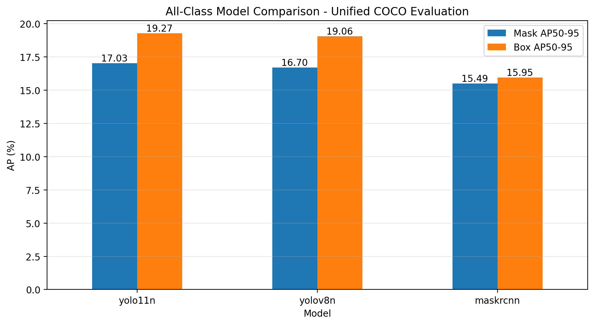
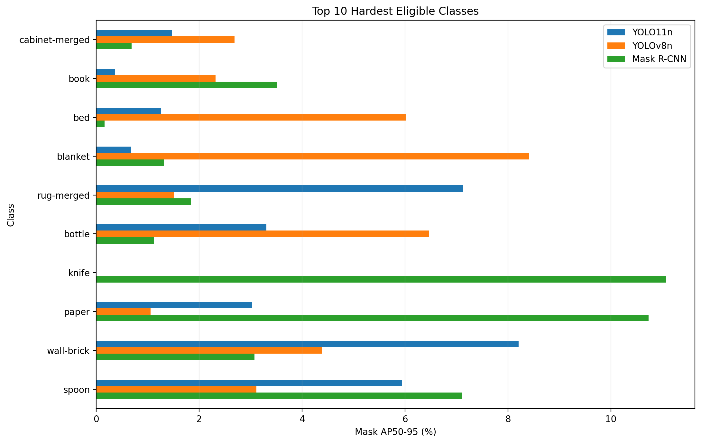
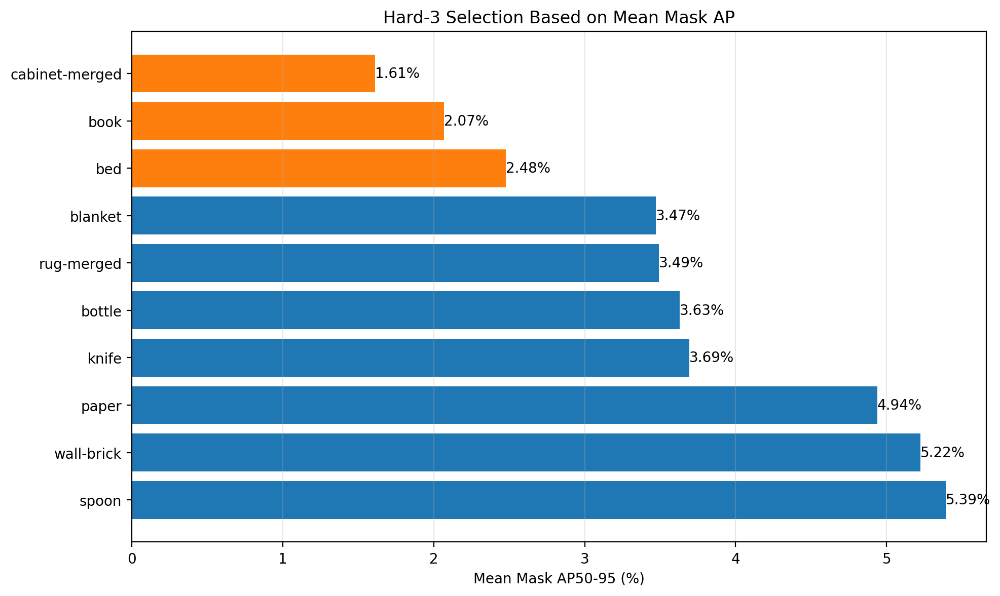

# Evaluasi bersama model all-class dan pemilihan Hard-3

## Pertanyaan penelitian

Bagaimana peringkat tiga model berubah ketika prediksi dinilai dengan ground truth dan evaluator yang sama? Kelas mana yang layak ditinjau sebagai kandidat Hard-3 karena sulit bagi ketiga model?

## Protokol evaluasi

Evaluasi membandingkan tiga checkpoint `best` pada 166 gambar validation Panoptic Indoor Segmentation v5. Ground truth COCO berisi 2.022 instance dan mendefinisikan 74 kategori objek. Daftar gambar sama dengan split validation asli. Geometri ground truth sama dengan COCO terkoreksi untuk baseline Mask R-CNN. Dua koreksi orientasi pada split ini mengikuti audit awal: gambar ID 8 (`182169109`) diputar CW dan ID 27 (`182169108`) diputar CCW. Nama kelas dan urutannya konsisten dengan aturan `COCO ID = YOLO ID + 1`. Original test dan personal test tidak digunakan untuk pemilihan kelas. Konfigurasi mencatat tidak ada retraining. [Konfigurasi evaluasi](evaluation_config.json) dan [manifest audit](../dataset_audit/conversion_manifest.json).

| Parameter | YOLO11n-seg dan YOLOv8n-seg | Mask R-CNN ResNet-50 FPN |
| --- | --- | --- |
| Checkpoint | `best.pt` masing-masing | `best.pth` |
| Resolusi yang dicatat | `imgsz=640` | Sisi pendek 640, sisi panjang dibatasi 960 |
| NMS IoU | 0,70 | 0,50 |
| Confidence minimum, batas deteksi per gambar, mask threshold | 0,001, 100, 0,50 | 0,001, 100, 0,50 |
| Lingkungan | Tesla T4 (`cuda:0`), seed 42, Ultralytics 8.4.216 | Tesla T4 (`cuda:0`), seed 42, Torchvision 0.26.0+cu130 |

COCOeval digunakan sebagai evaluator bersama untuk `bbox` dan `segm`. SHA-256 ketiga checkpoint lokal cocok dengan hash di konfigurasi. Keenam ekspor prediksi hanya memuat ID gambar dan kategori dari ground truth validation, mencakup 166 gambar, memenuhi confidence minimum 0,001, dan tidak melebihi 100 deteksi per gambar. Pada Mask R-CNN, terdapat 16.241 entri box dan 16.088 entri mask. Penyebab selisih 153 entri belum diketahui dari artefak yang tersedia.

NMS menyaring deteksi yang saling tumpang tindih. Nilai NMS dan kebijakan resize tetap berbeda antarkeluarga model, sehingga protokol menyamakan penilaian keluaran dengan tetap memakai pipeline prediksi masing-masing. Ukuran input, NMS, dan mask threshold dilaporkan sesuai konfigurasi. Mask yang sudah dikodekan dalam ekspor tidak memungkinkan penelusuran kembali nilai threshold aslinya. Penerapan resize, NMS, dan threshold secara terperinci serta pemanggilan evaluator memerlukan notebook evaluasi. Skor di bawah berasal dari ekspor Kaggle, dengan pemeriksaan konsistensi terhadap konfigurasi, prediksi, dan tabel per kelas. [Konfigurasi](evaluation_config.json) dan [hasil ekspor](model_comparison.csv).

## Hasil validasi

AP menilai hubungan precision dan recall pada ambang kecocokan tertentu. mAP50–95 merata-ratakan skor pada beberapa ambang IoU, mAP75 lebih ketat daripada mAP50, dan AR100 adalah *average recall* saat jumlah deteksi dibatasi hingga 100 per gambar. Semua nilai AP dan AR disajikan dalam persen.

| Model | Mask mAP50–95 | Mask mAP50 | Mask mAP75 | Mask AR100 | Box mAP50–95 | Box mAP50 | Pipeline evaluasi (detik) |
| --- | ---: | ---: | ---: | ---: | ---: | ---: | ---: |
| YOLO11n-seg | 17,029 | 24,753 | 17,484 | 28,367 | 19,272 | 25,315 | 31,82 |
| YOLOv8n-seg | 16,704 | 25,922 | 17,248 | 27,826 | 19,058 | 26,350 | 19,78 |
| Mask R-CNN | 15,489 | 23,252 | 16,305 | 28,256 | 15,946 | 25,268 | 40,23 |

YOLO11n mencatat mask mAP50–95 tertinggi, dengan selisih 0,325 poin persentase terhadap YOLOv8n dan 1,540 poin terhadap Mask R-CNN. Pada IoU 0,50, YOLOv8n memimpin untuk mask dan box. YOLO11n dan Mask R-CNN memiliki AR100 yang berdekatan, meskipun mask AP agregatnya berbeda. Rata-rata AP dari 58 kelas yang dapat dinilai menghasilkan skor mask mAP50–95 yang sama dengan tabel model. Satu validation split dan satu checkpoint per model belum cukup untuk menyimpulkan keunggulan keluarga arsitektur. [Metrik asli](model_comparison.csv).

### Hubungan dengan log pelatihan

| Model | Puncak mask mAP50–95 dari log baseline (%) | COCOeval checkpoint (%) | Selisih (poin persentase) | Epoch aktual | Waktu kumulatif pelatihan (detik) |
| --- | ---: | ---: | ---: | ---: | ---: |
| YOLO11n-seg | 18,474 | 17,029 | −1,445 | 60 | 599,949 |
| YOLOv8n-seg | 18,264 | 16,704 | −1,560 | 60 | 571,242 |
| Mask R-CNN | 14,838 | 15,489 | +0,651 | 20 | 2.238,738 |

Baris baseline adalah puncak kurva validasi selama pelatihan. Baris COCOeval berasal dari checkpoint yang diekspor. Untuk YOLO, epoch pilihan `best.pt` tidak dapat dipastikan dari metadata. Untuk Mask R-CNN, epoch checkpoint terbaik adalah 17 dan baseline-nya juga menggunakan COCOeval. Perubahan skor tetap bisa muncul karena pipeline ekspor dan pengaturan evaluasi. Selisih dalam tabel tidak mengisolasi pengaruh evaluator atau satu parameter tertentu. [Analisis baseline](../report.md#6-hasil-dan-analisis-all-class-baseline).

YOLOv8n mencatat pipeline tercepat, sekitar 12,04 detik lebih singkat daripada YOLO11n untuk 166 gambar. Mask R-CNN memerlukan 40,23 detik untuk pipeline evaluasi. Durasi ini berlaku untuk seluruh proses yang dicatat dan dapat mencakup penyiapan input, pemrosesan keluaran, akses berkas, atau penyandian mask. Pengukuran tidak menyediakan latensi murni model maupun variasi antar-run. Waktu kumulatif pelatihan pada tabel berasal dari log yang berbeda dan dipengaruhi jumlah epoch, batch size, dan jadwal pelatihan. [Waktu pipeline evaluasi](inference_times.json).

## Pemilihan tiga kelas tersulit

Kelas masuk pemeringkatan jika memiliki minimal 10 instance train, minimal 5 instance validation, dan mask AP50–95 untuk ketiga model. AP kosong menunjukkan hasil tidak tersedia. AP nol merupakan hasil yang sah dan ikut dihitung. Mean memakai bobot yang sama untuk ketiga model. Standar deviasi (SD) dihitung sebagai standar deviasi populasi dari tiga skor, sehingga menunjukkan perbedaan antarmodel, tanpa mengukur ketidakpastian statistik.

Kandidat diurutkan dari mean AP terendah. Bila seri, prioritas diberikan pada jumlah instance validation lebih tinggi, lalu instance train lebih tinggi, lalu COCO ID lebih kecil. Dari 74 kelas, 39 memenuhi syarat. Di antara 35 kelas yang dikecualikan, 16 gagal pada kedua ambang dan tidak memiliki AP lengkap, 15 gagal pada kedua ambang dengan AP lengkap, 2 hanya gagal pada ambang train, dan 2 hanya gagal pada ambang validation. Hitungan instance diperoleh dari anotasi split terkait. Mean, SD, seluruh urutan, dan tiga kandidat dihitung ulang dari AP ketiga model dan cocok dengan tabel ranking serta JSON seleksi. [AP per kelas](per_class_ap_comparison.csv), [ranking lengkap](hard3_ranking.csv), dan [aturan seleksi](hard3_selection.json).

| Rank | Kelas | COCO ID | YOLO ID | Train | Validation | AP YOLO11n (%) | AP YOLOv8n (%) | AP Mask R-CNN (%) | Mean (%) | SD (poin persentase) |
| ---: | --- | ---: | ---: | ---: | ---: | ---: | ---: | ---: | ---: | ---: |
| 1 | cabinet-merged | 8 | 7 | 47 | 19 | 1,469 | 2,686 | 0,684 | 1,613 | 0,823 |
| 2 | book | 4 | 3 | 105 | 15 | 0,368 | 2,319 | 3,517 | 2,068 | 1,298 |
| 3 | bed | 2 | 1 | 26 | 6 | 1,262 | 6,011 | 0,160 | 2,478 | 2,539 |
| 4 | blanket | 3 | 2 | 19 | 6 | 0,682 | 8,416 | 1,313 | 3,470 | 3,507 |
| 5 | rug-merged | 46 | 45 | 35 | 13 | 7,129 | 1,505 | 1,838 | 3,490 | 2,576 |
| 6 | bottle | 5 | 4 | 62 | 10 | 3,307 | 6,462 | 1,120 | 3,630 | 2,193 |
| 7 | knife | 29 | 28 | 12 | 5 | 0,000 | 0,000 | 11,077 | 3,692 | 5,222 |
| 8 | paper | 37 | 36 | 28 | 20 | 3,029 | 1,056 | 10,729 | 4,938 | 4,173 |
| 9 | wall-brick | 67 | 66 | 48 | 30 | 8,209 | 4,384 | 3,075 | 5,223 | 2,178 |
| 10 | spoon | 51 | 50 | 35 | 40 | 5,943 | 3,115 | 7,113 | 5,391 | 1,678 |

**`cabinet-merged`, `book`, dan `bed` ditetapkan sebagai Hard-3 pada 24 November 2026.** Ketiganya menempati tiga peringkat terbawah menurut rata-rata Mask AP50–95 dari ketiga model, dengan syarat minimum jumlah instance dan ketersediaan AP. Di antara ketiganya, `cabinet-merged` memiliki mean dan SD terendah. Untuk `book`, Mask R-CNN memperoleh skor tertinggi. Untuk `bed`, skor YOLOv8n lebih tinggi daripada kedua model lain. Enam instance validation dan SD 2,539 poin membuat hasil untuk `bed` peka terhadap perubahan beberapa prediksi. [Keputusan final](hard3_decision.json) dan [seleksi awal dari notebook](hard3_selection.json).

Penelusuran ilustratif memakai satu gambar validation beranotasi per kandidat, dipilih dengan ID gambar terendah. Pada gambar 9 (`cabinet-merged`), mask dengan skor tertinggi dari masing-masing model tidak bertumpang tindih dengan gabungan anotasi kelas tersebut. Pada gambar 7 (`book`), kedua YOLO tidak mengekspor prediksi kelas tersebut dan mask Mask R-CNN dengan skor tertinggi tidak bertumpang tindih. Pada gambar 61 (`bed`), mask dengan skor tertinggi hanya sedikit bertumpang tindih. Pemeriksaan ini memakai prediksi tersimpan dan tidak mewakili seluruh contoh atau pencocokan COCOeval. Pengaruh oklusi, ukuran, dan batas objek masih perlu ditinjau pada beberapa gambar per kelas.

## Reproduksi dan langkah penelitian berikutnya

Gunakan checkpoint dengan hash yang tercatat, gambar validation, ground truth COCO terkoreksi, serta versi pustaka pada konfigurasi. Ground truth evaluasi berada di `analysis/all_class_comparison/corrected_validation.coco.json` dan keenam keluaran prediksi berada di `analysis/all_class_comparison/predictions/`. Artefak tersebut berasal dari arsip evaluasi. Notebook evaluasi asli diperlukan untuk menelusuri urutan prapemrosesan dan ekspor secara utuh. [Konfigurasi](evaluation_config.json).

### Implikasi untuk eksperimen Hard-3

Baseline untuk H1 adalah AP model all-class pada tiga kelas terpilih. Rata-rata validation pada kelas tersebut adalah 1,033% untuk YOLO11n, 3,672% untuk YOLOv8n, dan 1,454% untuk Mask R-CNN. Angka ini menjadi dasar empiris H2, sementara keunggulan AP Mask R-CNN pada `book` menjadi dasar H3. Keduanya merupakan prediksi untuk pelatihan berikutnya. Untuk evaluasi akhir, hitung kembali skor all-class dan Hard-3 pada tiga kategori yang sama di masing-masing set uji. Pada pelatihan Hard-3, gambar tanpa instance target tetap dipakai sebagai sampel negatif. [Hipotesis](../../logbook.md#hipotesis-hard-3) dan [rancangan pengujian](../../logbook.md#rancangan-pengujian-hipotesis-hard-3).
