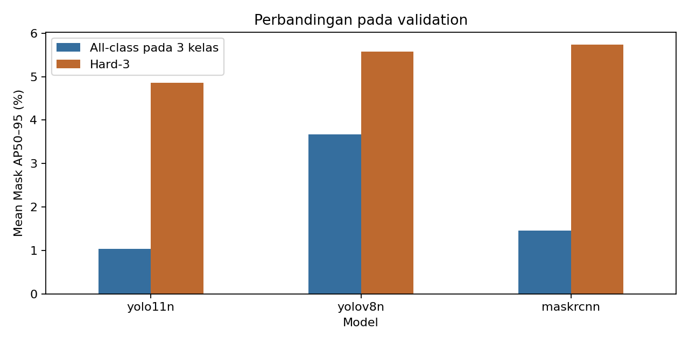
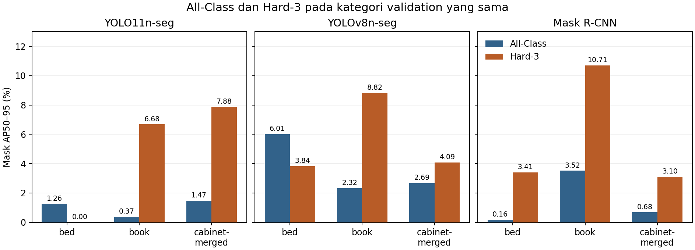
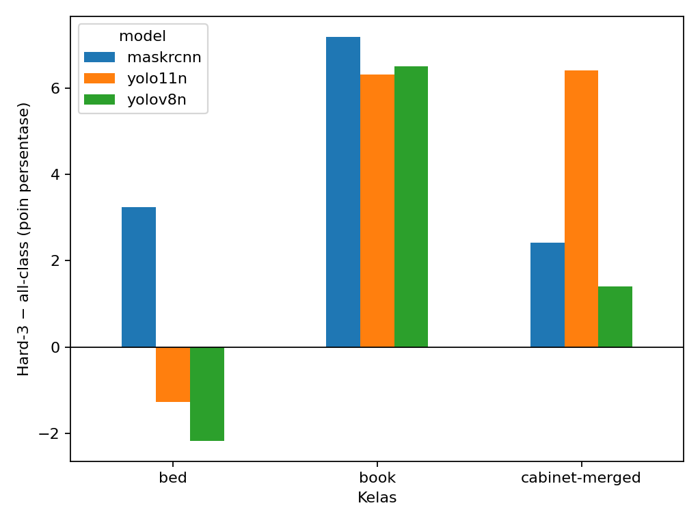
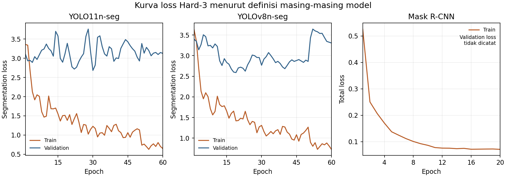
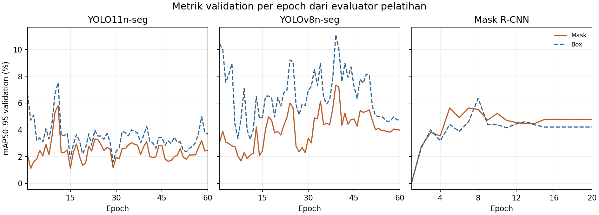

# Perbandingan All-Class dan Hard-3

Pada validasi, saya membandingkan All-Class dan Hard-3 pada tiga kelas yang sama. Ketiga model menaikkan rata-rata Mask AP50–95 pada tiga kelas target di validation. Mask R-CNN mencatat rata-rata Hard-3 tertinggi, 5,738%, dengan selisih 0,157 poin persentase dari YOLOv8n-seg. Bagian ini membahas satu run per konfigurasi pada validation. [Hasil kedua set uji](../test_evaluation/quantitative_analysis.md)

## Data dan protokol

Hard-3 mencakup `bed`, `book`, dan `cabinet-merged`, tiga kelas yang ditetapkan sebelum pelatihan dari peringkat AP terendah di antara 39 kelas yang memenuhi syarat jumlah instance. Split gambar tetap sama. Train memuat 178 instance target pada 60 dari 397 gambar. Validation memuat 40 instance pada 19 dari 166 gambar. Artinya 337 gambar train (84,89%) dan 147 gambar validation (88,55%) tidak mempunyai instance Hard-3. Gambar tersebut tetap memberi contoh latar terhadap kelas target dan memungkinkan prediksi keliru dihitung. [Dasar pemilihan](../all_class_comparison/hard3_decision.json) dan [manifest dataset](provenance/dataset_manifest.json).

| Kelas | COCO ID asli → Hard-3 | YOLO ID asli → Hard-3 | Instance train | Instance validation |
| --- | --- | --- | ---: | ---: |
| `bed` | 2 → 1 | 1 → 0 | 26 | 6 |
| `book` | 4 → 2 | 3 → 1 | 105 | 15 |
| `cabinet-merged` | 8 → 3 | 7 → 2 | 47 | 19 |

Rekaman 166 gambar, termasuk ID dan dimensinya, cocok persis antara ground truth validation All-Class dan Hard-3. Setelah kategori dipetakan, 40 anotasi target sama hingga ID anotasi, ID gambar, poligon, bounding box, area, dan `iscrowd`. Kedua evaluasi menggunakan COCOeval untuk mask, confidence minimum 0,001, mask threshold 0,5, dan maksimum 100 deteksi per gambar. Mask prediksi berbentuk COCO RLE pada resolusi gambar asli di kedua kondisi. AP50–95 COCOeval merata-ratakan 10 ambang IoU dari 0,50 sampai 0,95 dengan langkah 0,05. Notebook Hard-3 mempertahankan default ambang IoU tersebut. [Konfigurasi All-Class](../all_class_comparison/evaluation_config.json), [spesifikasi Hard-3](provenance/experiment_spec.json), [bukti pencocokan](provenance/artifact_audit.json), dan [protokol evaluasi COCO](https://cocodataset.org/dataset/detection-eval.htm).

Skor dibandingkan dari AP tiga kategori target. Untuk model All-Class, ketiga nilai diambil dari evaluasi run 74 kelas yang sama, sehingga prediksi dari 74 kelas tetap tunduk pada batas deteksi per gambar. Perbedaan cakupan prediksi dapat mengubah deteksi yang lolos batas tersebut. Konfigurasi dan hasil ekspor dapat dibandingkan, sementara kode evaluator All-Class yang dieksekusi belum tersedia untuk memeriksa setiap detail preprocessing. Pengaturan resize dan NMS juga berbeda antararsitektur. [Pemeriksaan protokol](protocol_check.json).

## Hasil validation

### Rata-rata tiga kelas

| Model | All-Class (%) | Hard-3 (%) | Selisih (poin persentase) | Perubahan relatif (%) |
| --- | ---: | ---: | ---: | ---: |
| YOLO11n-seg | 1,033 | 4,853 | +3,820 | +369,78 |
| YOLOv8n-seg | 3,672 | 5,581 | +1,909 | +51,99 |
| Mask R-CNN ResNet-50 FPN | 1,454 | 5,738 | +4,284 | +294,65 |

### Perubahan per kelas

| Model | Kelas | All-Class (%) | Hard-3 (%) | Selisih (poin persentase) | Perubahan relatif (%) |
| --- | --- | ---: | ---: | ---: | ---: |
| YOLO11n-seg | `bed` | 1,262 | 0,000 | −1,262 | −100,00 |
| YOLO11n-seg | `book` | 0,368 | 6,681 | +6,313 | +1.713,23 |
| YOLO11n-seg | `cabinet-merged` | 1,469 | 7,879 | +6,411 | +436,52 |
| YOLOv8n-seg | `bed` | 6,011 | 3,838 | −2,174 | −36,16 |
| YOLOv8n-seg | `book` | 2,319 | 8,816 | +6,497 | +280,15 |
| YOLOv8n-seg | `cabinet-merged` | 2,686 | 4,090 | +1,404 | +52,29 |
| Mask R-CNN | `bed` | 0,160 | 3,408 | +3,248 | +2.026,25 |
| Mask R-CNN | `book` | 3,517 | 10,707 | +7,190 | +204,41 |
| Mask R-CNN | `cabinet-merged` | 0,684 | 3,100 | +2,415 | +352,87 |

Selisih dihitung sebagai AP Hard-3 dikurangi AP All-Class. Perubahan relatif membagi selisih tersebut dengan AP All-Class dan mengalikannya dengan 100. Penyebut yang sangat kecil dapat menghasilkan persentase relatif besar meski kenaikannya hanya beberapa poin. Tabel rata-rata memakai rata-rata tiga AP tanpa bobot jumlah instance. [CSV per kelas](per_class_comparison_with_relative.csv) dan [CSV rata-rata](model_comparison_with_relative.csv).

`book` naik lebih dari 6 poin pada ketiga model dan merupakan kelas dengan instance train terbanyak. `cabinet-merged` juga meningkat di semua model. YOLO11n-seg mencatat skor Hard-3 tertinggi pada kelas ini, 7,879%. Respons pada `bed` berbeda. AP turun pada kedua YOLO dan naik pada Mask R-CNN. YOLOv8n-seg masih mencatat skor Hard-3 tertinggi untuk `bed` (3,838%). Enam instance validation membuat nilainya sensitif terhadap perubahan sedikit prediksi. Jumlah contoh train memberi konteks untuk pola tersebut, sementara hubungannya dengan peningkatan AP belum diuji. Audit baseline juga menemukan variasi batas mask, termasuk pemisahan perlengkapan tidur. Variasi itu mungkin memengaruhi IoU dan AP, dengan besar pengaruh yang belum diukur. [Audit konvensi anotasi](../../data/custom_test/annotation_guidelines.md).

## Evaluasi hipotesis

Status berikut merupakan evaluasi deskriptif pada validation. Kriteria yang dicatat sebelum eksperimen juga menetapkan evaluasi terpisah pada original test dan personal test setelah checkpoint dan protokol dikunci. [Hipotesis historis](../../logbook.md#hipotesis-hard-3) dan [rancangan pengujian](../../logbook.md#rancangan-pengujian-hipotesis-hard-3).

| Hipotesis dan ekspektasi | Hasil teramati | Status di validation | Interpretasi dan batas |
| --- | --- | --- | --- |
| H1. Rata-rata AP tiga kelas naik untuk setiap arsitektur. | YOLO11n +3,820, YOLOv8n +1,909, dan Mask R-CNN +4,284 poin. | **Supported** | Rata-rata naik pada semua arsitektur meski `bed` turun pada kedua YOLO. Paket stabilisasi Mask R-CNN ikut berubah. |
| H2. YOLOv8n-seg memiliki rata-rata Hard-3 tertinggi. | Mask R-CNN 5,738%, YOLOv8n 5,581%, dan YOLO11n 4,853%. | **Not supported** | Mask R-CNN berada 0,157 poin di atas YOLOv8n pada run ini. Stabilitas peringkat antar-run belum diketahui. |
| H3. Mask R-CNN mendapat AP Hard-3 tertinggi pada `book`. | Mask R-CNN 10,707%, YOLOv8n 8,816%, dan YOLO11n 6,681%. | **Supported** | Selisih terhadap posisi kedua 1,891 poin pada 15 instance. Temuan belum menjelaskan kontribusi RoIAlign atau efek konfigurasi. |

Data ini tidak disertai uji signifikansi, interval ketidakpastian, atau pengulangan dengan seed lain. Kelas dipilih dari AP rendah pada validation yang juga menjadi split yang dibandingkan, sehingga sebagian perubahan skor mungkin dipengaruhi oleh pemilihan kelas dengan nilai awal rendah. Hasil validation belum menunjukkan generalisasi di luar split tersebut.

## Pelatihan dan stabilitas numerik

Ketiga pelatihan berlangsung pada Tesla T4 dengan seed 42. Checkpoint dan evaluasi YOLO berasal dari run Hard-3 awal. Log asli mencatat 60 epoch dalam 374,481 detik untuk YOLO11n dan 338,730 detik untuk YOLOv8n. Angka ini merupakan waktu kumulatif pelatihan sumber, dengan waktu recovery artefak yang tidak tercatat terpisah. Mask R-CNN menjalankan 20 epoch dalam 2.437,471 detik, termasuk validasi per epoch. Jumlah kolom per tahap adalah 2.039,211 detik untuk train dan 387,907 detik untuk validation. Evaluasi unified mencatat waktu pipeline 5,907, 4,662, dan 51,933 detik untuk YOLO11n, YOLOv8n, dan Mask R-CNN. Waktu tersebut mencakup pipeline prediksi, termasuk konversi dan pengemasan keluaran. [Ringkasan durasi](model_comparison.csv) dan [lingkungan run](provenance/environment.json).

Mask R-CNN memakai ResNet-50 FPN dengan bobot awal COCO, empat keluaran kelas termasuk background, batch 2, SGD dengan momentum 0,9 dan weight decay 0,0005, serta MultiStepLR pada epoch 10 dan 15 dengan gamma 0,1. Input berukuran minimum 640 dan maksimum 960 piksel. Run AMP awal dengan laju belajar 0,005 gagal pada epoch 1 batch 32. Recovery FP32 pada laju yang sama gagal pada batch 43. Dua gambar tanpa instance target (ID 153 dan 205) menghasilkan `loss_classifier` dan `loss_box_reg` NaN dengan `loss_objectness` 933,6926. Jumlah proposal pada kegagalan awal tidak tercatat. [Traceback awal](../../evidence/training_logs/hard3_maskrcnn/initial_training_error.txt), [diagnostik batch 43](../../evidence/training_logs/hard3_maskrcnn/fp32_batch43_diagnostic.json), dan [konfigurasi V2](../../experiments/maskrcnn_hard3/config.json).

V2 memakai FP32 dengan AMP nonaktif, laju belajar awal 0,0005, serta clipping norma L2 gradien pada 5,0. Dua probe lolos sebelum bobot diperbarui. Log training mencatat clipping pada 40 dari 100 batch pertama. Pada batch 43 yang sama, model menghasilkan 2.000 proposal RPN dan 512 sampel RoI per gambar, loss objectness 0,02298, total loss 0,02873, serta norma gradien 1,14121. Ini menunjukkan konfigurasi V2 dapat menangani batch tersebut. Akar kegagalan sebelumnya serta kontribusi individual penurunan laju belajar atau clipping belum dapat ditentukan. Precision, laju belajar, dan clipping membatasi atribusi kenaikan AP terhadap spesialisasi saja pada Mask R-CNN. [Probe](../../experiments/maskrcnn_hard3/metrics/preflight.jsonl) dan [diagnostik 100 batch awal](../../experiments/maskrcnn_hard3/metrics/early_training_batches.jsonl).

Kurva YOLO mencatat segmentation loss train dan validation. Kurva Mask R-CNN mencatat total loss train sebagai jumlah komponen klasifikasi, box, mask, dan RPN. Nilai loss memakai definisi yang berbeda. Validation loss Mask R-CNN tidak dicatat. Checkpoint terbaiknya dipilih pada epoch 5 (Mask mAP50–95 5,634% menurut evaluator pelatihan) dan mencatat 5,738% pada unified COCOeval. Kurva AP per epoch mengikuti evaluator pelatihan masing-masing, termasuk ambang skor 0,05 pada validasi per epoch Mask R-CNN. [Log YOLO11n](../../experiments/yolo11n_hard3/metrics/results.csv), [log YOLOv8n](../../experiments/yolov8n_hard3/metrics/results.csv), dan [log Mask R-CNN](../../experiments/maskrcnn_hard3/metrics/results.csv).

## Reproduksibilitas

Untuk membuat ulang tabel perubahan relatif dan grafik turunan, jalankan `python analysis/hard3_comparison/plot_results.py` dari root repositori dengan pandas dan Matplotlib. Hasil asli unified COCOeval disimpan per model. Paket `CPMK3_Hard3_Recovery_V2_Complete.zip` memuat prediksi bbox dan segmentasi untuk audit lebih lanjut. Bobot best dan last berada di folder eksperimen lokal. Hash checkpoint, provenance pemulihan, dan status training serta evaluasi tercatat pada artefak berikut. [Status run](provenance/run_summary.json), [audit artefak](provenance/artifact_audit.json), [grafik validasi data](provenance/dataset_qa.png), dan [rekonstruksi notebook Kaggle](../../notebooks/CPMK3_Hard3_Final_Reconstructed.ipynb).
