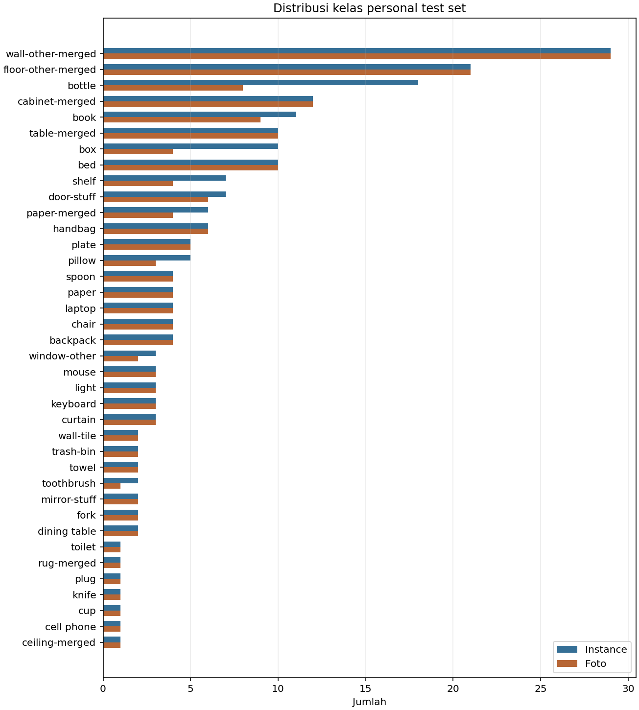

# Validasi ground truth personal test set

Dokumen ini merekam audit yang saya gunakan sebelum menyetujui koreksi anotasi. Hasil penerapan keputusan dan validasi kandidat terbaru tersedia dalam [laporan finalisasi](finalization/report.md).

**26 November 2026 WIB · REVIEW REQUIRED.** Ekspor 40 foto memenuhi pemeriksaan struktural dan menghasilkan kandidat All-Class dan Hard-3. Ketiga foto dalam [antrean review](human_review.md) memerlukan keputusan mengenai cakupan mask sebelum kandidat dapat dibekukan dan dipakai untuk evaluasi.

## Identitas gambar dan integritas ekspor

Saya menganotasi foto di Roboflow dengan bantuan SAM untuk memperoleh mask awal, kemudian menggunakan poligon manual dan pixel brush, menetapkan kelas, dan meninjau hasilnya. Ekspor COCO Segmentation v1 tercatat pada 26 November 2026 pukul 13.21 WIB. Seluruh foto berada pada split `test`. Jumlah anotasi pada setiap foto diperiksa langsung pada COCO JSON. Semua foto memiliki anotasi meskipun antarmuka Roboflow sempat melaporkan 40 foto sebagai *unannotated*.

P001–P040 dicocokkan menggunakan nama foto dalam ekspor, dimensi setelah orientasi EXIF, dan perbandingan thumbnail RGB 80 × 80 terhadap seluruh 40 foto asli. Setiap pasangan memiliki dimensi yang sama setelah orientasi diterapkan, dan foto sumbernya merupakan kecocokan terdekat. Selisih rata-rata absolut maksimum antarpasangan adalah 0,408490 pada skala RGB 0–255. Hasil tersebut konsisten dengan auto-orientation dan pengodean ulang JPEG. Metadata ekspor menyatakan tanpa augmentasi, dan pemeriksaan tidak menemukan duplikat, perubahan skala, atau transformasi geometris tambahan. SHA-256 40 foto sumber cocok dengan kedua CSV bukti. [Pemetaan foto sumber, nama ekspor, dan ID COCO](image_mapping.csv)

Berkas ZIP asli `CPMK3 Personal Indoor Test Set.v1-personal-test-set-v1.coco-segmentation.zip` dan hasil ekstraksinya di `data/custom_test/roboflow_raw/` merupakan rujukan data mentah. Kandidat memakai foto dari root tersebut. Checksum arsip, setiap berkas mentah, dan kedua kandidat tersedia dalam [provenance](dataset_provenance.json).

## Taksonomi, validasi mask, dan distribusi

Pemetaan dibuat berdasarkan nama kelas yang sama persis dengan `data/processed/all_classes/data.yaml` lokal dan kategori COCO asli Panoptic Indoor Segmentation v5 pada train, validation, dan test. ID COCO dan Mask R-CNN All-Class berada pada 1–74, sedangkan YOLO All-Class menggunakan 0–73. Pada Hard-3, `bed`, `book`, dan `cabinet-merged` menggunakan COCO dan label Mask R-CNN 1, 2, dan 3, serta YOLO 0, 1, dan 2. Label 0 pada Mask R-CNN merupakan background. Kategori ekspor ID 0 berisi nama proyek dan tidak dirujuk oleh anotasi. [Pemetaan 74 kelas dan jumlah instance pelatihan](category_mapping.json)

Pemeriksaan dengan `pycocotools` memverifikasi ID, referensi gambar dan kelas, dimensi, area piksel positif, dan batas mask. Seluruh 135 mask RLE dan 78 anotasi poligon dapat didekode. Tidak ada anotasi crowd, koordinat poligon di luar gambar, atau pasangan mask sesama kelas dengan IoU ≥ 0,85. Ambang IoU ini menandai kemungkinan duplikasi dan dilengkapi dengan pemeriksaan visual.

| Indikator | Hasil |
| --- | ---: |
| Foto terverifikasi dan beranotasi | 40 dari 40 |
| Instance dan kelas yang terwakili | 213 instance, 38 dari 74 kelas |
| Anotasi invalid dan anotasi dengan kategori tak dikenal | 0 dan 0 |
| Hard-3 | 10 `bed`, 11 `book`, 12 `cabinet-merged` |
| Foto positif dan negatif Hard-3 | 25 positif, 15 negatif |

`mouse`, `keyboard`, dan `toothbrush` muncul pada personal test set meski tidak memiliki instance di split train baseline. Ketiganya tetap tercakup sesuai ground truth. Sebanyak 36 kelas baseline tidak terwakili pada foto pribadi. AP yang tidak terdefinisi karena ketiadaan ground truth perlu ditandai sebagai tidak tersedia pada evaluasi berikutnya. [Statistik lengkap](dataset_statistics.json), [jumlah instance dan foto per kelas](instances_per_class.csv), serta [jumlah anotasi per foto](instances_per_image.csv)

## Kandidat, koreksi teknis, dan pemeriksaan visual

| Kandidat | Cakupan | Sumber gambar |
| --- | --- | --- |
| [Master COCO dan All-Class](../../data/custom_test/annotations/all_class_master_candidate.coco.json) | 40 foto, 74 kategori, 213 instance | `data/custom_test/roboflow_raw/` |
| [Hard-3](../../data/custom_test/annotations/hard3_candidate.coco.json) | 40 foto yang sama, 3 kategori, 33 instance | Root yang sama |

Di kandidat master, 206 nilai `image_id` dan 199 nilai `category_id` pada anotasi diselaraskan. Rasterisasi mask COCO digunakan untuk menghitung ulang `area` dalam piksel pada 213 anotasi dan memperbarui empat `bbox` yang berbeda. Seluruh ID anotasi sumber, geometri mask, dan makna kelas dipertahankan. Pada Hard-3, seluruh gambar ikut dipertahankan agar deteksi keliru pada foto tanpa instance target dapat dicatat. [Log koreksi](correction_log.json)

Pemeriksaan visual mencakup seluruh P001–P040, dengan pengecekan lebih dekat pada pasangan mask yang saling menutupi dan pada keputusan anotasi yang saya catat. Empat komponen meja P001 sudah tersimpan sebagai satu instance. Tiga foto memiliki irisan mask yang perlu ditinjau manusia. Penilaian dilakukan pada skala overlay dan berfokus pada perbedaan label, batas, dan pengelompokan yang material. [P001–P008](overlays/contact_1.jpg), [P009–P016](overlays/contact_2.jpg), [P017–P024](overlays/contact_3.jpg), [P025–P032](overlays/contact_4.jpg), [P033–P040](overlays/contact_5.jpg), dan [antrean review](human_review.md)

## Bukti penilaian

| Ketentuan dalam materi *Segmentasi Instance dengan Deep Learning*, slide 29–32 | Bukti dan status |
| --- | --- |
| Minimum 40 foto dari kamera ponsel sendiri dan lingkungan nyata | 40 sumber P001–P040 terverifikasi terhadap [manifest](../../evidence/photo_metadata/photo_manifest.csv) dan [metadata EXIF](../../evidence/photo_metadata/exif_metadata.csv). |
| Minimum 10 foto kondisi sulit | 12 foto berbeda disertai alasan visual dalam [daftar kondisi sulit](difficult_conditions.md). |
| Anotasi sendiri di Roboflow menggunakan kelas yang sama, disertai bukti proses | Saya mengonfirmasi penyelesaian anotasi 40 foto dan mendokumentasikan metode yang saya pakai. Anotasi ekspor, kelas baseline, serta [screenshot proses](../../evidence/annotation_screenshots/annotation_process.png) dan [tampilan dataset](../../evidence/annotation_screenshots/dataset_overview.png) tersedia. Persetujuan khusus dosen terkait SAM-assisted masking belum terdokumentasi. |
| Tiga model, minimal dua keluarga arsitektur, serta All-Class vs Hard-3 | Hasil [All-Class](../all_class_comparison/analysis.md) dan [Hard-3](../hard3_comparison/analysis.md) tersedia pada validation set. |
| Evaluasi original dan personal test set, analisis domain shift, lima kasus kegagalan, dan eksperimen pembuktian | Saat audit ini, persetujuan ground truth masih menunggu. [Hasil finalisasi](finalization/report.md) dan [evaluasi final](../test_evaluation/README.md). |
| Bukti training dan GPU, logbook, dan deklarasi AI | [Indeks artefak model dan notebook](../../README.md#artefak-per-model-dan-notebook), [logbook](../../logbook.md), dan [deklarasi AI](../../ai_usage.md) tersedia. |

## Kesiapan evaluasi berikutnya

Original test set di `data/original_v5/extracted/test/` berisi 359 gambar dan 5.344 anotasi COCO. Dimensi yang tertera pada COCO sesuai dengan dimensi seluruh gambar, termasuk setelah pemeriksaan orientasi EXIF. Protokol All-Class dari validation tercatat pada [konfigurasi unified evaluation](../all_class_comparison/evaluation_config.json). Kode Mask R-CNN, inference YOLO, konversi mask ke RLE, dan COCOeval dapat digunakan kembali dari [notebook rekonstruksi Hard-3](../../notebooks/CPMK3_Hard3_Final_Reconstructed.ipynb). Notebook tersebut masih menargetkan validation. Daftar koreksi orientasi validation berlaku pada split asalnya. Folder lokal `data/processed/three_classes/` belum memiliki salinan dataset siap pakai. Pemetaan Hard-3 dan checksum COCO original test tersedia di [spesifikasi Hard-3](../hard3_comparison/provenance/experiment_spec.json).

Enam checkpoint terbaik tersedia lokal di `experiments/<model>_all_classes/weights/` dan `experiments/<model>_hard3/weights/`. Keempat checkpoint YOLO `best.pt` dapat dimuat dan nama kelas sesuai urutan taksonomi. Kedua checkpoint Mask R-CNN `best.pth` memuat head dengan 75 dan 4 label, termasuk background. Checksum sesuai dengan [provenance All-Class](../all_class_comparison/evaluation_config.json) dan [provenance Hard-3](../hard3_comparison/provenance/artifact_audit.json).

Kaggle GPU lebih sesuai dengan lingkungan validation yang sudah digunakan, yaitu Tesla T4 dengan PyTorch 2.11.0+cu130, Torchvision 0.26.0+cu130, dan Ultralytics 8.4.216. Interpreter proyek yang diperiksa secara lokal menggunakan build CPU meski perangkat memiliki GPU RTX 3050 Laptop 4 GiB. Paket `pycocotools` 2.0.10 berhasil dipakai untuk QA. Beban evaluasi akhir mencakup sekitar 2.394 pasangan gambar dan checkpoint sebelum agregasi metrik. Waktu eksekusinya belum diukur. Input yang diperlukan mencakup enam checkpoint yang sesuai checksum, original test COCO, serta ekspor personal test dan dua JSON yang sudah dibekukan. Referensi Kaggle yang tercatat dapat digunakan kembali setelah akses input dikonfirmasi.

Untuk perbandingan spesialisasi, hitung metrik All-Class dan Hard-3 pada tiga kelas yang sama dengan COCOeval, confidence minimum 0,001, maksimum 100 deteksi, dan threshold mask 0,5 sesuai implementasi validation. Pertahankan foto negatif dan laporkan kelas yang memiliki ground truth di kedua domain saat membandingkan domain shift. Test set disisihkan dari training, pemilihan checkpoint, dan tuning.

## Reproduksi kandidat

Simpan ZIP sumber di root repositori dan siapkan COCO Panoptic v5 pada lokasi baseline di atas. Jalankan `python analysis/personal_test_qa/build_candidates.py` dengan Python 3.11 atau lebih baru, Pillow, NumPy, PyYAML, Matplotlib, dan pycocotools. Skrip dapat mengulang pembuatan kandidat dari ekspor v1. Kandidat yang kelak dikoreksi dan dibekukan perlu disimpan dengan versi tersendiri agar perubahan hasil review dapat ditelusuri. [Skrip](build_candidates.py)
