# Analisis Komparatif Model Instance Segmentation pada Lingkungan Indoor Nyata

## Abstrak

Penelitian ini membandingkan YOLO11n-seg, YOLOv8n-seg, dan Mask R-CNN ResNet-50 FPN pada Panoptic Indoor Segmentation v5. Ketiganya dilatih untuk 74 kategori (All-Class) dan untuk tiga kategori tersulit pada validation, yaitu `bed`, `book`, dan `cabinet-merged` (Hard-3). Enam checkpoint dievaluasi dengan COCOeval pada 359 gambar original test dan 40 foto personal test beranotasi. YOLO11n memimpin berdasarkan Mask AP50–95 di kedua cakupan primer pada original test, sedangkan Mask R-CNN memimpin pada personal test. Pada tiga kategori yang sama, spesialisasi menaikkan AR100 pada enam perbandingan dan menaikkan AP pada satu perbandingan, yakni YOLOv8n di personal test (+8,470 poin persentase). Analisis lima foto menemukan konflik label, objek terlewat, urutan confidence yang lemah, dan mask yang gagal meski kotak pembatas cocok. Eksperimen D1 menaikkan AP50 diagnostik lemari Hard-3 dari 5,604% menjadi 100,000% dengan menempatkan TP di depan dan mempertahankan 1.473 FP. Karena oracle memakai ground truth, hasil itu mengukur ruang perbaikan ranking pada prediksi yang sudah tersedia. Ukuran personal test dan penggunaan satu checkpoint per konfigurasi membatasi generalisasi temuan.

## 1. Pendahuluan

Bayangkan satu foto ruangan berisi dua kursi yang saling menutupi. Model perlu mengenali keduanya sebagai kursi dan menandai piksel milik masing-masing kursi secara terpisah. Wilayah piksel itu disebut *mask*, dan tugas untuk menghasilkan satu mask per objek disebut *instance segmentation*. Di dalam ruangan, ukuran objek yang beragam, bagian yang tertutup, dan batas objek yang samar membuat tugas ini lebih sulit.

Penelitian ini membandingkan YOLO11n-seg dan YOLOv8n-seg yang memprediksi instance dalam satu tahap dengan Mask R-CNN yang lebih dulu mengusulkan wilayah kandidat. Baseline All-Class menjadi acuan untuk menilai apakah pelatihan khusus Hard-3 memperbaiki kinerja pada tiga kategori yang sama. Original test dan foto pribadi disisihkan untuk menilai apakah hasil validasi bertahan pada dua distribusi gambar yang berbeda.

## 2. Tujuan dan Pertanyaan Penelitian

1. Seberapa baik YOLO11n-seg, YOLOv8n-seg, dan Mask R-CNN mengenali objek serta membentuk mask pada data validasi dan kedua set uji?
2. Bagaimana perkembangan loss, performa validasi, dan waktu komputasi pada konfigurasi baseline masing-masing?
3. Kelas mana yang konsisten sulit bagi ketiga model ketika diukur dengan evaluator yang sama dan memiliki cukup contoh untuk dianalisis?
4. Bagaimana hasil pelatihan Hard-3 dibandingkan dengan All-Class pada kategori yang sama, dan bagaimana hasil berubah dari original ke personal test?
5. Apa yang dapat dipelajari dari kegagalan pada foto pribadi, dan seberapa besar ranking confidence membatasi AP pada prediksi lemari yang sudah terbentuk?

## 3. Dataset dan Persiapan Data

Ketiga model memakai versi Kaggle yang sama dari Panoptic Indoor Segmentation v5 (ID versi `22504534`). Ekspor COCO menyimpan ukuran gambar, kategori, dan poligon yang mengikuti batas tiap objek. Anotasi ini menjadi sumber untuk dua format pelatihan. YOLO menggunakan titik poligon yang dinyatakan relatif terhadap ukuran gambar, sedangkan Mask R-CNN menggunakan anotasi COCO yang geometrinya sudah dikoreksi.

Kategori induk `indoor-objects` (ID 0) tidak memiliki anotasi objek, sehingga tersisa 74 kelas. ID pada label YOLO mengikuti `yolo_id = coco_category_id - 1`. Mask R-CNN memakai indeks 0 untuk latar belakang (*background*). Pemetaan nama kelas tersedia di `data/processed/all_classes/data.yaml` setelah dataset dibangun ulang secara lokal. [Manifest konversi](dataset_audit/conversion_manifest.json), [daftar kelas dan instance](dataset_audit/qa_report.json), dan [manifest koreksi COCO](../experiments/maskrcnn_all_classes/corrected_annotations/repair_manifest.json).

Tabel berikut menunjukkan jumlah gambar dan jumlah objek beranotasi (*instance*) pada setiap bagian data. Satu gambar dapat memuat beberapa objek.

| Split | Gambar | Instance | Kelas dengan contoh | Kelas tanpa contoh | Median instance per kelas |
| --- | ---: | ---: | ---: | ---: | ---: |
| Train | 397 | 4.479 | 65 | 9 | 17,5 |
| Validation | 166 | 2.022 | 58 | 16 | 6 |
| Original test | 359 | 5.344 | 69 | 5 | 32 |
| Total | 922 | 11.845 | — | — | — |

Median dihitung atas 74 kelas, termasuk kelas tanpa contoh. Jumlah contoh tidak merata. Sebagai gambaran, `wall-other-merged` sendiri menyumbang 756 dari 4.479 instance train (16,88%) dan 315 dari 2.022 instance validation (15,58%). Pada train, `table-merged` memiliki 319 instance dan `floor-other-merged` 261. Pada validation, `table-merged` memiliki 134 instance dan `food-other-merged` 108. Kelas tanpa contoh train tidak memberi model kesempatan untuk mempelajari objek itu dari data proyek. Kelas tanpa contoh validation belum dapat dinilai pada tahap ini. [Jumlah instance per kelas](dataset_audit/qa_report.json).

- **Tanpa contoh train (9)** — `flower`, `hair drier`, `keyboard`, `mouse`, `scissor`, `scissors`, `teddy bear`, `toaster`, `toothbrush`.
- **Tanpa contoh validation (16)** — `cardboard`, `clock`, `curtain`, `flower`, `hair drier`, `keyboard`, `mouse`, `scissor`, `scissors`, `st-`, `teddy bear`, `toothbrush`, `tree-merged`, `vase`, `wall`, `wall-stone`.

Dalam audit awal, sebagian titik batas objek pada label YOLO ditemukan berada di luar gambar. Logbook mencatat 3.527 dari 11.845 anotasi (29,8%). Keluaran audit awal tidak tersimpan, sehingga angka tersebut berasal dari catatan eksperimen. Pemeriksaan pada ekspor COCO tidak menemukan masalah serupa pada data yang diperiksa. Anotasi COCO kemudian digunakan untuk membangun ulang label. Ukuran gambar dan koordinat pikselnya memungkinkan setiap transformasi ditelusuri. [Logbook](../logbook.md).

Empat gambar memiliki dimensi aktual 480 × 640 piksel, sementara metadata COCO mencatat 640 × 480. Perbedaan orientasi ini dapat membuat poligon tidak lagi mengikuti objek. Geometri anotasi dikoreksi dengan rotasi berlawanan arah jarum jam (CCW) untuk `182169107`, `182169121`, dan `182169108`, serta searah jarum jam (CW) untuk `182169109`.

Setelah konversi tanpa memotong koordinat di batas gambar (*clipping*), pemeriksaan 11.845 anotasi tidak menemukan poligon di luar batas atau ID kelas yang tidak valid. Pemeriksaan visual melengkapi pemeriksaan angka dengan melihat apakah mask mengikuti objek, karena mask yang bergeser masih bisa berada sepenuhnya di dalam gambar. [Laporan pemeriksaan](dataset_audit/qa_report.json), [contoh mask](dataset_audit/rebuilt_yolo_mask_inspection.png), dan [pemeriksaan orientasi](../evidence/orientation_fixes_verification.png).

### 3.1 Personal test set

Saya mengambil 40 foto ruangan nyata dengan kamera ponsel sendiri. Manifest dan EXIF mencatat foto P001–P040. Dari 12 foto kondisi sulit, enam memperlihatkan oklusi, tiga memakai sudut pandang rendah, dua bercahaya rendah, dan satu memiliki cahaya dari belakang. Di Roboflow, saya menetapkan kelas sesuai taksonomi Panoptic Indoor, mengerjakan mask dengan poligon, pixel brush, dan bantuan SAM, lalu meninjau hasilnya. Catatan proyek belum memuat persetujuan khusus dosen untuk penggunaan bantuan SAM. [Manifest foto](../evidence/photo_metadata/photo_manifest.csv), [EXIF](../evidence/photo_metadata/exif_metadata.csv), [kondisi sulit](personal_test_qa/difficult_conditions.md), dan [screenshot anotasi](../evidence/annotation_screenshots/annotation_process.png)

Saya meninjau dan menyetujui empat koreksi batas mask pada P003, P005, dan P008 agar anotasi mengikuti bagian objek yang terlihat. Saya menetapkan kedua versi ground truth sebagai acuan tetap pada 26 November 2026 WIB. All-Class berisi 213 instance dari 38 kategori. Hard-3 berisi 33 instance, dengan 25 foto positif dan 15 foto negatif yang tetap disertakan untuk menilai false positive. [Koreksi dan finalisasi](personal_test_qa/finalization/report.md), [manifest pembekuan](personal_test_qa/finalization/ground_truth_freeze.json), dan [pedoman anotasi](../data/custom_test/annotation_guidelines.md)

## 4. Arsitektur Model

**YOLO11n-seg dan YOLOv8n-seg** memakai pendekatan satu tahap (*one-stage*). Keduanya langsung memprediksi kelas dan kotak pembatas (*bounding box*) dari fitur gambar. Untuk membentuk mask, model lebih dulu menghasilkan beberapa pola dasar (*prototype masks*) yang dipakai bersama dalam satu gambar. Setiap deteksi membawa koefisien yang menentukan cara menggabungkan pola itu menjadi mask untuk objek tersebut. [YOLO11][1], [YOLOv8][2], dan [head segmentasi Ultralytics][3].

**Mask R-CNN ResNet-50 FPN** memakai pendekatan dua tahap (*two-stage*). ResNet-50 mengekstrak fitur, lalu Feature Pyramid Network (FPN) menyediakannya pada beberapa skala agar objek kecil dan besar dapat ditangani. Pada tahap pertama, Region Proposal Network mengusulkan wilayah yang mungkin berisi objek. Pada tahap kedua, RoIAlign mengambil fitur yang selaras dengan wilayah tersebut. Cabang prediksi kemudian menentukan kelas, memperbaiki kotak pembatas, dan membentuk mask. Pemrosesan per wilayah menambah pekerjaan komputasi dibandingkan prediksi langsung pada YOLO. Besarnya perbedaan waktu pada baseline ini juga dipengaruhi konfigurasi pelatihan. [He dkk.][4] dan [Torchvision][5].

## 5. Metodologi Eksperimen

Ketiga baseline belajar dari 397 gambar train. Sebanyak 166 gambar validation dipakai untuk memantau kinerja dan menilai checkpoint, yaitu salinan bobot model yang disimpan selama pelatihan. Sebanyak 359 gambar original test disisihkan untuk evaluasi akhir.

Ukuran utama laporan ini adalah **mask mAP50–95**. Cara membacanya dimulai dari IoU, yaitu luas piksel yang sama antara mask prediksi dan anotasi dibagi luas gabungan keduanya. AP (*average precision*) merangkum hubungan antara precision, yaitu ketepatan prediksi, dan recall, yaitu seberapa banyak objek beranotasi berhasil ditemukan. mAP merata-ratakan AP antarkelas yang dapat dinilai. mAP50 memakai ambang IoU 0,50. mAP50–95 memakai ambang 0,50 sampai 0,95 dengan langkah 0,05, sehingga juga memperhitungkan batas kecocokan yang lebih ketat. Skor *box* menilai kotak, sementara skor *mask* menilai wilayah piksel. [COCOeval][6].

AP75 memakai ambang 0,75 dan memberi gambaran kecocokan geometri yang lebih ketat daripada AP50. AR100 merangkum recall pada batas maksimum 100 deteksi per foto. Confidence menentukan urutan prediksi saat precision dan recall dihitung. FP yang mendahului TP dapat menurunkan AP walaupun recall maksimum tetap.

Satu epoch berarti satu putaran pelatihan melalui dataset. Tabel berikut menunjukkan pengaturan yang dipakai pada masing-masing baseline.

| Pengaturan | YOLO11n-seg | YOLOv8n-seg | Mask R-CNN ResNet-50 FPN |
| --- | --- | --- | --- |
| Bobot pralatih | `yolo11n-seg.pt` | `yolov8n-seg.pt` | `MaskRCNN_ResNet50_FPN_Weights.DEFAULT` (COCO) |
| Kelas | 74 | 74 | 74 objek + 1 background |
| Epoch aktual | 60 | 60 | 20 |
| Batch size | 8 | 8 | 2 |
| Input / resize | `imgsz=640` | `imgsz=640` | Sisi pendek 640, sisi panjang dibatasi 960 |
| Optimizer aktual | AdamW (`optimizer=auto`) | AdamW (`optimizer=auto`) | SGD, momentum 0,9, weight decay 0,0005 |
| Learning rate | 0,000128 menurut log | 0,000128 menurut log | 0,005 awal |
| Scheduler | Warm-up 3 epoch, lalu penurunan linear (`cos_lr=false`, `lrf=0.01`) | Sama dengan YOLO11n | MultiStepLR pada milestone 10 dan 15, `gamma=0.1` |
| Random seed | 42 | 42 | 42 |
| GPU | 1 × Tesla T4, `CUDA:0` | 1 × Tesla T4, `CUDA:0` | 1 × Tesla T4, `cuda:0` |
| Pemilihan checkpoint | Fitness validasi Ultralytics | Fitness validasi Ultralytics | Mask mAP50–95 validasi |
| Evaluator | Ultralytics 8.4.216 | Ultralytics 8.4.216 | `pycocotools.COCOeval` (`bbox` dan `segm`) |

Pada kedua YOLO, YAML memuat `lr0=0.01`, sementara log mencatat bahwa `optimizer=auto` memilih AdamW dengan learning rate 0,000128. Tabel mencatat nilai yang dipakai saat pelatihan. Learning rate mengatur besar langkah pembaruan bobot, dan scheduler mengatur kapan langkah itu diperkecil.

Epoch dengan mask mAP tertinggi di CSV dan epoch checkpoint pilihan framework perlu dibaca terpisah. Ultralytics memakai *fitness* yang menggabungkan skor box dan mask. Metadata `best.pt` dan `last.pt` menyimpan `epoch: -1` dan `best_fitness: null`, sehingga epoch pemilihan `best.pt` tidak dapat ditentukan dari metadata itu. Mask R-CNN memilih checkpoint berdasarkan mask mAP50-95. Metadata menyimpan epoch 17 pada `best.pth` dan epoch 20 pada `last.pth`. [Fitness Ultralytics][7] dan [artefak eksperimen](#14-referensi-dan-artefak-pendukung).

### 5.1 Protokol evaluasi test set

Run02 `20261126T152940Z-d1cca883` mengevaluasi enam checkpoint pada kedua domain dengan COCOeval. Seluruh 12 kombinasi primer selesai dalam satu run baru. Pipeline memakai FP32, confidence minimum 0,001, maksimal 100 deteksi per foto, serta threshold mask 0,50. YOLO memakai letterbox persegi 640 × 640 dan NMS IoU 0,70. Mask R-CNN memakai sisi minimum 640, sisi maksimum 960, dan NMS IoU 0,50. Mask diproses satu per satu dan disimpan sebagai COCO RLE pada koordinat gambar asli. [Protokol dan reproduksi](test_evaluation/README.md), [ringkasan Run02](test_evaluation/run02/execution_summary.json), dan [manifest checkpoint](test_evaluation/run02/checkpoint_manifest.json)

Perbandingan spesialisasi memakai gambar, GT, dan tiga kategori yang sama pada tiap domain. Prediksi All-Class diproyeksikan setelah NMS dan pembatasan deteksi, sehingga kedua skenario masih berbeda dalam persaingan antarkelas sebelum proyeksi. Perbandingan antardomain memakai irisan kategori dengan GT non-crowd. AP kelas tanpa GT yang dapat dinilai tetap tak terdefinisi. [Dukungan per kategori](test_evaluation/run02/tables/ground_truth_support.csv)

## 6. Hasil dan Analisis All-Class Baseline

Bagian ini membaca kurva tiap model dari dua sisi. *Loss* adalah ukuran kesalahan yang dihitung selama pelatihan atau validasi. *Mask mAP* menunjukkan seberapa baik prediksi bertahan ketika dinilai terhadap anotasi validasi. Loss yang terus turun membantu menjelaskan proses belajar, tetapi kenaikan mask mAP memberi bukti yang lebih langsung tentang kualitas prediksi pada gambar validasi. Nilai loss dibandingkan dalam model yang sama karena tiap arsitektur memakai komponen dan skala yang berbeda.

### 6.1 YOLO11n-seg

**Sebagian besar perbaikan terjadi di awal.** Segmentation loss train turun dari 3,63951 ke 2,00172 pada epoch 10, lalu ke 1,45730 pada epoch 60. Loss box turun dari 1,29718 ke 0,74865, loss klasifikasi dari 4,58766 ke 1,36924, dan DFL, salah satu komponen untuk kotak pembatas, dari 1,44838 ke 1,10686. Kolom semantic loss tetap nol. Penurunan loss mask diselingi kenaikan singkat pada epoch 20 (1,78126 ke 1,86852) dan 51 (1,57386 ke 1,65706).

**Mask validasi membaik dan mendekati puncaknya di akhir.** Segmentation loss validasi mulai dari 2,85386, mencapai minimum 2,07355 pada epoch 33, lalu berakhir di 2,12510. Selisih loss validasi dikurangi train berubah dari −0,78565 pada epoch 1 menjadi +0,44274 pada epoch 33 dan +0,66780 pada epoch 60. Pada saat yang sama, mask mAP50–95 naik dari 7,744% ke 18,474% pada epoch 45. Nilai akhirnya 18,160%, atau 0,314 poin persentase di bawah puncak. Pada epoch terakhir, mask mAP50 mencapai 27,285%, box mAP50–95 20,969%, mask precision 49,661%, dan mask recall 26,512%.

**Interpretasi.** Model belajar paling cepat pada fase awal. Rata-rata mask mAP50–95 melandai dari 17,845% pada epoch 31–40 ke 18,173% pada epoch 41–50, lalu turun ke 17,569% pada epoch 51–60. Setelah epoch 33, loss train masih membaik sementara loss validasi relatif datar. Selisih tersebut bisa dipengaruhi perbedaan augmentasi dan mode antara pelatihan dan validasi. Karena mask mAP akhir kembali mendekati puncak, kurva ini menunjukkan manfaat tambahan yang mengecil dan belum cukup untuk menyimpulkan overfitting atau underfitting. [CSV YOLO11n](../experiments/yolo11n_all_classes/metrics/results.csv).

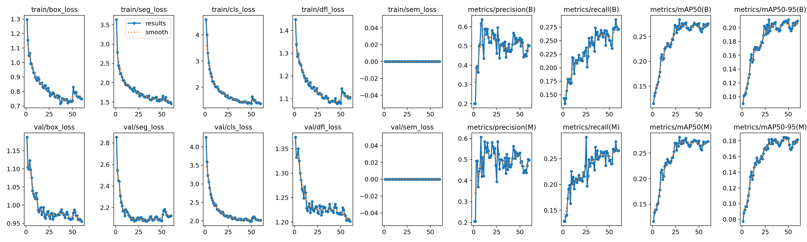

### 6.2 YOLOv8n-seg

**Loss mask turun tajam, lalu sempat naik pada epoch 51.** Segmentation loss train turun dari 3,45219 ke 2,02850 pada epoch 10. Nilainya mencapai minimum 1,60796 pada epoch 45 dan berakhir di 1,60909. Loss box turun dari 1,27134 ke 0,79259, loss klasifikasi dari 4,30550 ke 1,50296, dan DFL dari 1,42575 ke 1,14465. Semantic loss tetap nol. Kenaikan terbesar pada loss mask terjadi dari 1,64764 ke 1,89215 pada epoch 51, lalu nilainya turun ke 1,74153 pada epoch 52.

**Skor akhir berada di bawah puncak validasi.** Segmentation loss validasi mulai dari 2,93706, mencapai 2,08435 pada epoch 33, lalu berakhir di 2,09987. Selisih loss validasi dikurangi train berubah dari −0,51513 pada epoch 1 menjadi +0,37785 pada epoch 33 dan +0,49078 pada epoch 60. Mask mAP50–95 naik dari 9,086% ke 18,264% pada epoch 48, kemudian berakhir di 17,153%, atau 1,111 poin persentase di bawah puncak. Pada epoch terakhir, mask mAP50 mencapai 25,701%, box mAP50–95 19,291%, mask precision 51,967%, dan mask recall 25,792%.

**Interpretasi.** Rata-rata mask mAP50–95 berubah dari 17,324% pada epoch 31–40 ke 17,794% pada epoch 41–50, lalu turun ke 16,464% pada epoch 51–60. Penurunan terakhir lebih jelas daripada pada YOLO11n. Kedua log YOLO mencatat pergeseran loss di sekitar epoch 51, bertepatan dengan fase akhir saat augmentasi mosaic, yang menggabungkan beberapa gambar, dihentikan sesuai `close_mosaic=10`. Perubahan augmentasi merupakan salah satu kemungkinan penyebab. Learning rate juga sedang menurun, sehingga peran tiap faktor perlu diuji secara terpisah. Skor sempat pulih dan loss validasi akhir dekat dengan nilai minimumnya. Bukti yang tersedia menunjukkan fluktuasi pada fase akhir dan belum cukup untuk menyimpulkan overfitting, underfitting, atau ketidakstabilan sepanjang pelatihan. [CSV YOLOv8n](../experiments/yolov8n_all_classes/metrics/results.csv).

### 6.3 Mask R-CNN

**Loss total terus turun, dengan laju yang melambat.** Total loss turun dari 2,30709 ke 0,67741 pada epoch 10, lalu ke 0,41075 pada epoch 20. Loss klasifikasi turun dari 0,93501 ke 0,11336, box regression dari 0,60173 ke 0,13237, dan mask dari 0,54816 ke 0,13787. Dua komponen yang berkaitan dengan proposal region juga turun. Objectness bergerak dari 0,13157 ke 0,00407, dan RPN box regression dari 0,09062 ke 0,02307. Mask loss sempat mencapai minimum 0,13706 pada epoch 18. Learning rate turun ke 0,0005 pada epoch 11 dan ke 0,00005 pada epoch 16.

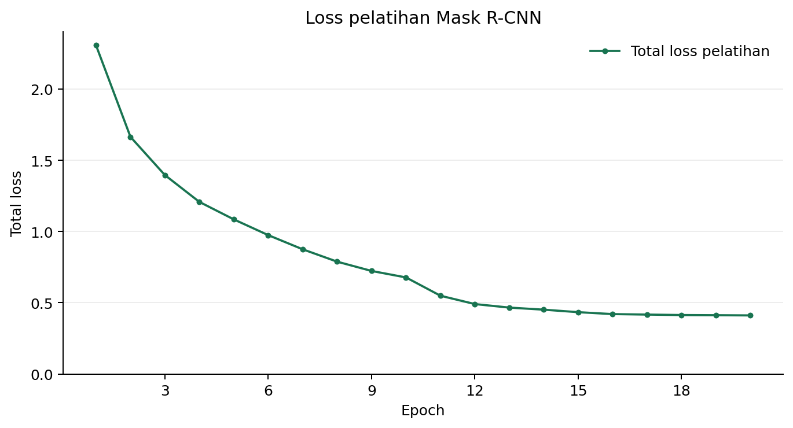

**Skor validasi relatif datar setelah epoch 10.** Mask mAP50–95 naik dari 3,887% pada epoch 1 ke 12,764% pada epoch 10. Pada epoch 11–20, skor berada di rentang 14,435–14,838%. Puncaknya 14,838% pada epoch 17, lalu berakhir di 14,693%, selisih 0,145 poin persentase. Nilai akhir mask mAP50 mencapai 22,260% dan box mAP50–95 15,342%. Baseline ini tidak mencatat validation loss atau mask precision dan recall agregat.

**Interpretasi.** Model memperbaiki prediksi dengan cepat pada fase awal. Setelah penurunan learning rate pertama, gain mAP menjadi kecil meskipun loss pelatihan terus turun. Kedua perubahan itu berdekatan waktunya. Peran scheduler sebagai penyebab perlu diuji dengan percobaan pembanding. Dengan 20 epoch dan tanpa validation loss, diagnosis overfitting, underfitting, serta konvergensi akhir masih terbuka. [CSV Mask R-CNN](../experiments/maskrcnn_all_classes/metrics/results.csv).

### 6.4 Perbandingan Performa

Tabel ini membantu menjawab model mana yang paling baik membentuk mask pada data validasi. Untuk setiap model, semua nilai diambil dari epoch dengan mask mAP50–95 tertinggi. Precision dan recall YOLO mengikuti ambang prediksi yang dipakai Ultralytics saat melaporkan keduanya. N/A menandakan metrik tidak tercatat.

| Model | Mask mAP50–95 | Mask mAP50 | Box mAP50–95 | Mask precision | Mask recall | Epoch puncak / aktual |
| --- | ---: | ---: | ---: | ---: | ---: | ---: |
| YOLO11n-seg | 18,474% | 27,586% | 20,845% | 50,430% | 26,337% | 45 / 60 |
| YOLOv8n-seg | 18,264% | 27,023% | 19,857% | 49,762% | 28,596% | 48 / 60 |
| Mask R-CNN | 14,838% | 22,246% | 15,425% | N/A | N/A | 17 / 20 |

YOLO11n unggul 0,210 poin persentase atas YOLOv8n pada mask mAP50–95. YOLOv8n memiliki recall lebih tinggi pada epoch puncaknya sendiri, artinya lebih banyak objek beranotasi ditemukan pada titik pelaporan tersebut. Selisih kedua YOLO terhadap Mask R-CNN masing-masing 3,636 dan 3,426 poin persentase. Peringkat ini menggambarkan run yang tersedia. Satu run per model membuat selisih 0,210 poin terlalu kecil untuk menyimpulkan keunggulan yang konsisten. Perbedaan evaluator juga perlu dipertimbangkan saat membaca selisih terhadap Mask R-CNN. [Ringkasan ketiga eksperimen](#14-referensi-dan-artefak-pendukung).

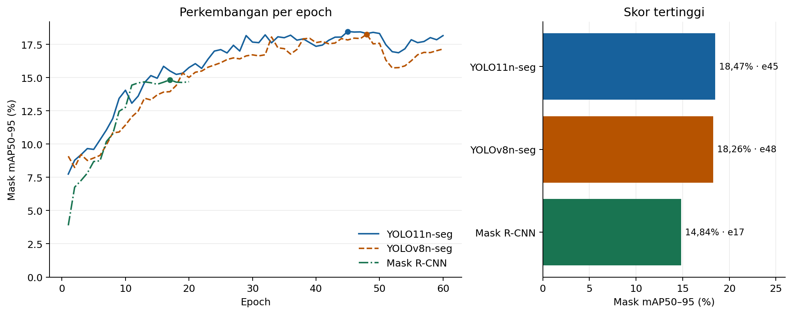

### 6.5 Perbandingan Efisiensi Komputasi

Waktu kumulatif adalah waktu yang tercatat sampai epoch terakhir pada kolom `time`. Angka per epoch membagi total itu dengan jumlah epoch aktual. Kolom eksekusi notebook memakai metadata Papermill dan mencakup proses di luar loop pelatihan.

| Model | GPU | Waktu kumulatif CSV (detik) | Waktu kumulatif per epoch (detik) | Train saja / validation saja (detik) | Eksekusi notebook (detik) |
| --- | --- | ---: | ---: | ---: | ---: |
| YOLO11n-seg | Tesla T4 | 599,949 | 9,999 | N/A / N/A | 912,606 |
| YOLOv8n-seg | Tesla T4 | 571,242 | 9,521 | N/A / N/A | 723,431 |
| Mask R-CNN | Tesla T4 | 2.238,738 | 111,937 | 1.397,645 / 828,470 | 2.342,766 |

Mask R-CNN mencatat waktu train dan validation secara terpisah. Jumlah keduanya tidak mencakup seluruh pekerjaan di dalam loop, sehingga waktu kumulatifnya sedikit lebih panjang. Log YOLO tidak memisahkan kedua tahap itu.

Untuk YOLO11n, layar Kaggle menampilkan 15 menit 26 detik dan Papermill mencatat 15 menit 12,6 detik. Selisihnya sekitar 13,4 detik. Kedua angka merujuk ke sumber pencatatan yang berbeda. Layar Kaggle juga menunjukkan alokasi `GPU T4 x2`, sementara log mengidentifikasi perangkat pelatihan yang digunakan sebagai `CUDA:0`. [Bukti Kaggle YOLO11n](../evidence/gpu_usage/YOLO11n-seg_all_class.png).

YOLOv8n memakai waktu sekitar 28,7 detik lebih sedikit daripada YOLO11n dengan selisih puncak mask mAP 0,210 poin persentase. Mask R-CNN memerlukan sekitar 37 menit 19 detik untuk 20 epoch. Kedua YOLO memerlukan sekitar 10 menit untuk 60 epoch. Selisih mencakup efek batch size, ukuran gambar, dan validasi. Durasi pipeline test dan bukti uji memori GPU Run02 dicatat terpisah. Angka pelatihan merupakan durasi tercatat, tanpa pengukuran utilisasi GPU. [Waktu evaluasi test](test_evaluation/run02/tables/timings.csv) dan [uji GPU](test_evaluation/run02/gpu_equivalence_report.json)

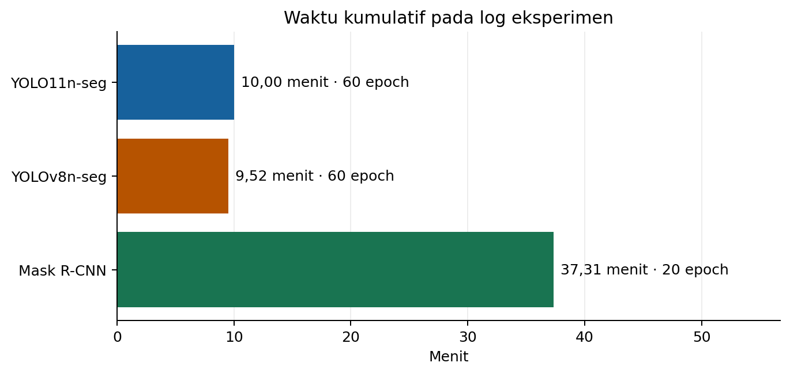

### 6.6 Keterbatasan Perbandingan Awal

Ketiga baseline melihat pembagian gambar yang sama. Pengaturan pelatihan dan evaluator bawaan berbeda antar keluarga model, sehingga tabel per epoch menggambarkan dinamika tiap run. Untuk perbandingan checkpoint, evaluasi bersama pada 166 gambar validation mencatat Mask AP50–95 sebesar 17,029% untuk YOLO11n, 16,704% untuk YOLOv8n, dan 15,489% untuk Mask R-CNN. Pengulangan dengan seed berbeda tidak dilakukan. [Agregat validation bersama](all_class_comparison/model_comparison.csv) dan [AP per kelas](all_class_comparison/per_class_ap_comparison.csv)

## 7. Pemilihan Tiga Kelas Tersulit

Digit terakhir NRP saya adalah 9. Sesuai ketentuan variabel eksperimen CPMK 3 untuk digit 8–9, saya membandingkan pelatihan pada tiga kelas tersulit (Hard-3) dengan pelatihan pada semua kelas (All-Class).

Hasil unified COCOeval pada 166 gambar validation menempatkan `cabinet-merged`, `book`, dan `bed` pada tiga peringkat terbawah dari 39 kategori yang memenuhi syarat. Aturan seleksi merata-ratakan Mask AP50–95 tiga model untuk kategori dengan minimal 10 instance train, minimal 5 instance validation, dan AP yang tersedia dari ketiga model. Ketiganya ditetapkan sebagai Hard-3 pada 24 November 2026 sebelum pelatihan Hard-3. Kedua test set disisihkan dari seleksi. [Peringkat kategori](all_class_comparison/hard3_ranking.csv) dan [keputusan final](all_class_comparison/hard3_decision.json)

| Kelas | Instance train | Instance validation | Rata-rata AP validation (%) |
| --- | ---: | ---: | ---: |
| `cabinet-merged` | 47 | 19 | 1,613 |
| `book` | 105 | 15 | 2,068 |
| `bed` | 26 | 6 | 2,478 |

## 8. Eksperimen All-Class vs Hard-3

Saya mempertahankan pembagian gambar Panoptic v5 untuk pelatihan khusus Hard-3. Gambar tanpa target tetap berfungsi sebagai sampel negatif. Train memuat 178 instance target dan validation 40 instance. Kedua YOLO memakai bobot pralatih masing-masing, 60 epoch, batch 8, input 640, AMP, dan AdamW dengan laju belajar awal 0,000128. Mask R-CNN memakai bobot pralatih COCO, 20 epoch, batch 2, SGD, dan resize minimum 640 serta maksimum 960. Pada run Hard-3 yang selesai, Mask R-CNN memakai FP32, laju belajar awal 0,0005, dan clipping norma gradien 5,0 setelah dua percobaan mengalami loss nonfinite. Perubahan itu membatasi atribusi efek pada spesialisasi kelas. [Manifest data](hard3_comparison/provenance/dataset_manifest.json), [konfigurasi YOLO11n](../experiments/yolo11n_hard3/config.json), [konfigurasi YOLOv8n](../experiments/yolov8n_hard3/config.json), dan [konfigurasi Mask R-CNN](../experiments/maskrcnn_hard3/config.json)

| Model | All-Class pada tiga target (%) | Hard-3 (%) | Δ AP (pp) | Durasi loop Hard-3 (detik) | Pipeline evaluasi validation Hard-3 (detik) |
| --- | ---: | ---: | ---: | ---: | ---: |
| YOLO11n-seg | 1,033 | 4,853 | +3,820 | 374,481 | 5,907 |
| YOLOv8n-seg | 3,672 | 5,581 | +1,909 | 338,730 | 4,662 |
| Mask R-CNN | 1,454 | 5,738 | +4,284 | 2.437,471 | 51,933 |

Tabel merangkum Mask AP50–95 pada tiga kelas yang sama di validation. Kedua YOLO Hard-3 mempertahankan checkpoint dan waktu training dari run awal saat recovery. Untuk Mask R-CNN Hard-3, subtotal training dan validation per epoch masing-masing 2.039,211 dan 387,907 detik, dengan sisa waktu tercakup dalam durasi loop. Semua model pada tabel dilatih dengan Tesla T4. Durasi pipeline validation mencakup pengolahan keluaran, termasuk mask. [Perbandingan dan per-kelas validation](hard3_comparison/analysis.md), [sumber durasi](hard3_comparison/model_comparison.csv), dan [kurva Hard-3](hard3_comparison/epoch_validation_metrics.png)

### 8.1 Hipotesis sebelum pelatihan Hard-3

Pada 23 November 2026 WIB, saya mencatat secara retrospektif bahwa hipotesis perbandingan ketiga model All-Class belum didokumentasikan sebelum pelatihan pertama. Setelah mengevaluasi baseline dan sebelum pelatihan Hard-3, pada 24 November 2026 WIB, saya menetapkan tiga hipotesis prospektif berikut dengan bantuan AI. [Catatan retrospektif](../logbook.md#catatan-retrospektif-23-november-2026-wib) dan [rumusan asli](../logbook.md#hipotesis-hard-3)

> **H1. Pelatihan Hard-3 meningkatkan rata-rata Mask AP50–95 pada tiga kelas target untuk setiap arsitektur.**
>
> **H2. YOLOv8n-seg memperoleh rata-rata Mask AP50–95 Hard-3 tertinggi di antara tiga model.**
>
> **H3. Mask R-CNN memperoleh Mask AP50–95 tertinggi pada kelas `book` setelah pelatihan Hard-3.**

## 9. Evaluasi Original Test Set dan Personal Test Set

### 9.1 Peringkat model

Tabel hasil primer mengurutkan model berdasarkan Mask AP50–95 dalam setiap skenario dan domain. Semua metrik ditulis sebagai persentase. Waktu per foto merupakan durasi pipeline inferensi dibagi jumlah foto, termasuk pemrosesan input, prediksi, dan penyiapan serialisasi. Waktu pemuatan model, I/O hasil, dan COCOeval dicatat terpisah. [Metrik primer](test_evaluation/run02/tables/primary_metrics.csv) dan [rincian waktu](test_evaluation/run02/tables/timings.csv)

| Skenario | Test set | Model | Mask AP50–95 (%) | AP50 (%) | AP75 (%) | AR100 (%) | Pipeline (ms/foto) |
| --- | --- | --- | ---: | ---: | ---: | ---: | ---: |
| All-Class | Original | YOLO11n-seg | 9,111 | 14,928 | 9,020 | 20,008 | 155,6 |
| All-Class | Original | Mask R-CNN | 7,746 | 13,138 | 7,869 | 21,294 | 435,6 |
| All-Class | Original | YOLOv8n-seg | 7,545 | 12,404 | 7,482 | 20,361 | 159,1 |
| All-Class | Personal | Mask R-CNN | 14,273 | 21,783 | 14,739 | 25,256 | 10.950,9 |
| All-Class | Personal | YOLO11n-seg | 12,628 | 16,165 | 12,971 | 20,088 | 1.788,3 |
| All-Class | Personal | YOLOv8n-seg | 9,976 | 12,845 | 9,698 | 18,957 | 1.827,8 |
| Hard-3 | Original | YOLO11n-seg | 7,194 | 17,588 | 3,900 | 26,394 | 78,0 |
| Hard-3 | Original | YOLOv8n-seg | 7,054 | 18,293 | 3,228 | 27,382 | 61,0 |
| Hard-3 | Original | Mask R-CNN | 6,870 | 16,194 | 5,114 | 36,147 | 437,6 |
| Hard-3 | Personal | Mask R-CNN | 12,283 | 24,354 | 8,980 | 53,914 | 10.399,5 |
| Hard-3 | Personal | YOLOv8n-seg | 11,724 | 22,522 | 13,153 | 28,621 | 349,6 |
| Hard-3 | Personal | YOLO11n-seg | 3,809 | 7,436 | 3,682 | 24,081 | 451,6 |

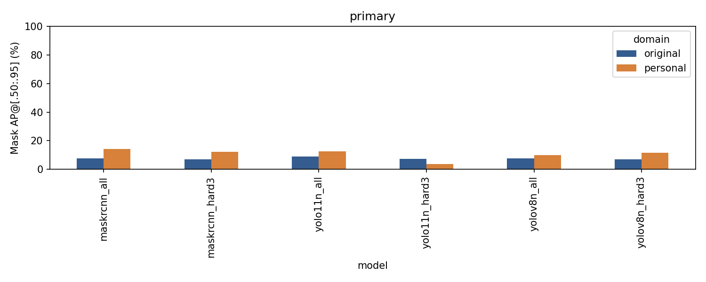

*Grafik hasil primer memakai cakupan masing-masing skenario, yaitu 74 kategori All-Class dan tiga kategori Hard-3. Perbandingan spesialisasi pada tiga kategori yang sama disajikan di Bagian 9.2.*

YOLO11n menempati peringkat pertama pada kedua skenario di original test. Mask R-CNN menempati peringkat pertama pada kedua skenario di personal test. Pada Hard-3 personal, YOLOv8n memperoleh AP75 tertinggi (13,153%) dan pipeline tercepat (349,6 ms/foto). Mask R-CNN memperoleh AR100 tertinggi (53,914%) dengan pipeline 10.399,5 ms/foto. Peringkat mask dan biaya komputasi ini berlaku untuk checkpoint serta pipeline Run02. Durasi pipeline mencakup pekerjaan setelah forward pass dan dipengaruhi jumlah mask, ukuran gambar asli, serta keluarga model. [Analisis peringkat dan biaya](test_evaluation/quantitative_analysis.md#2-performa-arsitektur-dan-biaya-komputasi)

Pada Tesla T4, total pipeline inferensi untuk 12 pasangan adalah 1.507,098 detik dan total COCOeval 74,336 detik. Jumlah durasi pasangan 1.634,512 detik, sedangkan waktu dinding Run02 dari mulai hingga selesai adalah 30 menit 48 detik. Catatan uji GPU, kegagalan Run01, dan diagnostik training Mask R-CNN Hard-3 tersedia terpisah. Durasi GPU verification dan sesi gagal yang tidak tercatat terpisah tidak diestimasi. [Durasi per pasangan](test_evaluation/run02/tables/timings.csv), [stempel waktu](test_evaluation/run02/integration.json), [uji GPU](test_evaluation/run02/gpu_equivalence_report.json), [audit Run01](test_evaluation/run01_audit/README.md), dan [logbook](../logbook.md)

### 9.2 Efek spesialisasi pada tiga kelas yang sama

Saya membandingkan Mask AP50–95 All-Class dan Hard-3 pada 530 GT original dan 33 GT personal. Kolom Δ menyatakan Hard-3 dikurangi All-Class dalam poin persentase (pp). [Agregat bersama](test_evaluation/run02/tables/shared_hard3_comparison.csv) dan [hasil per kelas](test_evaluation/run02/tables/shared_hard3_per_class.csv)

| Test set | Model | AP All-Class (%) | AP Hard-3 (%) | Δ AP (pp) | Δ AR100 (pp) | Δ AP bed (pp) | Δ AP book (pp) | Δ AP cabinet-merged (pp) |
| --- | --- | ---: | ---: | ---: | ---: | ---: | ---: | ---: |
| Original | YOLO11n-seg | 8,808 | 7,194 | −1,614 | +3,016 | −4,935 | −0,860 | +0,953 |
| Original | YOLOv8n-seg | 8,073 | 7,054 | −1,019 | +7,860 | −0,936 | −4,015 | +1,895 |
| Original | Mask R-CNN | 7,570 | 6,870 | −0,700 | +10,768 | +0,428 | +0,860 | −3,388 |
| Personal | YOLO11n-seg | 7,555 | 3,809 | −3,746 | +5,889 | −0,231 | −15,031 | +4,024 |
| Personal | YOLOv8n-seg | 3,254 | 11,724 | +8,470 | +20,202 | +17,979 | −1,595 | +9,025 |
| Personal | Mask R-CNN | 18,049 | 12,283 | −5,766 | +14,848 | +0,713 | −1,559 | −16,453 |

AR100 meningkat pada semua pasangan, sedangkan AP meningkat hanya untuk YOLOv8n di personal test (+8,470 pp), terutama dari `bed` dan `cabinet-merged`. AP `book` turun pada personal test untuk ketiga model. Pada Mask R-CNN, AP lemari turun 16,453 pp walaupun AR100 kelas itu naik 15,000 pp. Dengan memilih tiga kelas paling sulit berdasarkan validation, skor awal yang rendah juga dapat membuat kenaikan validation terlihat lebih besar daripada kenaikan di test. [Analisis spesialisasi](test_evaluation/quantitative_analysis.md#3-spesialisasi-pada-tiga-kelas-target)

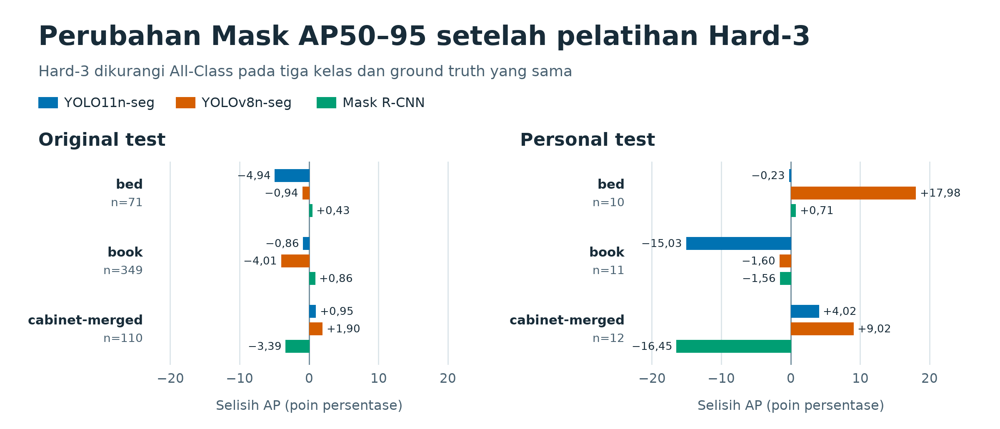

## 10. Analisis Domain Shift

*Domain shift* adalah perubahan distribusi data, misalnya perubahan pencahayaan, sudut pandang, ukuran objek, atau latar. Saya membandingkan checkpoint yang sama pada 37 kategori All-Class dan tiga kategori Hard-3 yang memiliki GT non-crowd di kedua domain. Δ AP adalah AP Personal dikurangi AP Original. Skor primer pada bagian 9.1 tetap berguna untuk membandingkan model dalam domain yang sama. Khusus All-Class, agregat primer memakai 69 kelas terwakili di original dan 38 di personal, sehingga analisis domain memakai cakupan bersama berikut. [Metrik cakupan bersama](test_evaluation/run02/tables/shared_represented_metrics.csv) dan [dukungan GT](test_evaluation/run02/tables/ground_truth_support.csv)

| Skenario | Model | AP Original (%) | AP Personal (%) | Δ AP (pp) |
| --- | --- | ---: | ---: | ---: |
| All-Class · 37 | YOLO11n-seg | 6,936 | 12,970 | +6,033 |
| All-Class · 37 | YOLOv8n-seg | 6,126 | 10,246 | +4,120 |
| All-Class · 37 | Mask R-CNN | 6,666 | 14,658 | +7,992 |
| Hard-3 · 3 | YOLO11n-seg | 7,194 | 3,809 | −3,385 |
| Hard-3 · 3 | YOLOv8n-seg | 7,054 | 11,724 | +4,669 |
| Hard-3 · 3 | Mask R-CNN | 6,870 | 12,283 | +5,413 |

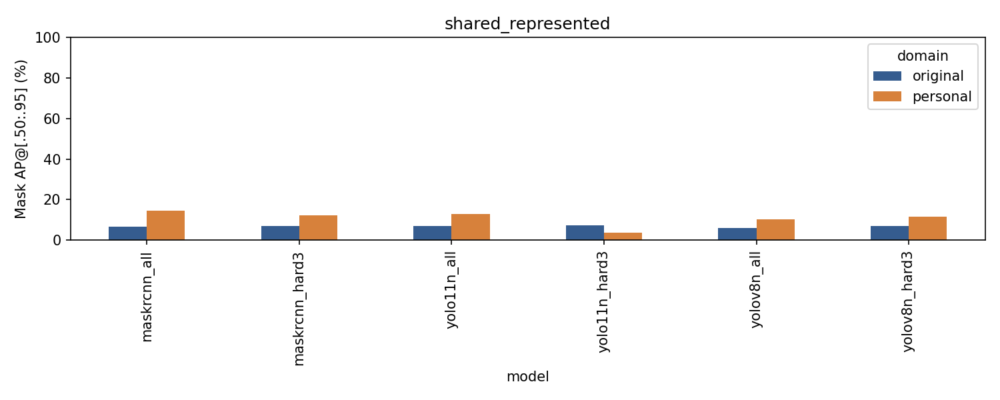

*Grafik domain shift memakai 37 kategori bersama untuk All-Class dan tiga kategori yang sama untuk Hard-3.*

Lima checkpoint mencatat kenaikan AP. YOLO11n Hard-3 turun 3,385 pp, terutama pada `bed` dan `book`. Median dukungan per kategori All-Class bersama turun dari 51 menjadi 3 instance. Kenaikan pada `laptop` dan `trash-bin` menyumbang sekitar 3,7–4,0 pp pada perubahan agregat tiap model, padahal keduanya hanya memiliki empat dan dua contoh di personal. Median luas mask relatif Hard-3 naik dari 0,785% menjadi 32,651% dari area foto. Perbedaan skala dan susunan adegan ini terjadi bersama perbedaan jumlah foto (359 vs 40), proporsi foto positif Hard-3 (137/359 vs 25/40), dan prosedur anotasi. Pengaruh masing-masing faktor belum dapat dipisahkan. [Analisis domain dan dukungan semua kelas bersama](test_evaluation/quantitative_analysis.md#4-perubahan-dari-original-ke-personal-test)

## 11. Analisis Kegagalan dan Eksperimen Pembuktian

### 11.1 Lima kegagalan pada foto personal

Dengan bantuan AI, saya menyaring 40 foto pada enam checkpoint menggunakan pencocokan satu-ke-satu sesuai kelas pada mask IoU 0,50 dan 0,75 serta pemeriksaan overlap tanpa syarat kelas. Lima foto dipilih untuk memperlihatkan jenis kesalahan berbeda dan pembanding yang berhasil. Contoh ini membantu membedakan kegagalan deteksi, konflik label, ranking, dan geometri mask. Pemilihan purposif ini tidak memberikan estimasi frekuensi kegagalan. [Metode dan bukti rinci](test_evaluation/failure_analysis/failure_analysis.md) dan [bukti per instance](test_evaluation/failure_analysis/case_metrics.csv)

#### F01 · P021 · Buku GT #87

Sampul terlihat jelas dan menempati 32,65% kanvas. YOLO11n All-Class mendeteksi buku dengan mask IoU 0,983 dan confidence 0,0582. YOLO11n Hard-3 kehilangan label `book` dan hanya menyimpan `cabinet-merged` dengan IoU 0,450 dan confidence 0,0013. Mask R-CNN Hard-3 masih cocok pada IoU 0,931. Pemilihan kelas dan kandidat pada head YOLO dapat menjelaskan hilangnya label akhir. Prediksi tersimpan belum memperlihatkan apakah confidence awal, persaingan kelas, atau NMS menentukan hasil tersebut.

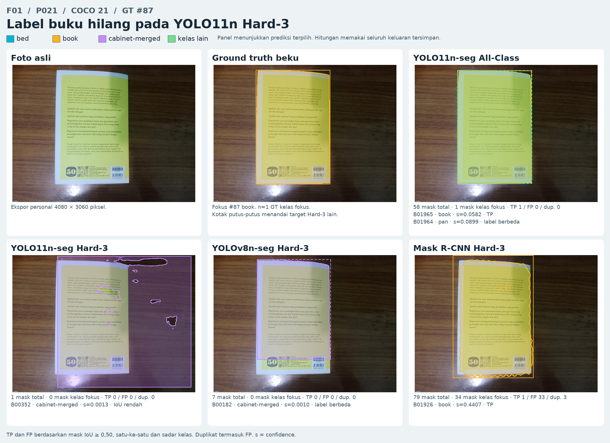

#### F02 · P026 · Buku GT #42

Sampul buku tampak miring dalam cahaya rendah. YOLOv8n All-Class memprediksi `trash-bin` dengan mask IoU 0,978 dan confidence 0,0030. YOLOv8n Hard-3 memprediksi `cabinet-merged` dengan IoU 0,892 dan confidence 0,0225. Keduanya tidak menghasilkan label `book`, sementara Mask R-CNN Hard-3 cocok dengan buku pada IoU 0,916. Prototipe mask YOLO dapat membentuk wilayah yang mengikuti objek meski head memilih label yang berbeda. Cahaya dan perspektif dapat memengaruhi skor kelas, tetapi kontribusinya belum diukur.

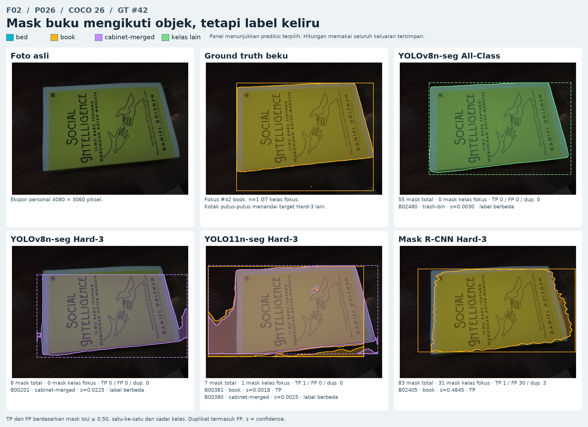

#### F03 · P018 · Lemari GT #124

Sebagian lemari tampak di tepi kanan dan bawah foto. Mask R-CNN Hard-3 menemukan lemari dengan IoU 0,933258 dan confidence 0,013883. Dari 42 prediksi mask kelas lemari pada foto ini, satu TP dan 41 FP. Sebanyak 21 FP mendahului TP menurut confidence, termasuk mask pada wilayah laptop. Skor klasifikasi per RoI menentukan posisi kandidat yang dipertahankan dalam ranking akhir. Keluaran ini menunjukkan konflik ranking dan label tanpa mengisolasi pengaruh RPN, NMS, atau perubahan pelatihan.

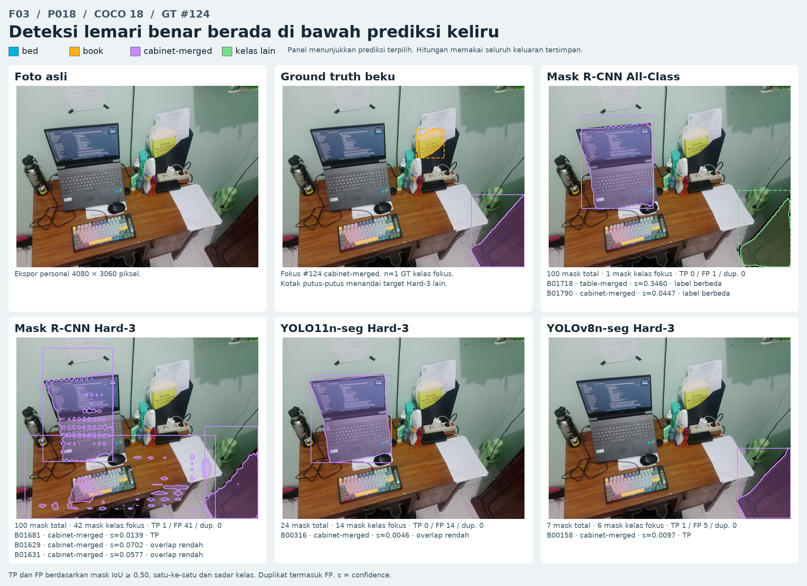

#### F04 · P006 · Kasur GT #23

Bagian kasur yang terlihat menempati 2,03% kanvas dan tertutup kursi serta tas. Kedua YOLO Hard-3 tidak menghasilkan mask `bed`. Mask R-CNN Hard-3 cocok pada IoU 0,5054 dengan confidence 0,00265, serta menyisakan satu duplikat. Resize dapat mengurangi detail bagian kasur yang terlihat, sementara RoIAlign menyediakan fitur terfokus dari crop kandidat. Oklusi, cakupan mask, dan konflik label juga dapat berperan. Kasus ini belum mengisolasi efek skala.

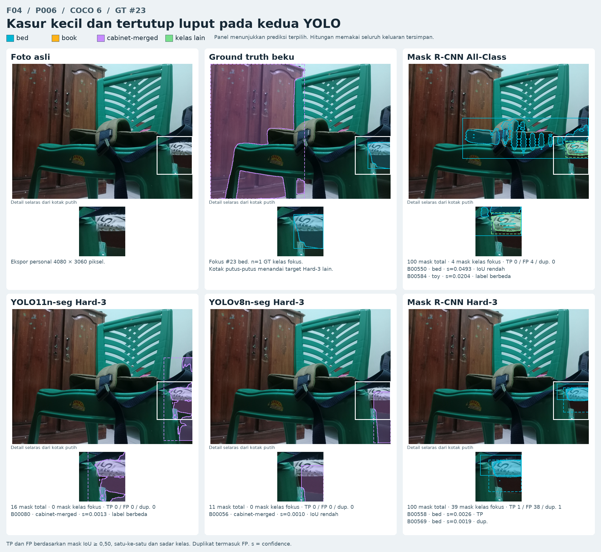

#### F05 · P012 · Kasur GT #77

Kasur besar mencapai tepi gambar dan sebagian permukaannya tertutup bantal serta tas. YOLO11n Hard-3 memperoleh box/mask IoU 0,719/0,340 pada confidence 0,00145. Mask R-CNN Hard-3 memperoleh 0,935/0,465 pada confidence 0,1245. Kotak keduanya cocok pada ambang 0,50, sedangkan mask tidak menutupi cukup bagian GT. Crop mask YOLO dan prediksi mask per RoI beserta resize Mask R-CNN dapat memengaruhi bentuk tersebut. Definisi batas ranjang, oklusi, dan tekstur sprei tetap menjadi penjelasan alternatif.

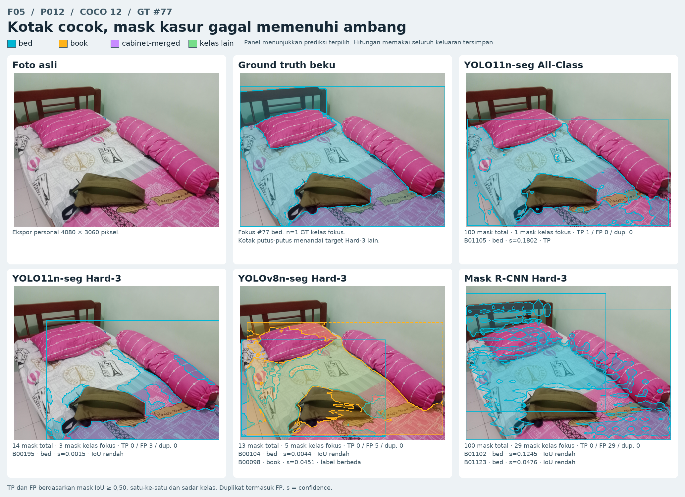

### 11.2 D1 · Kontribusi ranking confidence

Setelah meninjau kasus kegagalan, pada 27 November 2026 WIB saya memilih eksperimen D1 untuk mengukur seberapa besar urutan confidence membatasi AP lemari pada keluaran yang sudah terbentuk. Hipotesis diagnostik ini dirumuskan setelah evaluasi test dan analisis kasus.

> **H-D1.** Ranking confidence yang buruk berkontribusi terhadap rendahnya AP `cabinet-merged` Mask R-CNN Hard-3 meskipun cakupan deteksinya meningkat.

Pada 40 foto personal dengan 12 GT lemari yang sama, saya memakai prediksi Run02 yang telah tersimpan. Pencocokan sesuai kelas pada mask IoU 0,50 mengikuti confidence asli dan menghasilkan pasangan satu-ke-satu. Untuk oracle, seluruh TP dipindahkan ke depan pada ranking global sambil mempertahankan urutan dalam masing-masing kelompok TP dan FP. Identitas, mask, kotak, label, skor, penugasan, dan recall maksimum tetap. AP menggunakan *precision envelope* pada 101 titik recall. [Metode, kode, dan hasil](test_evaluation/diagnostic_experiment/diagnostic_experiment.md)

| Checkpoint | Prediksi | TP / FP / FN | AP50 diagnostik asli (%) | AP50 oracle (%) | Headroom (pp) |
| --- | ---: | ---: | ---: | ---: | ---: |
| Mask R-CNN All-Class | 116 | 10 / 106 / 2 | 37,460 | 83,168 | +45,708 |
| Mask R-CNN Hard-3 | 1.485 | 12 / 1.473 / 0 | 5,604 | 100,000 | +94,396 |

Ranking Hard-3 memiliki headroom 48,688 pp lebih besar. AP50 asli cocok dengan AP50 resmi kelas yang sama. AP50 oracle 100,000% pada Hard-3 terjadi karena 12 GT sudah tercakup, lalu semua TP ditempatkan sebelum 1.473 FP yang tetap ada. Oracle menggunakan GT dan memberi batas atas bersyarat pada keluaran beku. Skor itu tidak dapat dipakai sebagai estimasi performa model saat deployment. Pada IoU 0,95, satu dari 12 GT Hard-3 cocok dan AP oracle hanya 8,911%. Pengurutan ideal tidak memperbaiki geometri mask. Oracle per ambang memakai penugasan yang dibekukan pada ambang tersebut, sehingga rata-rata plafon antarambang belum tentu dapat dicapai oleh satu ranking. Eksperimen ini mengukur efek urutan pada AP diagnostik tanpa mengisolasi RPN, classifier RoI, NMS, atau mask head. [CSV eksperimen D1](test_evaluation/diagnostic_experiment/results.csv)

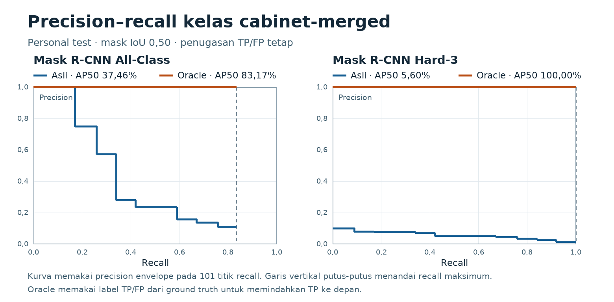

### 11.3 Evaluasi hipotesis

| Hipotesis | Bukti | Kesimpulan |
| --- | --- | --- |
| H1 | AP validation pada tiga kelas naik untuk ketiga model. Pada original test ketiganya turun. Pada personal hanya YOLOv8n yang naik (+8,470 pp). | **Tidak didukung pada kedua test set.** |
| H2 | YOLOv8n berada di posisi kedua pada validation dan kedua test set. YOLO11n memimpin original Hard-3 (7,194%) dan Mask R-CNN memimpin personal (12,283%). | **Tidak didukung.** |
| H3 | Mask R-CNN memimpin AP `book` Hard-3 pada validation (10,707%) dan personal (21,680%). Di original, YOLO11n unggul 0,591 pp atas Mask R-CNN. | **Didukung sebagian.** |
| H-D1 | Foto P018 menunjukkan 21 FP di atas TP. Pada eksperimen terkontrol terhadap keluaran beku, pemindahan TP ke depan menghasilkan headroom AP50 Hard-3 sebesar 94,396 pp. | **Didukung secara diagnostik pada personal test Run02.** |

Dengan bantuan AI, saya menghubungkan kenaikan recall dan penurunan AP pada kelas lemari dengan bukti kesalahan ranking di tingkat instance. Eksperimen D1 kemudian mengubah urutan saja untuk mengukur kontribusinya pada AP dengan penugasan tetap. Kesimpulan hipotesis bersifat deskriptif. [Analisis kuantitatif dan evaluasi hipotesis](test_evaluation/quantitative_analysis.md#5-evaluasi-hipotesis)

## 12. Keterbatasan Penelitian

- Eksperimen memakai satu checkpoint per konfigurasi dan satu seed tanpa interval ketidakpastian. AP kelas dengan sedikit anotasi peka terhadap beberapa prediksi. Personal test hanya mencakup 40 foto.
- Perbandingan spesialisasi dibatasi oleh perubahan precision, learning rate, dan clipping Mask R-CNN, serta proyeksi kategori All-Class sesudah NMS dan batas deteksi. Rekonstruksi evaluator validation dan test untuk Mask R-CNN berbeda dalam penanganan normalisasi backbone.
- Evaluasi kategori bersama menyamakan kelas, tetapi dukungan anotasi, skala objek, komposisi adegan, dan konvensi anotasi antardomain masih berbeda.
- Waktu pelatihan dan inferensi mencakup tahap yang berbeda. Validation loss Mask R-CNN tidak tercatat. Angka durasi merupakan waktu eksekusi, tanpa pengukuran utilisasi GPU.
- Lima foto dipilih berdasarkan jenis kegagalan yang dapat ditelaah. Oracle memakai GT dan penugasan beku, sehingga hasilnya terbatas pada efek ranking terhadap prediksi yang tersedia. Kontribusi setiap tahap internal model belum terisolasi.

## 13. Kesimpulan

Saya menemukan bahwa peringkat segmentasi berubah menurut domain dan cakupan evaluasi. Pada validation, YOLO11n memimpin evaluasi bersama All-Class dengan Mask AP50–95 17,029%, sedangkan YOLOv8n mencatat waktu kumulatif baseline terpendek. Pada test, YOLO11n memimpin kedua skenario di original dan Mask R-CNN memimpin kedua skenario di personal.

Saya memilih tiga kelas Hard-3 dari hasil validation. Pelatihan khusus meningkatkan recall pada seluruh perbandingan test pada kelas yang sama, tetapi peningkatan AP terbatas pada YOLOv8n di personal. Pada perbandingan antardomain yang menyamakan kategori, lima checkpoint memperoleh AP lebih tinggi di personal, sementara YOLO11n Hard-3 turun. Hasil itu perlu dibaca dalam konteks perbedaan skala objek dan dukungan anotasi.

Lima foto memperlihatkan kegagalan deteksi, klasifikasi, ranking, dan geometri mask. Eksperimen D1 menunjukkan bahwa urutan confidence dapat membatasi AP lemari meski semua GT telah terdeteksi pada IoU 0,50. Karena ambang lebih ketat tetap memperlihatkan keterbatasan geometri, kinerja pada data uji bergantung pada bentuk mask dan urutan prediksi. H1 dan H2 tidak didukung pada hasil test, H3 didukung sebagian, dan H-D1 didukung sebagai diagnosis post-hoc pada keluaran Run02.

## 14. Referensi dan Artefak Pendukung

1. Ultralytics. Dokumentasi resmi [YOLO11][1], [YOLOv8][2], [head segmentasi][3], dan [fitness segmentasi][7].
2. He, K., Gkioxari, G., Dollár, P., dan Girshick, R. (2017). [Mask R-CNN][4]. ICCV. Lihat juga [implementasi Torchvision][5].
3. COCO. [Kode evaluator COCOeval][6].
4. Sumber dataset sesuai manifest: `wayanradityaputra/panoptic-indoor-segmentation-v5-coco-format` pada Kaggle. [Manifest sumber dan konversi](dataset_audit/conversion_manifest.json).

| Model | Konfigurasi | Log dan ringkasan | Notebook |
| --- | --- | --- | --- |
| YOLO11n-seg | [YAML](../experiments/yolo11n_all_classes/args.yaml) | [CSV](../experiments/yolo11n_all_classes/metrics/results.csv), [ringkasan](../experiments/yolo11n_all_classes/metrics/summary.json) | [Kaggle](../notebooks/cpmk3-yolo11n-seg-all-class-baseline.ipynb) |
| YOLOv8n-seg | [YAML](../experiments/yolov8n_all_classes/args.yaml) | [CSV](../experiments/yolov8n_all_classes/metrics/results.csv), [ringkasan](../experiments/yolov8n_all_classes/metrics/summary.json) | [Kaggle](../notebooks/cpmk3-yolov8n-seg-all-class-baseline.ipynb) |
| Mask R-CNN | [JSON](../experiments/maskrcnn_all_classes/config.json) | [CSV](../experiments/maskrcnn_all_classes/metrics/results.csv), [ringkasan](../experiments/maskrcnn_all_classes/metrics/summary.json) | [Kaggle](../notebooks/cpmk3-mask-r-cnn-all-class-baseline.ipynb) |

| Tahap | Artefak untuk penelusuran dan reproduksi |
| --- | --- |
| Hard-3 | [Notebook awal](../notebooks/CPMK3_Hard3_All_Models.ipynb), [rekonstruksi run akhir](../notebooks/CPMK3_Hard3_Final_Reconstructed.ipynb), dan log asli [YOLO11n](../experiments/yolo11n_hard3/metrics/training_log.txt), [YOLOv8n](../experiments/yolov8n_hard3/metrics/training_log.txt), serta [Mask R-CNN](../experiments/maskrcnn_hard3/metrics/training_log.txt). |
| Personal test | [Provenance dan pembekuan](personal_test_qa/finalization/ground_truth_freeze.json), [anotasi All-Class](../data/custom_test/annotations/all_class_master_corrected.coco.json), dan [anotasi Hard-3](../data/custom_test/annotations/hard3_corrected.coco.json). |
| Run02 | [Notebook yang dijalankan](../notebooks/CPMK3_Unified_Test_Evaluation_Recovery.ipynb), [status pasangan evaluasi](test_evaluation/run02/evaluation_status_manifest.json), dan [panduan input dan reproduksi](test_evaluation/README.md). |
| Kasus dan D1 | [Bukti per instance](test_evaluation/failure_analysis/case_metrics.csv), [hasil D1](test_evaluation/diagnostic_experiment/results.csv), dan [skrip D1](test_evaluation/diagnostic_experiment/run_oracle.py). |
| Kronologi dan transparansi | [Logbook](../logbook.md) dan [deklarasi penggunaan AI](../ai_usage.md). |

Grafik baseline dapat dibuat ulang dari root repo dengan `python analysis/plot_baselines.py`. Reproduksi analisis prediksi memerlukan arsip Run02 yang disimpan lokal. Notebook dan manifest mencatat aset Kaggle yang digunakan untuk mendapatkan input evaluasi dan menghasilkan arsip baru. [Skrip grafik](plot_baselines.py) dan [petunjuk Run02](test_evaluation/README.md#reproduksi-di-kaggle)

[1]: https://docs.ultralytics.com/models/yolo11/
[2]: https://docs.ultralytics.com/models/yolov8/
[3]: https://docs.ultralytics.com/reference/nn/modules/head/#ultralytics.nn.modules.head.Segment
[4]: https://arxiv.org/abs/1703.06870
[5]: https://github.com/pytorch/vision/blob/main/torchvision/models/detection/mask_rcnn.py
[6]: https://github.com/cocodataset/cocoapi/blob/master/PythonAPI/pycocotools/cocoeval.py
[7]: https://docs.ultralytics.com/reference/utils/metrics/#ultralytics.utils.metrics.SegmentMetrics.fitness
