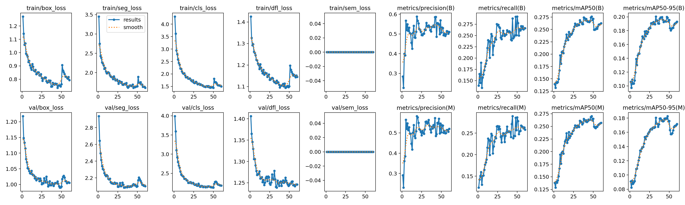
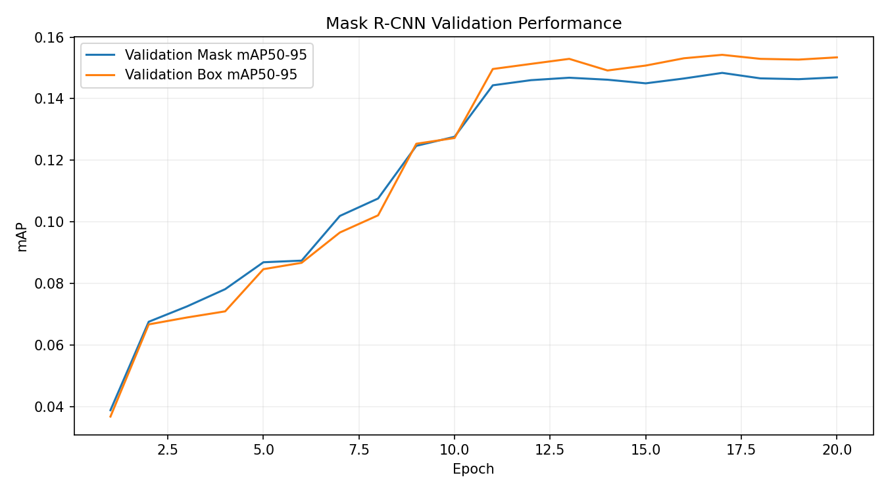

# Analisis Komparatif Model Instance Segmentation pada Lingkungan Indoor Nyata

## 1. Pendahuluan

Bayangkan satu foto ruangan berisi dua kursi yang saling menutupi. Model perlu mengenali keduanya sebagai kursi dan menandai piksel milik masing-masing kursi secara terpisah. Wilayah piksel itu disebut *mask*, dan tugas untuk menghasilkan satu mask per objek disebut *instance segmentation*. Di dalam ruangan, ukuran objek yang beragam, bagian yang tertutup, dan batas objek yang samar membuat tugas ini lebih sulit.

Penelitian ini membandingkan YOLO11n-seg, YOLOv8n-seg, dan Mask R-CNN pada Panoptic Indoor Segmentation v5. Ketiganya sudah dilatih dengan konfigurasi awal sebagai acuan (*baseline*) untuk semua kelas. Hasil yang dibahas berasal dari data validasi, yaitu gambar yang dipakai untuk memantau kinerja selama pengembangan. Data uji disisihkan untuk penilaian akhir.

## 2. Tujuan dan Pertanyaan Penelitian

1. Seberapa baik YOLO11n-seg, YOLOv8n-seg, dan Mask R-CNN mengenali objek serta membentuk mask pada data validasi?
2. Bagaimana perkembangan loss, performa validasi, dan waktu komputasi pada konfigurasi baseline masing-masing?
3. Kelas mana yang konsisten sulit bagi ketiga model ketika diukur dengan evaluator yang sama dan memiliki cukup contoh untuk dianalisis?
4. Bagaimana pelatihan khusus tiga kelas tersulit memengaruhi hasil pada kelas tersebut, dan bagaimana hasilnya berubah pada set uji asli serta foto pribadi?

Hasil baseline menjawab dua pertanyaan pertama. Dua pertanyaan berikutnya menuntun tahap selanjutnya: mengidentifikasi kelas yang sulit bagi semua model, lalu menguji apakah pelatihan khusus membantu.

## 3. Dataset dan Persiapan Data

Ketiga model memakai versi Kaggle yang sama dari Panoptic Indoor Segmentation v5 (ID versi `22504534`). Ekspor COCO menyimpan ukuran gambar, kategori, dan poligon yang mengikuti batas tiap objek. Anotasi ini menjadi sumber untuk dua format pelatihan. YOLO menggunakan titik poligon yang dinyatakan relatif terhadap ukuran gambar, sedangkan Mask R-CNN menggunakan anotasi COCO yang geometrinya sudah dikoreksi.

Kategori induk `indoor-objects` (ID 0) tidak memiliki anotasi objek, sehingga tersisa 74 kelas. ID pada label YOLO mengikuti `yolo_id = coco_category_id - 1`. Mask R-CNN memakai indeks 0 untuk latar belakang (*background*). [Manifest konversi](dataset_audit/conversion_manifest.json), [pemetaan YOLO](../data/processed/all_classes/data.yaml), dan [manifest koreksi COCO](../experiments/maskrcnn_all_classes/corrected_annotations/repair_manifest.json).

Tabel berikut menunjukkan jumlah gambar dan jumlah objek beranotasi (*instance*) pada setiap bagian data. Satu gambar dapat memuat beberapa objek.

| Split | Gambar | Instance | Kelas dengan contoh | Kelas tanpa contoh | Median instance per kelas |
| --- | ---: | ---: | ---: | ---: | ---: |
| Train | 397 | 4.479 | 65 | 9 | 17,5 |
| Validation | 166 | 2.022 | 58 | 16 | 6 |
| Original test | 359 | 5.344 | 69 | 5 | 32 |
| Total | 922 | 11.845 | — | — | — |

Median dihitung atas 74 kelas, termasuk kelas tanpa contoh. Jumlah contoh tidak merata. Sebagai gambaran, `wall-other-merged` sendiri menyumbang 756 dari 4.479 instance train (16,88%) dan 315 dari 2.022 instance validation (15,58%). Pada train, `table-merged` memiliki 319 instance dan `floor-other-merged` 261. Pada validation, `table-merged` memiliki 134 instance dan `food-other-merged` 108. Kelas tanpa contoh train tidak memberi model kesempatan untuk mempelajari objek itu dari data proyek. Kelas tanpa contoh validation belum dapat dinilai pada tahap ini. [Jumlah instance per kelas](dataset_audit/qa_report.json).

- **Tanpa contoh train (9)** — `flower`, `hair drier`, `keyboard`, `mouse`, `scissor`, `scissors`, `teddy bear`, `toaster`, `toothbrush`.
- **Tanpa contoh validation (16)** — `cardboard`, `clock`, `curtain`, `flower`, `hair drier`, `keyboard`, `mouse`, `scissor`, `scissors`, `st-`, `teddy bear`, `toothbrush`, `tree-merged`, `vase`, `wall`, `wall-stone`.

Dalam audit awal, sebagian titik batas objek pada label YOLO ditemukan berada di luar gambar. Logbook mencatat 3.527 dari 11.845 anotasi (29,8%). Keluaran audit awal tidak tersimpan, sehingga angka tersebut berasal dari catatan eksperimen. Pemeriksaan pada ekspor COCO tidak menemukan masalah serupa pada data yang diperiksa. Anotasi COCO kemudian digunakan untuk membangun ulang label. Ukuran gambar dan koordinat pikselnya memungkinkan setiap transformasi ditelusuri. [Logbook](../logbook.md).

Empat gambar memiliki dimensi aktual 480 × 640 piksel, sementara metadata COCO mencatat 640 × 480. Perbedaan orientasi ini dapat membuat poligon tidak lagi mengikuti objek. Geometri anotasi dikoreksi dengan rotasi berlawanan arah jarum jam (CCW) untuk `182169107`, `182169121`, dan `182169108`, serta searah jarum jam (CW) untuk `182169109`.

Setelah konversi tanpa memotong koordinat di batas gambar (*clipping*), pemeriksaan 11.845 anotasi tidak menemukan poligon di luar batas atau ID kelas yang tidak valid. Pemeriksaan visual melengkapi pemeriksaan angka dengan melihat apakah mask mengikuti objek, karena mask yang bergeser masih bisa berada sepenuhnya di dalam gambar. [Laporan pemeriksaan](dataset_audit/qa_report.json), [contoh mask](dataset_audit/rebuilt_yolo_mask_inspection.png), dan [pemeriksaan orientasi](../evidence/orientation_fixes_verification.png).

## 4. Arsitektur Model

**YOLO11n-seg dan YOLOv8n-seg** memakai pendekatan satu tahap (*one-stage*). Keduanya langsung memprediksi kelas dan kotak pembatas (*bounding box*) dari fitur gambar. Untuk membentuk mask, model lebih dulu menghasilkan beberapa pola dasar (*prototype masks*) yang dipakai bersama dalam satu gambar. Setiap deteksi membawa koefisien yang menentukan cara menggabungkan pola itu menjadi mask untuk objek tersebut. [YOLO11][1], [YOLOv8][2], dan [head segmentasi Ultralytics][3].

**Mask R-CNN ResNet-50 FPN** memakai pendekatan dua tahap (*two-stage*). ResNet-50 mengekstrak fitur, lalu Feature Pyramid Network (FPN) menyediakannya pada beberapa skala agar objek kecil dan besar dapat ditangani. Pada tahap pertama, Region Proposal Network mengusulkan wilayah yang mungkin berisi objek. Pada tahap kedua, RoIAlign mengambil fitur yang selaras dengan wilayah tersebut. Cabang prediksi kemudian menentukan kelas, memperbaiki kotak pembatas, dan membentuk mask. Pemrosesan per wilayah menambah pekerjaan komputasi dibandingkan prediksi langsung pada YOLO. Besarnya perbedaan waktu pada baseline ini juga dipengaruhi konfigurasi pelatihan. [He dkk.][4] dan [Torchvision][5].

## 5. Metodologi Eksperimen

Ketiga baseline belajar dari 397 gambar train. Sebanyak 166 gambar validation dipakai untuk memantau kinerja dan menilai checkpoint, yaitu salinan bobot model yang disimpan selama pelatihan. Sebanyak 359 gambar original test disisihkan untuk evaluasi akhir.

Ukuran utama laporan ini adalah **mask mAP50–95**. Cara membacanya dimulai dari IoU, yaitu luas piksel yang sama antara mask prediksi dan anotasi dibagi luas gabungan keduanya. AP (*average precision*) merangkum hubungan antara precision, yaitu ketepatan prediksi, dan recall, yaitu seberapa banyak objek beranotasi berhasil ditemukan. mAP merata-ratakan AP antarkelas yang dapat dinilai. mAP50 memakai ambang IoU 0,50. mAP50–95 memakai ambang 0,50 sampai 0,95 dengan langkah 0,05, sehingga juga memperhitungkan batas kecocokan yang lebih ketat. Skor *box* menilai kotak, sementara skor *mask* menilai wilayah piksel. [COCOeval][6].

Satu epoch berarti satu putaran pelatihan melalui dataset. Tabel berikut menunjukkan pengaturan yang dipakai pada masing-masing baseline.

| Pengaturan | YOLO11n-seg | YOLOv8n-seg | Mask R-CNN ResNet-50 FPN |
| --- | --- | --- | --- |
| Bobot pralatih | `yolo11n-seg.pt` | `yolov8n-seg.pt` | `MaskRCNN_ResNet50_FPN_Weights.DEFAULT` (COCO) |
| Kelas | 74 | 74 | 74 objek + 1 background |
| Epoch aktual | 60 | 60 | 20 |
| Batch size | 8 | 8 | 2 |
| Input / resize | `imgsz=640` | `imgsz=640` | Sisi pendek 640, sisi panjang dibatasi 960 |
| Optimizer aktual | AdamW (`optimizer=auto`) | AdamW (`optimizer=auto`) | SGD, momentum 0,9, weight decay 0,0005 |
| Learning rate | 0,000128 menurut log | 0,000128 menurut log | 0,005 awal |
| Scheduler | Warm-up 3 epoch, lalu penurunan linear (`cos_lr=false`, `lrf=0.01`) | Sama dengan YOLO11n | MultiStepLR pada milestone 10 dan 15, `gamma=0.1` |
| Random seed | 42 | 42 | 42 |
| GPU | 1 × Tesla T4, `CUDA:0` | 1 × Tesla T4, `CUDA:0` | 1 × Tesla T4, `cuda:0` |
| Pemilihan checkpoint | Fitness validasi Ultralytics | Fitness validasi Ultralytics | Mask mAP50–95 validasi |
| Evaluator | Ultralytics 8.4.216 | Ultralytics 8.4.216 | `pycocotools.COCOeval` (`bbox` dan `segm`) |

Pada kedua YOLO, YAML memuat `lr0=0.01`, sementara log mencatat bahwa `optimizer=auto` memilih AdamW dengan learning rate 0,000128. Tabel mencatat nilai yang dipakai saat pelatihan. Learning rate mengatur besar langkah pembaruan bobot, dan scheduler mengatur kapan langkah itu diperkecil.

Epoch dengan mask mAP tertinggi di CSV dan epoch checkpoint pilihan framework perlu dibaca terpisah. Ultralytics memakai *fitness* yang menggabungkan skor box dan mask. Metadata `best.pt` dan `last.pt` menyimpan `epoch: -1` dan `best_fitness: null`, sehingga epoch pemilihan `best.pt` tidak dapat ditentukan dari metadata itu. Mask R-CNN memilih checkpoint berdasarkan mask mAP50–95. Metadata menyimpan epoch 17 pada `best.pth` dan epoch 20 pada `last.pth`. [Fitness Ultralytics][7] dan [artefak eksperimen](#14-referensi-dan-artefak-pendukung).

## 6. Hasil dan Analisis All-Class Baseline

Bagian ini membaca kurva tiap model dari dua sisi. *Loss* adalah ukuran kesalahan yang dihitung selama pelatihan atau validasi. *Mask mAP* menunjukkan seberapa baik prediksi bertahan ketika dinilai terhadap anotasi validasi. Loss yang terus turun membantu menjelaskan proses belajar, tetapi kenaikan mask mAP memberi bukti yang lebih langsung tentang kualitas prediksi pada gambar validasi. Nilai loss dibandingkan dalam model yang sama karena tiap arsitektur memakai komponen dan skala yang berbeda.

### 6.1 YOLO11n-seg

**Sebagian besar perbaikan terjadi di awal.** Segmentation loss train turun dari 3,63951 ke 2,00172 pada epoch 10, lalu ke 1,45730 pada epoch 60. Loss box turun dari 1,29718 ke 0,74865, loss klasifikasi dari 4,58766 ke 1,36924, dan DFL, salah satu komponen untuk kotak pembatas, dari 1,44838 ke 1,10686. Kolom semantic loss tetap nol. Penurunan loss mask diselingi kenaikan singkat pada epoch 20 (1,78126 ke 1,86852) dan 51 (1,57386 ke 1,65706).

**Mask validasi membaik dan mendekati puncaknya di akhir.** Segmentation loss validasi mulai dari 2,85386, mencapai minimum 2,07355 pada epoch 33, lalu berakhir di 2,12510. Selisih loss validasi dikurangi train berubah dari −0,78565 pada epoch 1 menjadi +0,44274 pada epoch 33 dan +0,66780 pada epoch 60. Pada saat yang sama, mask mAP50–95 naik dari 7,744% ke 18,474% pada epoch 45. Nilai akhirnya 18,160%, atau 0,314 poin persentase di bawah puncak. Pada epoch terakhir, mask mAP50 mencapai 27,285%, box mAP50–95 20,969%, mask precision 49,661%, dan mask recall 26,512%.

**Interpretasi.** Model belajar paling cepat pada fase awal. Rata-rata mask mAP50–95 melandai dari 17,845% pada epoch 31–40 ke 18,173% pada epoch 41–50, lalu turun ke 17,569% pada epoch 51–60. Setelah epoch 33, loss train masih membaik sementara loss validasi relatif datar. Selisih tersebut bisa dipengaruhi perbedaan augmentasi dan mode antara pelatihan dan validasi. Karena mask mAP akhir kembali mendekati puncak, kurva ini menunjukkan manfaat tambahan yang mengecil dan belum cukup untuk menyimpulkan overfitting atau underfitting. [CSV YOLO11n](../experiments/yolo11n_all_classes/metrics/results.csv).

### 6.2 YOLOv8n-seg

**Loss mask turun tajam, lalu sempat naik pada epoch 51.** Segmentation loss train turun dari 3,45219 ke 2,02850 pada epoch 10. Nilainya mencapai minimum 1,60796 pada epoch 45 dan berakhir di 1,60909. Loss box turun dari 1,27134 ke 0,79259, loss klasifikasi dari 4,30550 ke 1,50296, dan DFL dari 1,42575 ke 1,14465. Semantic loss tetap nol. Kenaikan terbesar pada loss mask terjadi dari 1,64764 ke 1,89215 pada epoch 51, lalu nilainya turun ke 1,74153 pada epoch 52.

**Skor akhir berada di bawah puncak validasi.** Segmentation loss validasi mulai dari 2,93706, mencapai 2,08435 pada epoch 33, lalu berakhir di 2,09987. Selisih loss validasi dikurangi train berubah dari −0,51513 pada epoch 1 menjadi +0,37785 pada epoch 33 dan +0,49078 pada epoch 60. Mask mAP50–95 naik dari 9,086% ke 18,264% pada epoch 48, kemudian berakhir di 17,153%, atau 1,111 poin persentase di bawah puncak. Pada epoch terakhir, mask mAP50 mencapai 25,701%, box mAP50–95 19,291%, mask precision 51,967%, dan mask recall 25,792%.

**Interpretasi.** Rata-rata mask mAP50–95 berubah dari 17,324% pada epoch 31–40 ke 17,794% pada epoch 41–50, lalu turun ke 16,464% pada epoch 51–60. Penurunan terakhir lebih jelas daripada pada YOLO11n. Kedua log YOLO mencatat pergeseran loss di sekitar epoch 51, bertepatan dengan fase akhir saat augmentasi mosaic, yang menggabungkan beberapa gambar, dihentikan sesuai `close_mosaic=10`. Perubahan augmentasi merupakan salah satu kemungkinan penyebab. Learning rate juga sedang menurun, sehingga peran tiap faktor perlu diuji secara terpisah. Skor sempat pulih dan loss validasi akhir dekat dengan nilai minimumnya. Bukti yang tersedia menunjukkan fluktuasi pada fase akhir dan belum cukup untuk menyimpulkan overfitting, underfitting, atau ketidakstabilan sepanjang pelatihan. [CSV YOLOv8n](../experiments/yolov8n_all_classes/metrics/results.csv).

### 6.3 Mask R-CNN

**Loss total terus turun, dengan laju yang melambat.** Total loss turun dari 2,30709 ke 0,67741 pada epoch 10, lalu ke 0,41075 pada epoch 20. Loss klasifikasi turun dari 0,93501 ke 0,11336, box regression dari 0,60173 ke 0,13237, dan mask dari 0,54816 ke 0,13787. Dua komponen yang berkaitan dengan proposal region juga turun. Objectness bergerak dari 0,13157 ke 0,00407, dan RPN box regression dari 0,09062 ke 0,02307. Mask loss sempat mencapai minimum 0,13706 pada epoch 18. Learning rate turun ke 0,0005 pada epoch 11 dan ke 0,00005 pada epoch 16.

**Skor validasi relatif datar setelah epoch 10.** Mask mAP50–95 naik dari 3,887% pada epoch 1 ke 12,764% pada epoch 10. Pada epoch 11–20, skor berada di rentang 14,435–14,838%. Puncaknya 14,838% pada epoch 17, lalu berakhir di 14,693%, selisih 0,145 poin persentase. Nilai akhir mask mAP50 mencapai 22,260% dan box mAP50–95 15,342%. Baseline ini tidak mencatat validation loss atau mask precision dan recall agregat.

**Interpretasi.** Model memperbaiki prediksi dengan cepat pada fase awal. Setelah penurunan learning rate pertama, gain mAP menjadi kecil meskipun loss pelatihan terus turun. Kedua perubahan itu berdekatan waktunya. Peran scheduler sebagai penyebab perlu diuji dengan percobaan pembanding. Dengan 20 epoch dan tanpa validation loss, diagnosis overfitting, underfitting, serta konvergensi akhir masih terbuka. [CSV Mask R-CNN](../experiments/maskrcnn_all_classes/metrics/results.csv).

### 6.4 Perbandingan Performa

Tabel ini membantu menjawab model mana yang paling baik membentuk mask pada data validasi. Untuk setiap model, semua nilai diambil dari epoch dengan mask mAP50–95 tertinggi. Precision dan recall YOLO mengikuti ambang prediksi yang dipakai Ultralytics saat melaporkan keduanya. N/A menandakan metrik tidak tercatat.

| Model | Mask mAP50–95 | Mask mAP50 | Box mAP50–95 | Mask precision | Mask recall | Epoch puncak / aktual |
| --- | ---: | ---: | ---: | ---: | ---: | ---: |
| YOLO11n-seg | 18,474% | 27,586% | 20,845% | 50,430% | 26,337% | 45 / 60 |
| YOLOv8n-seg | 18,264% | 27,023% | 19,857% | 49,762% | 28,596% | 48 / 60 |
| Mask R-CNN | 14,838% | 22,246% | 15,425% | N/A | N/A | 17 / 20 |

YOLO11n unggul 0,210 poin persentase atas YOLOv8n pada mask mAP50–95. YOLOv8n memiliki recall lebih tinggi pada epoch puncaknya sendiri, artinya lebih banyak objek beranotasi ditemukan pada titik pelaporan tersebut. Selisih kedua YOLO terhadap Mask R-CNN masing-masing 3,636 dan 3,426 poin persentase. Peringkat ini menggambarkan run yang tersedia. Satu run per model membuat selisih 0,210 poin terlalu kecil untuk menyimpulkan keunggulan yang konsisten. Perbedaan evaluator juga perlu dipertimbangkan saat membaca selisih terhadap Mask R-CNN. [Ringkasan ketiga eksperimen](#14-referensi-dan-artefak-pendukung).

### 6.5 Perbandingan Efisiensi Komputasi

Waktu kumulatif adalah waktu yang tercatat sampai epoch terakhir pada kolom `time`. Angka per epoch membagi total itu dengan jumlah epoch aktual. Kolom eksekusi notebook memakai metadata Papermill dan mencakup proses di luar loop pelatihan.

| Model | GPU | Waktu kumulatif CSV (detik) | Waktu kumulatif per epoch (detik) | Train saja / validation saja (detik) | Eksekusi notebook (detik) |
| --- | --- | ---: | ---: | ---: | ---: |
| YOLO11n-seg | Tesla T4 | 599,949 | 9,999 | N/A / N/A | 912,606 |
| YOLOv8n-seg | Tesla T4 | 571,242 | 9,521 | N/A / N/A | 723,431 |
| Mask R-CNN | Tesla T4 | 2.238,738 | 111,937 | 1.397,645 / 828,470 | 2.342,766 |

Mask R-CNN mencatat waktu train dan validation secara terpisah. Jumlah keduanya tidak mencakup seluruh pekerjaan di dalam loop, sehingga waktu kumulatifnya sedikit lebih panjang. Log YOLO tidak memisahkan kedua tahap itu.

Untuk YOLO11n, layar Kaggle menampilkan 15 menit 26 detik dan Papermill mencatat 15 menit 12,6 detik. Selisihnya sekitar 13,4 detik. Kedua angka merujuk ke sumber pencatatan yang berbeda. Layar Kaggle juga menunjukkan alokasi `GPU T4 x2`, sementara log mengidentifikasi perangkat pelatihan yang digunakan sebagai `CUDA:0`. [Bukti Kaggle YOLO11n](../evidence/gpu_usage/YOLO11n-seg_all_class.png).

YOLOv8n memakai waktu sekitar 28,7 detik lebih sedikit daripada YOLO11n dengan selisih puncak mask mAP 0,210 poin persentase. Mask R-CNN memerlukan sekitar 37 menit 19 detik untuk 20 epoch. Kedua YOLO memerlukan sekitar 10 menit untuk 60 epoch. Selisih ini mencerminkan biaya keseluruhan pada konfigurasi yang dijalankan, termasuk batch size, ukuran gambar, dan evaluasi. Latensi saat model memproses gambar baru dan kebutuhan memorinya belum diukur.

### 6.6 Keterbatasan Perbandingan Awal

Ketiga baseline melihat pembagian gambar yang sama. Namun, tiap keluarga model dilatih dengan pengaturan yang berbeda, dan evaluator dapat menggunakan aturan yang berbeda untuk mempertahankan deteksi dan mencocokkannya dengan anotasi. Karena itu, selisih skor mencerminkan gabungan arsitektur, konfigurasi, dan cara evaluasi. Run tambahan dengan beberapa seed dan evaluator bersama diperlukan untuk menilai apakah peringkatnya tetap sama.

## 7. Pemilihan Tiga Kelas Tersulit

**Kandidat sementara**. Setelah baseline, ketiga checkpoint dinilai bersama dengan COCOeval pada 166 gambar validation. Dari 39 kelas yang memenuhi batas jumlah contoh dan memiliki AP untuk ketiga model, `cabinet-merged`, `book`, dan `bed` memiliki mean mask AP50–95 terendah. Ketiganya masih perlu ditinjau pada contoh validation sebelum keputusan akhir. Original test dan personal test tetap disisihkan dari seleksi. Untuk perbandingan antarmodel dengan evaluator yang sama dan ranking lengkap, lihat [analisis evaluasi bersama](all_class_comparison/analysis.md).

## 8. Eksperimen All-Class vs Hard-3

**Menunggu eksperimen lanjutan**. Bagian ini akan menguji apakah pelatihan yang difokuskan pada tiga kelas membuat model lebih baik mengenali ketiganya. Bandingkan versi all-class dan versi Hard-3 pada gambar, kategori, serta aturan evaluasi yang sama. Laporkan AP per kelas dan rata-rata ketiganya. Jelaskan juga bagaimana anotasi kategori lain diperlakukan, karena keputusan itu berpengaruh pada pelatihan dan penilaian.

## 9. Evaluasi Original Test Set dan Personal Test Set

**Belum dievaluasi**. Original test set berisi 359 gambar yang disisihkan untuk menilai kemampuan model pada contoh baru. Jalankan evaluasi setelah pemilihan kelas, checkpoint, dan pengaturan evaluasi dikunci. Untuk personal test set, persiapkan anotasi dan pemetaan kategori yang konsisten, lalu catat kondisi pengambilan fotonya.

## 10. Analisis Domain Shift

**Belum dievaluasi**. *Domain shift* adalah perbedaan karakteristik antara data yang biasa dilihat model dan data dari lingkungan baru, misalnya perubahan pencahayaan, sudut pandang, ukuran objek, atau latar. Untuk menilainya, bandingkan skor per kelas antara original test dan personal test dengan aturan evaluasi yang sama. Periksa jumlah contoh dan komposisi kelas pada kedua set agar perubahan skor tidak langsung dikaitkan dengan kondisi foto.

## 11. Analisis Kegagalan dan Eksperimen Pembuktian

**Menunggu eksperimen lanjutan**. Bandingkan prediksi dengan anotasi untuk mengetahui seperti apa kesalahannya, misalnya objek terlewat, salah kelas, prediksi ganda, atau mask yang tidak mengikuti bentuk objek.

Dua dugaan dapat diperiksa lebih lanjut. Pertama, uji apakah jadwal penghentian mosaic berkontribusi pada fluktuasi akhir YOLO dengan mengubah jadwal tersebut sambil menjaga pengaturan lain tetap sama. Kedua, periksa hubungan jumlah contoh dengan AP dengan mengelompokkan kelas berdasarkan jumlah instance. Lengkapi analisis kelas yang lolos ambang minimum dengan contoh prediksi agar pola statistik bisa ditafsirkan bersama karakteristik objek.

## 12. Keterbatasan Penelitian

- Dataset relatif kecil untuk 74 kelas. Distribusinya timpang dan sebagian kelas absen dari train atau validation. Peringkat AP kelas dengan sedikit contoh sensitif terhadap beberapa prediksi.
- Baseline memakai konfigurasi dan evaluator yang berbeda dengan satu seed (42). Ketidakpastian antar-run belum terukur.
- Validation loss Mask R-CNN tidak tercatat. Sumber waktu tiap eksperimen juga tidak memisahkan tahapan dengan cara yang seragam.
- Hasil original test dan personal test belum tersedia. Tiga kelas tersulit lintas model belum ditetapkan.
- Hipotesis awal perbandingan tiga model belum dicatat sebelum pelatihan pertama. Pertanyaan penelitian pada laporan ini merangkum arah analisis saat ini. [Catatan retrospektif](../logbook.md).

## 13. Kesimpulan

**Kesimpulan sementara**. Ketiga model meningkatkan mask mAP50–95 paling cepat pada fase awal, lalu perbaikannya melambat. Di data validasi, YOLO11n memperoleh skor tertinggi (18,474%), dekat dengan YOLOv8n (18,264%). YOLOv8n mencatat waktu pelatihan kumulatif paling singkat. Mask R-CNN mencapai 14,838% dengan konfigurasi dan evaluator yang berbeda.

Hasil ini menjadi acuan untuk tahap berikutnya. Evaluasi per kelas dengan COCOeval bersama sudah menghasilkan tiga kandidat Hard-3. Tinjauan prediksi validation dan konfirmasi pilihan masih diperlukan sebelum eksperimen khusus tiga kelas. Performa akhir baru dapat dinilai setelah evaluasi pada data uji.

## 14. Referensi dan Artefak Pendukung

1. Ultralytics. Dokumentasi resmi [YOLO11][1], [YOLOv8][2], [head segmentasi][3], dan [fitness segmentasi][7].
2. He, K., Gkioxari, G., Dollár, P., dan Girshick, R. (2017). [Mask R-CNN][4]. ICCV. Lihat juga [implementasi Torchvision][5].
3. COCO. [Kode evaluator COCOeval][6].
4. Sumber dataset sesuai manifest: `wayanradityaputra/panoptic-indoor-segmentation-v5-coco-format` pada Kaggle. [Manifest sumber dan konversi](dataset_audit/conversion_manifest.json).

| Model | Konfigurasi | Log dan ringkasan | Notebook |
| --- | --- | --- | --- |
| YOLO11n-seg | [YAML](../experiments/yolo11n_all_classes/args.yaml) | [CSV](../experiments/yolo11n_all_classes/metrics/results.csv), [ringkasan](../experiments/yolo11n_all_classes/metrics/summary.json) | [Kaggle](../notebooks/cpmk3-yolo11n-seg-all-class-baseline.ipynb) |
| YOLOv8n-seg | [YAML](../experiments/yolov8n_all_classes/args.yaml) | [CSV](../experiments/yolov8n_all_classes/metrics/results.csv), [ringkasan](../experiments/yolov8n_all_classes/metrics/summary.json) | [Kaggle](../notebooks/cpmk3-yolov8n-seg-all-class-baseline.ipynb) |
| Mask R-CNN | [JSON](../experiments/maskrcnn_all_classes/config.json) | [CSV](../experiments/maskrcnn_all_classes/metrics/results.csv), [ringkasan](../experiments/maskrcnn_all_classes/metrics/summary.json) | [Kaggle](../notebooks/cpmk3-mask-r-cnn-all-class-baseline.ipynb) |

Grafik turunan dapat dibuat ulang dengan `python analysis/plot_baselines.py` dari root repo. [Script visualisasi](plot_baselines.py), [logbook](../logbook.md), dan [pernyataan penggunaan AI](../ai_usage.md).

[1]: https://docs.ultralytics.com/models/yolo11/
[2]: https://docs.ultralytics.com/models/yolov8/
[3]: https://docs.ultralytics.com/reference/nn/modules/head/#ultralytics.nn.modules.head.Segment
[4]: https://arxiv.org/abs/1703.06870
[5]: https://github.com/pytorch/vision/blob/main/torchvision/models/detection/mask_rcnn.py
[6]: https://github.com/cocodataset/cocoapi/blob/master/PythonAPI/pycocotools/cocoeval.py
[7]: https://docs.ultralytics.com/reference/utils/metrics/#ultralytics.utils.metrics.SegmentMetrics.fitness
