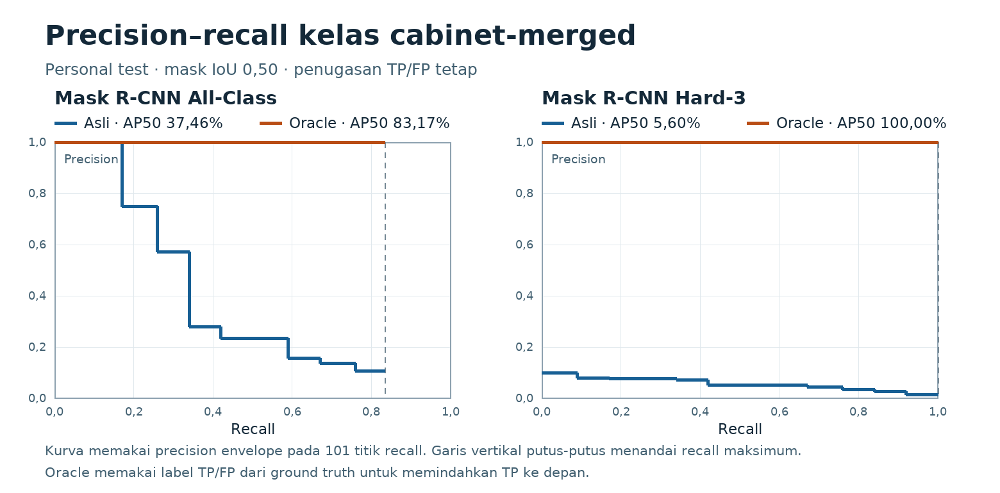

# Eksperimen D1 · Oracle confidence ranking

**Batch 3.3 · 27 November 2026 WIB · Run02 `20261126T152940Z-d1cca883`**

Pada kelas `cabinet-merged` di personal test, pengurutan oracle menaikkan AP50 diagnostik Mask R-CNN Hard-3 dari **5,604% ke 100,000%** dengan jumlah dan identitas TP, FP, dan FN tetap. Headroom Hard-3 mencapai **94,396 poin persentase (pp)**, atau **48,688 pp** lebih besar daripada All-Class. Angka ini mengukur batas perbaikan yang bisa diperoleh dari urutan prediksi ketika penugasan sudah dibekukan. [Hasil CSV](results.csv)

## Pertanyaan dan hipotesis

Seberapa besar ranking confidence membatasi AP `cabinet-merged` pada Mask R-CNN All-Class dan Hard-3 ketika semua mask, kategori, dan penugasan dipertahankan?

**H-D1.** Ranking confidence yang buruk berkontribusi terhadap rendahnya AP `cabinet-merged` Mask R-CNN Hard-3 meskipun cakupan deteksinya meningkat. Hipotesis ini mencakup urutan keluaran yang tersimpan. Peneliti memilih D1 setelah review Batch 3.2. [Dasar kuantitatif](../quantitative_analysis.md) dan [bukti analisis kegagalan](../failure_analysis/failure_analysis.md)

## Metode dan kontrol

Kedua checkpoint dievaluasi pada **40 foto personal**, termasuk foto tanpa lemari, dengan **12 GT `cabinet-merged` yang sama**. Pemetaan Run02 menghubungkan COCO ID 8 All-Class dan COCO ID 3 Hard-3. Kedua versi GT cocok pada ID anotasi, foto, mask, kotak, area, serta flag crowd dan ignore. Eksperimen membaca anggota arsip bbox dan segmentation untuk kedua checkpoint pada personal test sesuai indeks integrasi. Deteksi yang hanya memiliki kotak berada di luar metrik mask. [Pemetaan kelas dan foto](../run02/image_category_mapping.json), [indeks arsip](../run02/integration.json), dan [ground truth beku](../../personal_test_qa/finalization/ground_truth_freeze.json)

1. Pada **mask IoU 0,50**, jalankan pencocokan sadar kelas satu-ke-satu per gambar dengan urutan confidence asli melalui utilitas Batch 3.2. Indeks keluaran bbox sumber memecahkan skor seri secara deterministik. Prediksi yang cocok dengan crowd atau ignore diperlakukan sebagai diabaikan sesuai utilitas. Pada dua hasil uji ini, tidak ada GT lemari atau prediksi lemari yang diabaikan.
2. Bekukan penugasan TP/FP, pasangan GT, dan status duplikat. Urutan asli menggabungkan prediksi dari **seluruh 40 foto** berdasarkan confidence menurun. Oracle memindahkan seluruh TP ke depan dan mempertahankan urutan asli di dalam kelompok TP serta FP. Confidence tersimpan, label kelas, kotak, mask, dan jumlah prediksi tetap sama. Oracle memakai penugasan yang dibekukan, tanpa pencocokan ulang.
3. Hitung AP dari *precision envelope* pada 101 titik recall `0,00, 0,01, …, 1,00`. Recall memakai seluruh 12 GT sebagai penyebut dan grid di atas recall yang dapat dicapai mendapat presisi nol. Headroom adalah **AP oracle − AP asli**, dalam pp. Skrip memeriksa identitas record, urutan dalam kelompok, serta kesamaan TP, FP, FN, jumlah duplikat, jumlah prediksi, dan recall maksimum di kedua kondisi. [Skrip eksperimen](run_oracle.py) dan [utilitas pencocokan](../failure_analysis/screening.py)

## Hasil utama · Mask IoU 0,50

| Checkpoint | Urutan | Prediksi | TP | FP | FN | Duplikat | Recall maksimum (%) | AP50 diagnostik (%) |
| --- | --- | ---: | ---: | ---: | ---: | ---: | ---: | ---: |
| Mask R-CNN All-Class | Asli | 116 | 10 | 106 | 2 | 3 | 83,333 | 37,460 |
| Mask R-CNN All-Class | Oracle | 116 | 10 | 106 | 2 | 3 | 83,333 | 83,168 |
| Mask R-CNN Hard-3 | Asli | 1.485 | 12 | 1.473 | 0 | 8 | 100,000 | 5,604 |
| Mask R-CNN Hard-3 | Oracle | 1.485 | 12 | 1.473 | 0 | 8 | 100,000 | 100,000 |

**Perbandingan dengan Run02.** AP50 kelas pada urutan asli cocok dengan AP50 COCOeval resmi pada kedua checkpoint, hingga nilai yang disimpan CSV sumber. Aturan seri indeks, pencocokan Batch 3.2, dan pengabaian crowd tidak menghasilkan selisih terukur di sini. Kesamaan ini berlaku untuk data dan konfigurasi ini. Skor oracle berasal dari eksperimen diagnostik dengan penugasan beku. AP50–95 resmi sebelum eksperimen tercatat **19,144%** untuk All-Class dan **2,691%** untuk Hard-3. [Metrik resmi per kelas](../run02/tables/per_class_metrics.csv)

**Recall menjelaskan batas oracle.** All-Class mendapat presisi 1 hingga recall maksimum 10/12. Hanya 84 dari 101 titik recall yang terjangkau, sehingga AP50 oracle menjadi 84/101 atau **83,168%**. Hard-3 menjangkau semua titik recall karena 12 GT sudah memiliki TP. Setelah semua TP diletakkan di depan, FP tetap ada di ujung ranking dan tidak menurunkan *precision envelope* pada titik recall yang terjangkau.

**Contoh P018.** Mask R-CNN Hard-3 `B01681` cocok dengan lemari GT #124 pada IoU **0,933258** dengan confidence **0,013883**. Pada foto yang sama terdapat **21 FP kelas lemari** dengan confidence lebih tinggi. Oracle mempertahankan seluruh prediksi itu dan hanya memindahkan posisi TP dalam urutan global. Contoh ini memperlihatkan bagaimana prediksi dengan mask yang baik dapat berada jauh di bawah keluaran yang salah. [Figur F03](../failure_analysis/figures/F03_P018.png) dan [bukti per instance Batch 3.2](../failure_analysis/case_metrics.csv)

## Pemeriksaan pendukung · Sepuluh ambang IoU

Pencocokan asli dibentuk secara mandiri pada setiap ambang COCO, lalu penugasan pada ambang tersebut dibekukan sebelum pengurutan oracle. Rata-rata mencakup IoU 0,50 hingga 0,95 dengan langkah 0,05.

| Checkpoint | AP50–95 diagnostik asli (%) | Rata-rata AP oracle (%) | Headroom rata-rata (pp) |
| --- | ---: | ---: | ---: |
| Mask R-CNN All-Class | 19,144 | 45,941 | +26,797 |
| Mask R-CNN Hard-3 | 2,691 | 60,990 | +58,299 |

Pada IoU 0,75, Hard-3 hanya memiliki 8/12 TP dan oracle mencapai **66,337%**. Pada IoU 0,95, hanya 1/12 GT yang cocok dan oracle mencapai **8,911%**. Artinya, ranking ideal di IoU 0,50 masih menyisakan batas kualitas mask pada ambang lebih ketat. Oracle per ambang menggunakan informasi GT dan dapat menghasilkan urutan berbeda, sehingga rata-ratanya merupakan gabungan plafon ideal yang mungkin tidak bisa dicapai oleh satu urutan. [Hasil per ambang](results.csv)

## Interpretasi ilmiah

**H-D1 didukung pada Run02 personal test.** Headroom All-Class adalah **+45,708 pp** dan headroom Hard-3 **+94,396 pp**. Hard-3 mempunyai jangkauan yang lebih tinggi pada IoU 0,50, tetapi banyak FP muncul sebelum TP sehingga presisi turun saat recall bertambah. Intervensi urutan memperlihatkan besar efek ranking dengan himpunan mask dan penugasan yang sudah tetap. Perbedaan headroom **48,688 pp** dihitung dari skor sebelum pembulatan.

Oracle merupakan batas atas *post-hoc* yang memakai GT. Angka 100,000% pada Hard-3 berlaku untuk AP50 dengan penugasan beku. Dua GT All-Class yang terlewat, keterbatasan geometri pada IoU tinggi, label yang salah, dan FP yang tersimpan tetap menjadi bagian dari keluaran. Eksperimen juga tidak memisahkan peran RPN, classifier RoI, NMS, atau mask head dalam menghasilkan ranking. Hasil berasal dari satu kelas, 12 GT, dan satu test set. Nilainya bersifat deskriptif, tanpa klaim signifikansi atau generalisasi ke model, kelas, dan domain lain.

## Reproduksi

Jalankan `python analysis/test_evaluation/diagnostic_experiment/run_oracle.py` dari root repositori pada lingkungan yang bisa mengimpor NumPy, pycocotools, dan Pillow. Skrip memakai prediksi yang sudah ada dan menjalankan pencocokan serta perhitungan AP di CPU. [Skrip eksperimen](run_oracle.py)

Pada [results.csv](results.csv), AP dan recall disimpan pada skala 0–1. `ranking_headroom_pp` berisi selisih dalam poin persentase pada baris oracle. `official_original_ap` menampilkan metrik Run02 untuk perbandingan dengan urutan asli. Baris rata-rata IoU mengosongkan hitungan TP/FP/FN per ambang karena hitungan itu dapat berubah ketika kriteria IoU berubah.
