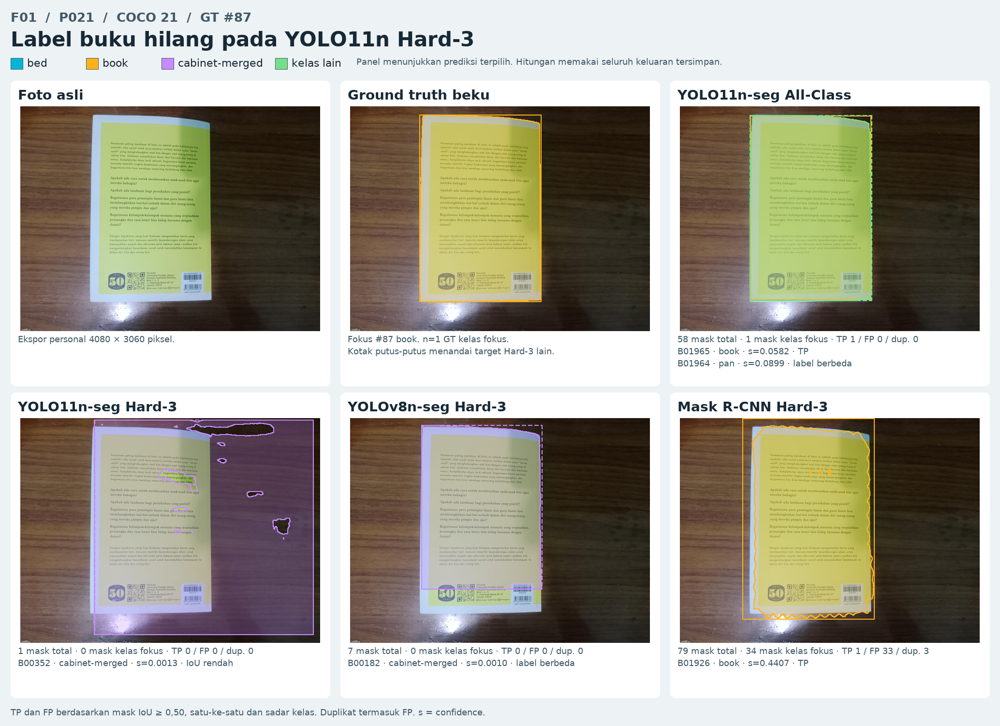
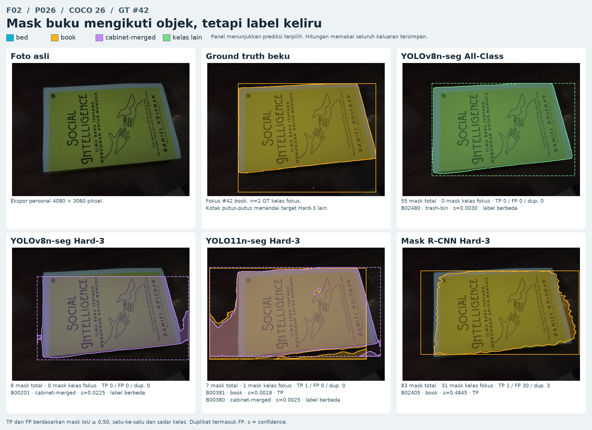
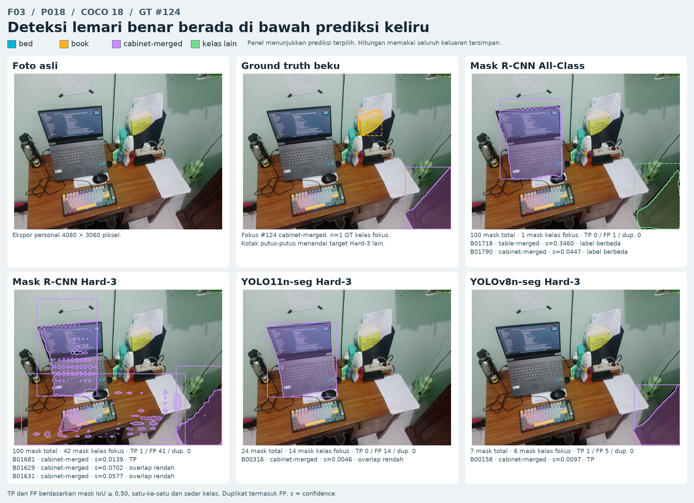
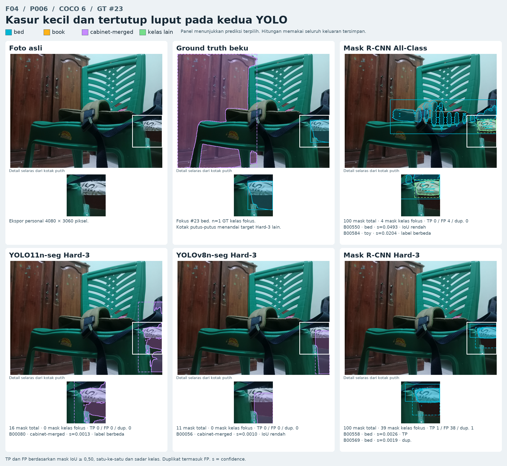
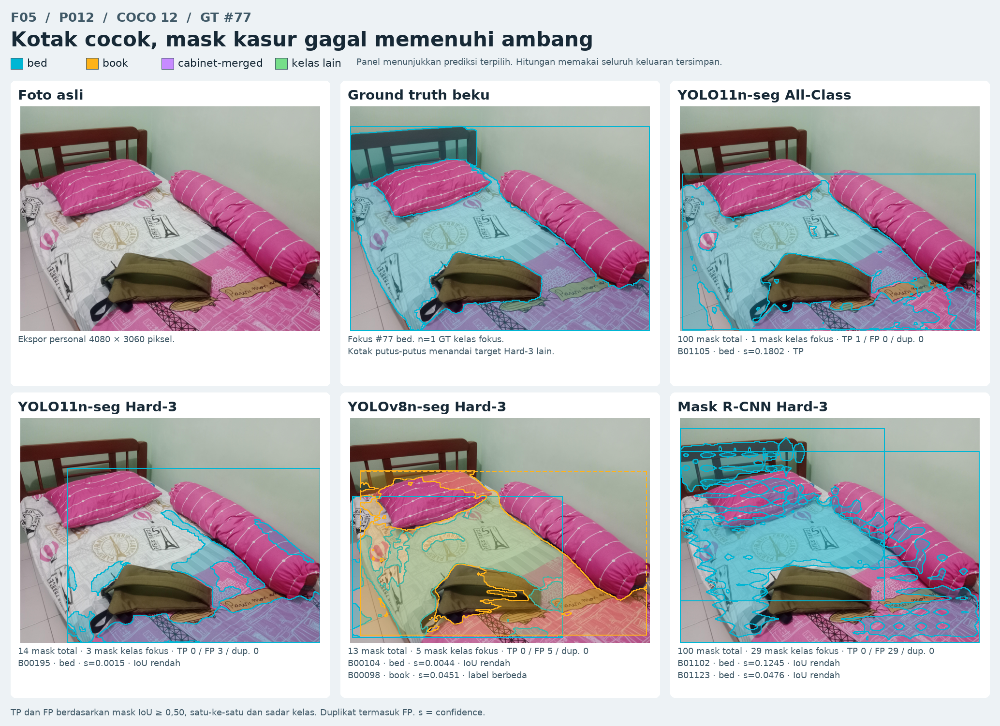

# Analisis kegagalan segmentasi instance pada personal test

**Batch 3.2 · 27 November 2026 WIB · Run02 `20261126T152940Z-d1cca883`**

Dengan bantuan AI, saya memilih lima foto yang menunjukkan tiga pola yang dapat dibedakan dari prediksi tersimpan. Pada dua foto buku, mask dapat mengikuti objek meski label keluaran keliru. Pada satu foto lemari, Mask R-CNN Hard-3 menempatkan 21 prediksi kelas target yang tidak cocok di atas deteksi benar. Pada dua foto kasur, perbandingan memperlihatkan hilangnya deteksi kelas target dan ketidakcocokan mask meski kotaknya cukup tepat. [Analisis kuantitatif](../quantitative_analysis.md) dan [indeks Run02](../run02/integration.json)

## Metode penyaringan dan pemilihan

Penyaringan mencakup **40 foto × 6 checkpoint**, dengan **16.200 kotak dan 15.909 mask** Run02. Perbandingan pada tiga kelas target memakai **33 instance** pada 25 foto positif dan 15 foto negatif. Ground truth All-Class beku dipakai untuk checkpoint All-Class dan proyeksi Hard-3 beku untuk checkpoint Hard-3. ID kategori diterjemahkan lewat nama kelas yang tercatat. Analisis agnostik tambahan pada lima kasus memakai ground truth master untuk mengenali objek seperti laptop yang berada di luar taksonomi Hard-3. [Pemetaan Run02](../run02/image_category_mapping.json), [ground truth All-Class](../../../data/custom_test/annotations/all_class_master_corrected.coco.json), dan [ground truth Hard-3](../../../data/custom_test/annotations/hard3_corrected.coco.json)

- **Pencocokan sadar kelas.** Untuk setiap foto dan checkpoint, urutkan prediksi berdasarkan confidence menurun dan gunakan urutan indeks sumber untuk skor seri. Pada tiap ambang, pilih GT belum terpakai dengan IoU tertinggi di antara label yang sama. Hitung mask IoU dan box IoU secara terpisah pada 0,50 dan 0,75. GT berstatus crowd atau ignore tidak dihitung sebagai target. Keluaran bbox tanpa mask tetap masuk pemeriksaan bbox. Dengan aturan ini, satu GT dapat menerima paling banyak satu TP pada setiap jenis metrik dan ambang.
- **Inspeksi agnostik.** Periksa kandidat dari kategori lain secara terpisah. Mask dengan IoU ≥ 0,50 terhadap GT kelas lain menunjukkan konflik label keluaran terhadap anotasi. Pada pencocokan utama, mask kelas sama yang menyentuh GT yang sudah diklaim pada IoU ≥ 0,50 dicatat sebagai duplikat. Prediksi yang tersisa dipilah menurut overlap mask atau kotak dengan GT, menggunakan 0,10 sebagai batas deskriptif untuk overlap rendah. Status overlap rendah atau nol hanya menggambarkan hubungan dengan GT yang tersedia. Verifikasi visual diperlukan untuk menyebut latar belakang, objek kelas lain, atau ambiguitas anotasi.
- **Data dan tampilan.** Hitungan memakai semua keluaran tersimpan pada konfigurasi Run02 dengan confidence minimum 0,001 dan batas 100 deteksi per foto. IoU dihitung pada resolusi asli dengan COCO RLE. Hanya mask yang ditampilkan didekode, satu per satu. Panel menampilkan satu hingga tiga prediksi yang mewakili kecocokan GT, kandidat kelas alternatif, duplikat, atau FP berperingkat tinggi sesuai kasus. Tidak ada ambang confidence tambahan. Catatan di bawah panel melaporkan hitungan lengkap kelas fokus. Kotak putus-putus pada panel prediksi membedakan kelas alternatif atau duplikat. Foto P006 menyertakan crop tampilan yang selaras.
- **Pemilihan purposif.** P021 memperlihatkan YOLO11n All-Class yang berhasil dan YOLO11n Hard-3 yang kehilangan label pada buku yang terlihat utuh. P026 memberi kontras cahaya rendah dan dua label alternatif YOLOv8n dengan IoU tinggi. P018 memiliki paling banyak prediksi lemari lebih tinggi skornya daripada TP Mask R-CNN Hard-3 di antara foto dengan lemari yang cocok. P006 dipilih untuk menguji kontras pada bagian kasur kecil yang tertutup, sementara P011 memberi contoh kasur lebih kecil yang juga cocok pada Mask R-CNN All-Class. P012 memberi pasangan box–mask dengan GT tunggal dan bagian kasur yang jauh lebih besar. Pemilihan ini mencakup keberhasilan pembanding dan menggambarkan kasus diagnostik. Jumlah lima foto mengikuti ringkasan ketentuan pada laporan QA repositori. [Kondisi sulit](../../personal_test_qa/difficult_conditions.md), [finalisasi anotasi](../../personal_test_qa/finalization/report.md), dan [ringkasan ketentuan tugas](../../personal_test_qa/report.md#bukti-penilaian)

Hitungan di sini merupakan diagnosis pada ambang tertentu. Mask AP COCOeval resmi tetap berasal dari Run02 dan menggunakan beberapa ambang IoU. [Bukti numerik per instance](case_metrics.csv) dan [protokol Run02](../README.md#protokol-dan-verifikasi)

## Dasar mekanisme model

Manifest Run02 mencatat keempat checkpoint YOLO sebagai head `Segment` dengan varian YAML YOLO11n-seg atau YOLOv8n-seg. YAML lokal Ultralytics 8.4.216 untuk kedua varian memakai head segmentasi P3/P4/P5 dan 32 kanal mask. Pada implementasi `Segment` di `nn/modules/head.py`, fitur skala tinggi menghasilkan prototipe mask bersama. Koefisien tiap kandidat menggabungkan prototipe tersebut, lalu pascaproses memetakan mask terpilih ke koordinat asli dan membatasi mask dengan kotak. Run02 memakai letterbox 640 × 640, NMS IoU 0,70, dan encoding dari crop retina mask. Kandidat kelas dan deteksi yang dipertahankan menentukan mask mana yang mendapat label akhir. [Manifest checkpoint](../run02/checkpoint_manifest.json) dan [notebook Run02, cell 05–06](../../../notebooks/CPMK3_Unified_Test_Evaluation_Recovery.ipynb)

Jalur Mask R-CNN Run02 merekonstruksi `maskrcnn_resnet50_fpn` dari checkpoint. Backbone FPN dipakai bersama oleh RPN dan RoI heads. Proposal RPN diolah melalui RoIAlign untuk klasifikasi dan regresi kotak. Cabang mask menghasilkan grid mask per RoI dan model memilih kanal kelas prediksi. Notebook menerapkan resize/paste Torchvision ke kotak di kanvas asli sebelum ambang 0,50. Nilai konfigurasi aktual memakai resize minimum 640, maksimum 960, dan NMS kotak 0,50. Prediksi tersimpan tidak memuat proposal mentah, logit sebelum NMS, atau grid mask per RoI. Dengan demikian, mekanisme ini memberi penjelasan yang dapat diuji tanpa menentukan tahap internal yang gagal pada sebuah foto. [Konfigurasi Mask R-CNN Hard-3](../../../experiments/maskrcnn_hard3/config.json) dan [notebook Run02](../../../notebooks/CPMK3_Unified_Test_Evaluation_Recovery.ipynb)

## Lima kasus

Semua IoU dan confidence di bawah memakai skala 0–1. ID `Bxxxxx` adalah indeks berbasis nol pada keluaran bbox checkpoint dalam kombinasi personal. Satu ID harus dibaca bersama nama checkpoint. Mask yang terkait dicatat melalui `segm_source_index` pada CSV.

### F01 · P021 · COCO 21 · buku GT #87

**A–B. Identitas dan konteks.** Buku menempati 32,65% dari kanvas. Sampul belakang dan bentuk persegi panjang terlihat jelas di atas meja. Ada pantulan dan bayangan pada permukaan kayu. Kasus ini menguji kegagalan YOLO11n dalam perpindahan All-Class ke Hard-3 ketika target berukuran relatif besar.

**C–D. Bukti dan kegagalan.** Dari 58 mask YOLO11n All-Class, tepat satu berlabel `book`. `B01965` cocok pada mask IoU **0,983**, box IoU **0,976**, confidence **0,0582**. Mask `pan` `B01964` juga mengikuti buku dengan IoU **0,988** dan skor **0,0899**. YOLO11n Hard-3 menyimpan satu mask, `cabinet-merged` `B00352`, skor **0,0013**, dengan mask IoU **0,450** dan area meluas ke meja. Ia tidak menyimpan label `book`. YOLOv8n Hard-3 juga menyimpan nol mask `book`, meski `cabinet-merged` `B00182` punya mask IoU **0,856**. Mask R-CNN Hard-3 mencocokkan GT melalui `B01926`, mask IoU **0,931** dan confidence **0,4407**. Pada panel itu terdapat 34 mask berlabel buku, satu TP, dan 33 FP termasuk tiga duplikat.

**E–G. Mekanisme, alternatif, dan simpulan.** Keluaran alternatif YOLO menunjukkan bahwa kandidat dengan label salah dapat membawa mask yang beririsan dengan target. Pengaitan kandidat kelas, kotak, dan koefisien prototipe konsisten dengan pola ini. Bukti YOLO11n Hard-3 masih membiarkan beberapa penjelasan, seperti confidence rendah sebelum seleksi, persaingan kelas, atau NMS. Batas 100 deteksi tidak tercapai oleh kedua YOLO Hard-3 pada foto ini. Kasus ini berguna untuk memisahkan kehilangan label akhir dari kualitas mask, terutama sebagai pembanding terhadap P026.

### F02 · P026 · COCO 26 · buku GT #42

**A–B. Identitas dan konteks.** Sampul terlihat miring di atas meja kayu dalam cahaya rendah dan menempati 44,16% kanvas. Ini menguji rendahnya AP buku YOLOv8n pada personal test. Objek tetap tampak besar dan tidak tertutup oleh objek lain pada bagian sampul yang dianotasi.

**C–D. Bukti dan kegagalan.** YOLOv8n All-Class menyimpan 55 mask dan Hard-3 delapan mask, keduanya tanpa `book`. All-Class memberi label `trash-bin` pada `B02480` dengan mask/box IoU **0,978/0,821** dan confidence **0,0030**. Hard-3 memberi label `cabinet-merged` pada `B00201` dengan mask/box IoU **0,892/0,715** dan confidence **0,0225**. Kedua IoU mask melewati 0,75 secara agnostik dan tetap gagal mencocokkan `book` secara sadar kelas. YOLO11n Hard-3 mencatat satu TP dari satu mask `book`, `B00381` (IoU **0,818**, skor **0,0018**), sekaligus menyimpan `cabinet-merged` `B00380` (IoU **0,876**, skor **0,0025**). Mask R-CNN Hard-3 memiliki TP `B02405` dengan IoU **0,916**, skor **0,4845**. Dari 31 mask `book` pada panel tersebut, 30 merupakan FP termasuk tiga duplikat pada ambang 0,50.

**E–G. Mekanisme, alternatif, dan simpulan.** Pada YOLOv8n, geometri kandidat tersedia untuk area buku, sementara kategori akhir gagal. Output ini konsisten dengan persaingan skor kelas pada head deteksi-segmentasi. Cahaya rendah, perspektif, dan ciri tekstur sampul dapat memengaruhi klasifikasi. Keberhasilan dua checkpoint lain di foto yang sama membatasi penjelasan yang hanya mengandalkan pencahayaan atau ukuran. Contoh ini kuat untuk mengidentifikasi konflik label akhir dan belum melokalisasi penyebab pada logit atau fitur tertentu.

### F03 · P018 · COCO 18 · lemari GT #124

**A–B. Identitas dan konteks.** GT `cabinet-merged` menempati 5,12% kanvas dan mencapai tepi kanan serta bawah. Hanya sebagian furnitur kayu terlihat di kanan meja. Foto juga memuat laptop, keyboard, buku, dan beberapa benda di meja. Bagian furnitur yang terpotong membatasi petunjuk semantik. Analisis mengikuti label beku #124.

**C–D. Bukti dan kegagalan.** Mask R-CNN All-Class memiliki satu mask `cabinet-merged` dari 100 mask total. Prediksi itu, `B01790`, mengikuti laptop GT #107 (IoU **0,949**), sementara bagian lemari dilabeli `table-merged` oleh `B01718` (IoU **0,904** terhadap #124, skor **0,3460**). Mask R-CNN Hard-3 mencocokkan lemari dengan `B01681` (mask/box IoU **0,933/0,781**, skor **0,0139**). Dari **42** mask `cabinet-merged`, ada **1 TP, 41 FP, 0 duplikat**. **Dua puluh satu FP** memiliki confidence di atas TP. `B01629`, skor **0,0702**, beririsan **0,773** dengan laptop beku dan nol dengan lemari. `B01631`, skor **0,0577**, memiliki IoU nol terhadap lemari dan hanya **0,207** terhadap GT master terbaiknya, keyboard. Fokus pada ground truth master membantu membedakan objek lain dan overlap rendah dari dugaan FP latar. YOLOv8n Hard-3 juga cocok pada lemari, `B00158` dengan IoU **0,960**. YOLO11n Hard-3 kehilangan lemari dengan 14 FP kelas itu, termasuk mask `B00316` yang berimpit dengan laptop pada IoU **0,978**.

**E–G. Mekanisme, alternatif, dan simpulan.** Pada Mask R-CNN, head klasifikasi per RoI memberi skor kandidat yang kemudian menentukan urutan evaluasi. Kandidat yang berkualitas tinggi secara geometri dapat berada di bawah RoI berlabel keliru atau mask dengan overlap rendah. Foto mencapai batas 100 mask pada kedua skenario Mask R-CNN. Pengaruh NMS, konfigurasi training, dan keterbatasan tiga label masih mungkin berperan. Kasus ini menunjukkan pemulihan kecocokan tanpa urutan skor yang baik serta menjadi contoh utama untuk eksperimen peringkat.

### F04 · P006 · COCO 6 · kasur GT #23

**A–B. Identitas dan konteks.** Bagian kasur berada di tepi kanan, tertutup kursi dan tas, serta menempati 2,03% foto. Lemari lain di latar terlihat jauh lebih besar dan memiliki anotasi berbeda, #20. Crop tampilan sejajar membantu menilai batas antara kain, bagian samping kasur, dan objek di depan.

**C–D. Bukti dan kegagalan.** Kedua YOLO Hard-3 menghasilkan nol mask `bed`, dari 16 mask YOLO11n dan 11 mask YOLOv8n. Kandidat `cabinet-merged` `B00080` YOLO11n beririsan **0,5001** terhadap kasur tanpa memenuhi label. Kandidat `B00056` YOLOv8n mencapai **0,3893**. Mask R-CNN All-Class mempunyai empat mask `bed` dan nol TP. Kandidat `bed` terbaiknya hanya mencapai IoU **0,012**. Dari 39 mask `bed` pada Mask R-CNN Hard-3, satu TP dan 38 FP, termasuk satu duplikat. `B00558` dipilih lebih dahulu dengan skor **0,00265** dan mask IoU **0,5054**, walaupun box IoU **0,342**. `B00569` menyusul pada skor **0,00193** dengan mask IoU **0,5160** dan box IoU **0,834**. Keduanya tidak melewati mask IoU 0,75. TP hanya mencakup sekitar **50,7% area GT**, terutama permukaan kain, dengan sisi bawah yang dilewatkan.

**E–G. Mekanisme, alternatif, dan simpulan.** Letterbox YOLO mengecilkan struktur bagian terlihat, sedangkan RoIAlign Mask R-CNN dapat memberi representasi terfokus pada crop kandidat. Ukuran efektif, label `cabinet-merged`, sedikitnya konteks kasur, dan oklusi saling berkaitan pada foto ini. Model kedua tahap juga hanya lolos tipis serta memiliki duplikat. Contoh ini menunjukkan miss sadar kelas dan penutupan sebagian mask. Peran skala pada tahap internal belum terisolasi.

### F05 · P012 · COCO 12 · kasur GT #77

**A–B. Identitas dan konteks.** Kasur memanjang sampai tepi kiri, kanan, dan bawah, dengan bagian kepala, dua bantal, dan tas di atas permukaan. GT mencakup bagian terlihat kasur dan kepala ranjang serta memakai 42,61% kanvas. Kasus ini menguji apakah mask dapat gagal walaupun objek besar dan kotak sudah beririsan cukup tinggi.

**C–D. Bukti dan kegagalan.** YOLO11n All-Class mempunyai satu mask `bed`. `B01105` lolos mask IoU **0,635**, box IoU **0,747** dan confidence **0,1802**. Pada Hard-3, ketiga mask `bed` YOLO11n gagal. `B00195` memiliki box IoU **0,719**, mask IoU **0,340**, skor **0,00145**, dan hanya mencakup **34,9%** luas GT. Overlay memperlihatkan bagian kepala dan permukaan kasur yang tidak tercakup. Mask R-CNN Hard-3 menghasilkan 29 mask `bed` dan nol TP. `B01102` mempunyai box IoU **0,935**, mask IoU **0,465**, dan skor **0,1245**. Ia mencakup **53,6%** GT, dengan bagian berlubang pada permukaan dan piksel tambahan di luar GT. Mask berlabel benar terbaiknya `B01123` pun hanya mencapai **0,487**. YOLOv8n Hard-3 menyimpan lima mask `bed` dengan IoU terbaik **0,388**. Kandidat `book` `B00098` justru mempunyai mask IoU **0,636** terhadap #77. Mask R-CNN All-Class juga lolos (mask IoU **0,532**), memberi pembanding kedua terhadap tiga Hard-3 yang gagal.

**E–G. Mekanisme, alternatif, dan simpulan.** Untuk YOLO, kombinasi prototipe dan crop kotak dapat menghasilkan mask yang hanya menutupi bagian dari target. Untuk Mask R-CNN, grid mask per RoI dan paste ke kotak besar juga dapat kehilangan detail atau memasukkan bagian objek di depan. Kualitas kotak saja jelas tidak menjamin mask yang baik di foto ini. Definisi batas kasur dan kepala ranjang, pola sprei, oklusi bantal/tas, atau perubahan training dapat turut memengaruhi hasil. Kasus ini cocok untuk dekomposisi geometri box–mask dengan label dan confidence dipertahankan.

## Sintesis lintas kasus dan layar 40 foto

| Pola | Bukti dari kasus | Makna |
| --- | --- | --- |
| Kelas akhir keliru meski mask beririsan tinggi | F01 dan F02. Pada F02, kedua YOLOv8n mempunyai kandidat kelas lain dengan mask IoU ≥ 0,75. | Kesalahan keluaran mencakup klasifikasi. IoU geometris tidak cukup untuk menjadi TP sadar kelas. |
| Recall dan urutan skor dapat bergeser berlawanan | F03. Lemari Hard-3 baru terdeteksi, dengan 21 FP kelas fokus di atas TP. F04 memperlihatkan satu duplikat yang tersisa. | Jumlah TP tambahan dapat hidup berdampingan dengan ranking yang lemah. |
| Kotak dan mask dapat berbeda tajam | F05. Kotak YOLO11n dan Mask R-CNN Hard-3 melampaui 0,50. Mask untuk kandidat yang sama gagal di 0,50. F04 juga memuat TP mask dengan box IoU rendah. | Kedua bentuk lokalisasi mengukur aspek yang berbeda. |
| Ukuran saja tidak menjelaskan kegagalan | F04 kecil dan tertutup, F01 dan F02 besar, F05 besar tetapi mask kurang tercakup. | Skala, label, konfigurasi training, dan adegan memerlukan kontrol terpisah. |

Pada seluruh 40 foto, YOLO11n untuk buku berubah dari **4/11 TP** dengan 30 mask kelas buku pada All-Class menjadi **3/11 TP** dengan 79 mask kelas buku pada Hard-3 pada IoU 0,50. YOLOv8n memperoleh **1/11** pada kedua skenario. Mask R-CNN Hard-3 memperoleh **9/11** di 0,50 dan **8/11** di 0,75. Terdapat keberhasilan kedua YOLO Hard-3 pada buku atas P023 #64. Jadi pola buku dalam F01–F02 dapat ditemukan pada kasus nyata tanpa menghapus keberhasilan pembanding.

Untuk `cabinet-merged`, Mask R-CNN berubah dari **10/12** ke **12/12** TP pada IoU 0,50 dan **5/12** ke **8/12** pada 0,75. Pada 40 foto, mask yang berlabel lemari meningkat dari **116 ke 1.485**, dengan **106 ke 1.473 FP diagnostik** dan **3 ke 8 duplikat**. Di antara foto yang memiliki TP lemari, prediksi salah berperingkat lebih tinggi muncul pada **3 dari 10** foto All-Class dan **7 dari 12** foto Hard-3. Sebagai pembanding yang berlawanan dengan F03, pada P033 #147 mask terbaik Hard-3 meraih IoU **0,973** dan TP berada di atas semua FP kelas lemari. Jumlah FP tumbuh jauh lebih besar dari jumlah duplikat yang didefinisikan pada 0,50. Hasil ini menjelaskan bagaimana jangkauan deteksi dan kualitas peringkat dapat berlawanan, tanpa mengukur kontribusinya terhadap AP resmi.

Untuk `bed`, YOLOv8n Hard-3 memperoleh **5/10** TP pada 0,50 dan **3/10** di 0,75. YOLO11n Hard-3 memperoleh **3/10** dan **0/10** pada ambang yang sama. Masing-masing tetap gagal di P006 dan P012. Pola akhir mencakup deteksi, klasifikasi, dan mask. Frekuensi seluruh tipe kegagalan tidak dapat diinferensikan dari lima foto, sementara hitungan yang didefinisikan eksplisit pada 40 foto dapat dipakai sebagai konteks deskriptif. [AP buku, lemari, dan kasur Run02](../run02/tables/shared_hard3_per_class.csv) dan [skrip penyaringan](screening.py)

## Kandidat eksperimen diagnostik Batch 3.3

| Kandidat | Bukti dan mekanisme yang diuji | Variabel dan kontrol | Data, biaya, dan keterbatasan |
| --- | --- | --- | --- |
| **D1. Uji kontribusi urutan confidence pada lemari Mask R-CNN** | F03 memiliki 21 FP di atas TP, sedangkan cakupan Hard-3 naik pada 40 foto. Uji seberapa banyak peringkat keluaran membatasi presisi pada himpunan mask yang sudah terbentuk. | Variabel bebas ialah urutan asli vs urutan oracle yang mendahulukan TP pada mask IoU 0,50. Bekukan assignment satu-ke-satu, duplikat, skor asli sebagai tie break dalam kelompok, jumlah deteksi, kategori, dan GT. Ukur AP50 interpolasi dengan assignment beku, luas gap, serta presisi pada recall yang sama. Jalankan desain yang sama pada All-Class dan Hard-3. | Prediksi tersimpan dan GT dari 40 foto cukup. CPU, tanpa inferensi. Oracle memakai GT dan memberi plafon diagnostik ranking pada hasil beku. Ia tidak mengukur AP resmi yang akan diperoleh model baru ataupun menentukan apakah RPN, NMS, atau classifier yang menyebabkan ranking. |
| **D2. Intervensi geometri mask pada kotak yang sudah cocok** | F05 memperlihatkan box IoU 0,719/0,935 dengan mask IoU 0,340/0,465. Pertanyaannya ialah apakah kotak yang sudah tersedia cukup untuk menampung mask yang lolos. | Pakai pasangan sadar kelas yang lulus box IoU 0,50. Bandingkan mask asli dengan mask oracle berupa GT yang dipotong oleh kotak prediksi tetap. Pertahankan skor, label, pasangan, dan koordinat. Ukur perubahan IoU dan jumlah pasangan yang melewati 0,50/0,75 dengan aturan pembulatan piksel yang tetap. | Prediksi bbox/mask dan GT cukup. CPU, tanpa inferensi. Oracle hanya mengukur plafon geometri bersyarat pada kotak yang ada. Ia tidak menguji resolusi prototipe atau grid RoI secara langsung. |

**Pada tahap analisis kasus, saya mengajukan D1 untuk ditinjau.** F03 memperlihatkan urutan confidence yang langsung teramati, dan hasil penyaringan semua foto memberi dukungan untuk membedakan contoh tunggal dari pola lebih luas. Dengan assignment tetap, intervensi urutan dapat menjawab berapa besar efek ranking pada presisi tanpa mengubah mask, melatih model, atau menambah inferensi. Eksperimen ini bersifat **post-hoc** pada personal test dan tidak menggantikan skor Run02. Setelah meninjau kedua rancangan, saya memilih dan menjalankan D1 pada Batch 3.3 dengan bantuan AI. [Hasil eksperimen D1](../diagnostic_experiment/diagnostic_experiment.md)

## Jejak reproduksi

[case_metrics.csv](case_metrics.csv) menyimpan bukti dari keenam checkpoint untuk kelima foto. Baris `gt_evidence` mencatat pasangan terbaik dan kecocokan di kedua ambang. Baris `prediction` mencatat semua prediksi berlabel tiga target dan prediksi kelas lain yang ditampilkan. Kolom `focus_bbox_iou` dan `focus_mask_iou` selalu mengacu ke GT fokus, sementara `best_full_gt_*` mengacu ke pencarian agnostik terhadap anotasi master. `focus_gt_covered` dan `pred_fraction_on_focus` adalah fraksi luas irisan terhadap GT dan mask prediksi. Nilai kosong menandai pasangan atau mask yang tidak tersedia. `displayed=1` menghubungkan baris ke panel melalui ID sumber.

Dengan NumPy, pycocotools, dan Pillow yang tersedia pada lingkungan proyek, jalankan `python analysis/test_evaluation/failure_analysis/screening.py` dari root untuk ringkasan 40 foto. Jalankan `python analysis/test_evaluation/failure_analysis/render_cases.py` untuk membuat ulang CSV dan komposit dari arsip. Renderer memakai font DejaVu dari instalasi Matplotlib lokal pada Windows. [Skrip komposit](render_cases.py)
