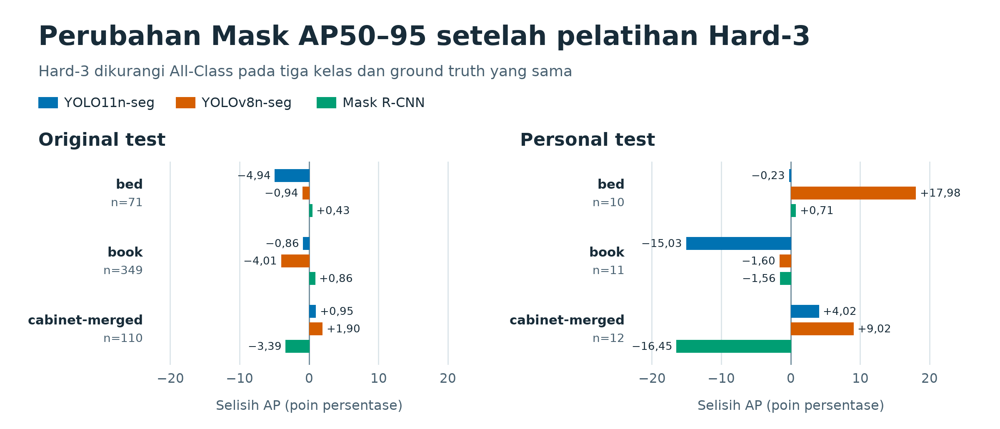

# Analisis kuantitatif original dan personal test set

**Batch 3.1 · 27 November 2026 WIB · Run02 `20261126T152940Z-d1cca883`**

Pada Run02, saya membandingkan ketiga model pada domain dan cakupan kelas yang sama. Peringkat model bergantung pada domain dan cakupan kelas. Pelatihan Hard-3 menaikkan recall pada keenam perbandingan berpasangan, tetapi hanya satu yang sekaligus menaikkan AP50–95. Perpindahan dari original ke personal test juga menghasilkan lima kenaikan AP agregat dari enam checkpoint. Kenaikan ini perlu dibaca dengan memperhatikan dukungan anotasi, skala objek, dan komposisi foto. [Indeks evaluasi Run02](README.md)

## 1. Pertanyaan dan dasar perbandingan

1. **Arsitektur.** Bandingkan tiga checkpoint untuk setiap skenario dan domain. Tabel primer memakai 74 kategori All-Class atau tiga kategori Hard-3. COCOeval hanya memasukkan kelas dengan ground truth yang dapat dinilai ke rata-rata AP.
2. **Spesialisasi.** Bandingkan checkpoint All-Class dengan Hard-3 pada foto, ground truth, dan tiga kategori yang sama dalam setiap domain. Gunakan scope `shared_hard3`. Proyeksi prediksi All-Class dilakukan setelah NMS dan batas 100 deteksi per foto, sehingga persaingan antarkelas di pipeline All-Class ikut memengaruhi hasil.
3. **Domain.** Bandingkan checkpoint yang sama dari original ke personal test pada irisan kelas dengan ground truth non-crowd di kedua domain, yakni 37 kelas All-Class dan tiga kelas Hard-3. Scope bersama menyamakan kategori. Distribusi gambar, jumlah anotasi, dan proporsi latar belakang tetap berbeda.

Mask AP adalah rata-rata AP COCO pada 10 ambang IoU 0,50–0,95. AP50 dan AP75 memakai ambang tunggal, sementara AR100 merupakan rata-rata recall dengan paling banyak 100 deteksi per foto. AP dan AR ditampilkan dalam persen. Selisih dihitung dari nilai sumber sebelum pembulatan dan disajikan dalam poin persentase (pp). AP tak terdefinisi tetap N/A. Pada scope primer All-Class, 5 kelas original dan 36 kelas personal tidak memiliki AP terdefinisi. Semua kelas dalam scope bersama memiliki AP terdefinisi, termasuk nilai nol. [Metrik primer](run02/tables/primary_metrics.csv), [dukungan ground truth](run02/tables/ground_truth_support.csv), dan [protokol](README.md#protokol-dan-verifikasi)

| Cakupan | Original · foto / instance / kelas terwakili | Personal · foto / instance / kelas terwakili |
| --- | ---: | ---: |
| All-Class primer | 359 / 5.344 / 69 | 40 / 213 / 38 |
| All-Class, kelas bersama | 359 / 3.859 / 37 | 40 / 206 / 37 |
| Hard-3, primer dan bersama | 359 / 530 / 3 | 40 / 33 / 3 |

## 2. Performa arsitektur dan biaya komputasi

Urutan dalam tiap cakupan ditentukan oleh **Mask AP50–95**. Box AP dan Box AP75 menunjukkan apakah peringkat mask sejalan dengan metrik kotak. Waktu pipeline mencakup pemrosesan input, prediksi, dan penyiapan serialisasi, termasuk konversi mask. Angka ms/foto adalah waktu pipeline dibagi jumlah foto. Pemuatan model, I/O keluaran, dan COCOeval dicatat terpisah. [Metrik primer](run02/tables/primary_metrics.csv) dan [komponen durasi](run02/tables/timings.csv)

| Skenario · domain | Peringkat | Model | Mask AP (%) | Mask AP50 (%) | Mask AP75 (%) | Mask AR100 (%) | Box AP (%) | Box AP75 (%) | Pipeline (ms/foto) |
| --- | ---: | --- | ---: | ---: | ---: | ---: | ---: | ---: | ---: |
| All-Class · Original | 1 | YOLO11n | 9,111 | 14,928 | 9,020 | 20,008 | 10,930 | 11,245 | 155,6 |
| All-Class · Original | 2 | Mask R-CNN | 7,746 | 13,138 | 7,869 | 21,294 | 8,127 | 7,854 | 435,6 |
| All-Class · Original | 3 | YOLOv8n | 7,545 | 12,404 | 7,482 | 20,361 | 9,279 | 9,511 | 159,1 |
| All-Class · Personal | 1 | Mask R-CNN | 14,273 | 21,783 | 14,739 | 25,256 | 13,518 | 13,781 | 10.950,9 |
| All-Class · Personal | 2 | YOLO11n | 12,628 | 16,165 | 12,971 | 20,088 | 13,110 | 12,823 | 1.788,3 |
| All-Class · Personal | 3 | YOLOv8n | 9,976 | 12,845 | 9,698 | 18,957 | 10,757 | 10,996 | 1.827,8 |
| Hard-3 · Original | 1 | YOLO11n | 7,194 | 17,588 | 3,900 | 26,394 | 9,419 | 6,530 | 78,0 |
| Hard-3 · Original | 2 | YOLOv8n | 7,054 | 18,293 | 3,228 | 27,382 | 9,231 | 5,906 | 61,0 |
| Hard-3 · Original | 3 | Mask R-CNN | 6,870 | 16,194 | 5,114 | 36,147 | 6,326 | 2,777 | 437,6 |
| Hard-3 · Personal | 1 | Mask R-CNN | 12,283 | 24,354 | 8,980 | 53,914 | 11,235 | 7,229 | 10.399,5 |
| Hard-3 · Personal | 2 | YOLOv8n | 11,724 | 22,522 | 13,153 | 28,621 | 14,352 | 12,652 | 349,6 |
| Hard-3 · Personal | 3 | YOLO11n | 3,809 | 7,436 | 3,682 | 24,081 | 3,434 | 2,754 | 451,6 |

- **All-Class.** YOLO11n memimpin original test dengan selisih 1,365 pp dan memiliki pipeline tercepat dalam skenario ini. Mask R-CNN memiliki recall mask tertinggi di original dan memimpin keempat metrik mask di personal, dengan selisih Mask AP 1,644 pp dari YOLO11n.
- **Hard-3.** Selisih YOLO11n dan YOLOv8n di original hanya 0,139 pp. YOLOv8n memimpin AP50 dan memiliki pipeline tercepat, sementara Mask R-CNN mencatat AP75 dan recall tertinggi. Di personal test, Mask R-CNN unggul 0,560 pp pada Mask AP dan 25,293 pp pada recall dibanding YOLOv8n. YOLOv8n unggul pada Mask AP75 dan Box AP. Ambang IoU dan target evaluasi bisa mengubah peringkat. Agregat ini belum mengisolasi kesalahan klasifikasi, kotak, atau batas mask.
- **Trade-off runtime.** Pada Hard-3 personal, YOLOv8n memakai 349,6 ms/foto dan Mask R-CNN 10.399,5 ms/foto. Keduanya menghasilkan rata-rata 7,65 dan 88,90 mask per foto. Pada Mask R-CNN, 394,40 dari 415,98 detik pipeline tercatat pada penyiapan serialisasi. Jumlah keluaran memberi konteks untuk biaya pipeline. Komponen waktu internal Ultralytics dan pemanggilan Torchvision memiliki cakupan berbeda. Angka di tabel menggambarkan pipeline penelitian pada Tesla T4.

[Grafik Run02 untuk metrik primer](run02/figures/primary.png)

## 3. Spesialisasi pada tiga kelas target

Selisih spesialisasi adalah **Hard-3 dikurangi All-Class** pada scope yang sama. Jumlah ground truth adalah 530 di original dan 33 di personal, dengan seluruh foto positif dan negatif tetap dinilai. AP agregat memberi bobot sama pada ketiga kelas. [Agregat shared Hard-3](run02/tables/shared_hard3_comparison.csv), [hasil per kelas](run02/tables/shared_hard3_per_class.csv), dan [metrik pendukung](run02/tables/aggregate_metrics.csv)

| Domain | Model | Mask AP All-Class (%) | Mask AP Hard-3 (%) | Δ AP (pp) | Δ AP50 (pp) | Δ AP75 (pp) | Δ AR100 (pp) |
| --- | --- | ---: | ---: | ---: | ---: | ---: | ---: |
| Original | YOLO11n | 8,808 | 7,194 | −1,614 | −2,752 | −2,771 | +3,016 |
| Original | YOLOv8n | 8,073 | 7,054 | −1,019 | −0,614 | −1,904 | +7,860 |
| Original | Mask R-CNN | 7,570 | 6,870 | −0,700 | −1,099 | −0,759 | +10,768 |
| Personal | YOLO11n | 7,555 | 3,809 | −3,746 | −2,999 | −3,230 | +5,889 |
| Personal | YOLOv8n | 3,254 | 11,724 | +8,470 | +15,987 | +10,249 | +20,202 |
| Personal | Mask R-CNN | 18,049 | 12,283 | −5,766 | −16,461 | −3,529 | +14,848 |

### Perubahan per kelas

| Domain | Model | Kelas | GT | AP All-Class (%) | AP Hard-3 (%) | Δ AP (pp) | Δ AP50 (pp) | Δ AP75 (pp) | Δ AR100 (pp) |
| --- | --- | --- | ---: | ---: | ---: | ---: | ---: | ---: | ---: |
| Original | YOLO11n | `bed` | 71 | 15,571 | 10,636 | −4,935 | −9,947 | −5,827 | −4,507 |
| Original | YOLO11n | `book` | 349 | 9,529 | 8,669 | −0,860 | +0,097 | −3,107 | −0,172 |
| Original | YOLO11n | `cabinet-merged` | 110 | 1,324 | 2,277 | +0,953 | +1,594 | +0,620 | +13,727 |
| Original | YOLOv8n | `bed` | 71 | 15,000 | 14,064 | −0,936 | +1,454 | −2,663 | +2,817 |
| Original | YOLOv8n | `book` | 349 | 8,144 | 4,129 | −4,015 | −7,000 | −4,482 | −1,691 |
| Original | YOLOv8n | `cabinet-merged` | 110 | 1,075 | 2,970 | +1,895 | +3,703 | +1,434 | +22,455 |
| Original | Mask R-CNN | `bed` | 71 | 10,554 | 10,982 | +0,428 | +0,476 | −0,207 | +13,944 |
| Original | Mask R-CNN | `book` | 349 | 7,217 | 8,078 | +0,860 | +2,605 | +0,347 | +12,178 |
| Original | Mask R-CNN | `cabinet-merged` | 110 | 4,938 | 1,550 | −3,388 | −6,376 | −2,417 | +6,182 |
| Personal | YOLO11n | `bed` | 10 | 3,040 | 2,809 | −0,231 | +1,153 | 0,000 | +1,000 |
| Personal | YOLO11n | `book` | 11 | 16,195 | 1,164 | −15,031 | −15,491 | −15,491 | −10,000 |
| Personal | YOLO11n | `cabinet-merged` | 12 | 3,430 | 7,454 | +4,024 | +5,339 | +5,800 | +26,667 |
| Personal | YOLOv8n | `bed` | 10 | 2,178 | 20,157 | +17,979 | +32,615 | +22,539 | +25,000 |
| Personal | YOLOv8n | `book` | 11 | 1,980 | 0,385 | −1,595 | −1,430 | −1,430 | −2,727 |
| Personal | YOLOv8n | `cabinet-merged` | 12 | 5,604 | 14,629 | +9,025 | +16,777 | +9,637 | +38,333 |
| Personal | Mask R-CNN | `bed` | 10 | 11,765 | 12,479 | +0,713 | −11,200 | −0,511 | +5,000 |
| Personal | Mask R-CNN | `book` | 11 | 23,239 | 21,680 | −1,559 | −6,328 | +0,575 | +24,545 |
| Personal | Mask R-CNN | `cabinet-merged` | 12 | 19,144 | 2,691 | −16,453 | −31,856 | −10,651 | +15,000 |

Pada kedua domain, spesialisasi menaikkan AP `cabinet-merged` untuk kedua YOLO dan menurunkannya untuk Mask R-CNN. Pada personal test, AP `book` turun untuk ketiga model. Kenaikan YOLOv8n berasal dari `bed` dan `cabinet-merged`. Penurunan YOLO11n didominasi `book`, sedangkan penurunan Mask R-CNN didominasi `cabinet-merged`. Secara agregat, **seluruh AR100 naik, tetapi lima dari enam AP turun**, dengan AP50 dan AP75 turun pada lima pasangan yang sama. Pola ini kompatibel dengan jangkauan deteksi yang lebih luas dan presisi yang lebih rendah pada bagian kurva tertentu. Kemungkinan yang perlu diperiksa mencakup false positive, duplikasi, dan lokalisasi. Metrik agregat belum mengidentifikasi kontribusi masing-masing.

Perubahan konfigurasi pelatihan juga membatasi atribusi. Mask R-CNN Hard-3 memakai FP32, learning rate awal 0,0005, dan gradient clipping untuk mengatasi kegagalan numerik. Perbandingan ini mengukur dua checkpoint hasil pelatihan pada kondisi yang tercatat. [Konfigurasi dan stabilitas pelatihan](../hard3_comparison/analysis.md#pelatihan-dan-stabilitas-numerik)

## 4. Perubahan dari original ke personal test

**Δ AP = AP Personal − AP Original.** Perubahan relatif adalah Δ AP dibagi AP Original dan dikalikan 100. Angka relatif berikut memakai penyebut agregat nonnol. Fokus interpretasi tetap pada pp karena perubahan relatif sensitif terhadap besarnya nilai awal. [Metrik cakupan bersama](run02/tables/shared_represented_metrics.csv), [dukungan ground truth](run02/tables/ground_truth_support.csv), dan [grafik cakupan bersama](run02/figures/shared_represented.png)

| Cakupan bersama | Model | AP Original (%) | AP Personal (%) | Δ AP (pp) | Relatif (%) | Δ AP50 (pp) | Δ AP75 (pp) | Δ AR100 (pp) | Δ Box AP (pp) |
| --- | --- | ---: | ---: | ---: | ---: | ---: | ---: | ---: | ---: |
| All-Class · 37 kelas | YOLO11n | 6,936 | 12,970 | +6,033 | +86,99 | +4,572 | +6,502 | +1,978 | +4,638 |
| All-Class · 37 kelas | YOLOv8n | 6,126 | 10,246 | +4,120 | +67,26 | +2,772 | +4,060 | −1,038 | +3,158 |
| All-Class · 37 kelas | Mask R-CNN | 6,666 | 14,658 | +7,992 | +119,88 | +10,790 | +8,323 | +3,118 | +6,898 |
| Hard-3 · 3 kelas | YOLO11n | 7,194 | 3,809 | −3,385 | −47,05 | −10,152 | −0,218 | −2,313 | −5,985 |
| Hard-3 · 3 kelas | YOLOv8n | 7,054 | 11,724 | +4,669 | +66,19 | +4,229 | +9,925 | +1,239 | +5,121 |
| Hard-3 · 3 kelas | Mask R-CNN | 6,870 | 12,283 | +5,413 | +78,79 | +8,160 | +3,867 | +17,767 | +4,908 |

Hasil All-Class pada himpunan kategori masing-masing domain disajikan di bagian 2 sebagai deskripsi set uji. Perbandingan domain memakai tabel 37 kelas di atas karena set primer memiliki 69 dan 38 kelas terwakili.

### All-Class pada 37 kelas bersama

Mask R-CNN mencatat kenaikan agregat terbesar. Meski ketiga checkpoint naik, jumlah kelas naik/turun/tetap masing-masing adalah **12/17/8** untuk YOLO11n, **13/14/10** untuk YOLOv8n, dan **15/13/9** untuk Mask R-CNN. Kontribusi gabungan `laptop` dan `trash-bin` pada rata-rata perubahan 37 kelas adalah +3,691, +3,767, dan +3,999 pp untuk ketiga model secara berurutan. Personal test hanya mempunyai empat instance `laptop` dan dua `trash-bin`. Ketiga model turun pada `chair` dan `cup`. `Cup` hanya mempunyai satu instance personal, dengan AP kelas 0% untuk ketiganya. `Ceiling-merged` juga hanya memiliki satu instance personal dan menunjukkan arah berbeda antarcheckpoint, dari +59,829 pp pada YOLO11n hingga −27,298 pp pada YOLOv8n. [AP per kelas dan jumlah dukungan](run02/tables/per_class_metrics.csv)

Selisih Mask AP50–95 untuk seluruh 37 kelas bersama

Dukungan GT ditulis sebagai Original / Personal. Selisih nol berarti kedua AP terdefinisi dan sama.

| Kelas | Dukungan GT | YOLO11n (pp) | YOLOv8n (pp) | Mask R-CNN (pp) |
| --- | ---: | ---: | ---: | ---: |
| `backpack` | 31 / 4 | −1,703 | 0,000 | +15,644 |
| `bed` | 71 / 10 | −12,532 | −12,822 | +1,211 |
| `book` | 349 / 11 | +6,666 | −6,164 | +16,022 |
| `bottle` | 58 / 18 | −3,846 | +1,581 | +2,037 |
| `box` | 1 / 10 | +12,871 | +1,152 | +10,147 |
| `cabinet-merged` | 110 / 12 | +2,107 | +4,529 | +14,205 |
| `ceiling-merged` | 149 / 1 | +59,829 | −27,298 | −6,271 |
| `cell phone` | 40 / 1 | −1,535 | −4,912 | −4,417 |
| `chair` | 353 / 4 | −22,743 | −15,550 | −15,157 |
| `cup` | 131 / 1 | −18,450 | −17,468 | −21,998 |
| `curtain` | 107 / 3 | 0,000 | 0,000 | 0,000 |
| `dining table` | 112 / 2 | −1,340 | −1,241 | 0,000 |
| `door-stuff` | 64 / 7 | −5,797 | −6,035 | −15,068 |
| `floor-other-merged` | 239 / 21 | +7,752 | +9,126 | +17,252 |
| `fork` | 24 / 2 | 0,000 | 0,000 | 0,000 |
| `handbag` | 125 / 6 | −1,431 | −0,198 | +14,455 |
| `keyboard` | 7 / 3 | 0,000 | 0,000 | 0,000 |
| `knife` | 19 / 1 | −0,079 | −1,471 | −0,032 |
| `laptop` | 27 / 4 | +64,674 | +73,165 | +65,347 |
| `light` | 295 / 3 | −1,778 | +1,925 | −5,762 |
| `mirror-stuff` | 34 / 2 | 0,000 | 0,000 | −0,162 |
| `mouse` | 8 / 3 | 0,000 | 0,000 | 0,000 |
| `paper` | 6 / 4 | −0,286 | 0,000 | 0,000 |
| `paper-merged` | 51 / 6 | 0,000 | 0,000 | 0,000 |
| `pillow` | 37 / 5 | +24,233 | +50,523 | +36,637 |
| `plate` | 104 / 5 | +24,390 | +31,649 | +41,150 |
| `plug` | 14 / 1 | −1,356 | +4,743 | +34,671 |
| `rug-merged` | 107 / 1 | −1,482 | −1,007 | −0,616 |
| `spoon` | 36 / 4 | +14,732 | +5,756 | +19,645 |
| `table-merged` | 258 / 10 | +16,278 | +2,815 | −1,755 |
| `toilet` | 14 / 1 | −11,188 | −14,158 | 0,000 |
| `toothbrush` | 14 / 2 | 0,000 | 0,000 | 0,000 |
| `towel` | 19 / 2 | 0,000 | 0,000 | −0,073 |
| `trash-bin` | 4 / 2 | +71,905 | +66,230 | +82,635 |
| `wall-other-merged` | 650 / 29 | +14,146 | +11,537 | +10,156 |
| `wall-tile` | 47 / 2 | −2,944 | −0,619 | −3,419 |
| `window-other` | 144 / 3 | −7,853 | −3,350 | −10,782 |

### Hard-3 pada tiga kelas bersama

| Model | Kelas | GT Original / Personal | AP Original (%) | AP Personal (%) | Δ AP (pp) | Δ AP50 (pp) | Δ AP75 (pp) | Δ AR100 (pp) |
| --- | --- | ---: | ---: | ---: | ---: | ---: | ---: | ---: |
| YOLO11n | `bed` | 71 / 10 | 10,636 | 2,809 | −7,827 | −18,089 | −3,661 | −19,887 |
| YOLO11n | `book` | 349 / 11 | 8,669 | 1,164 | −7,505 | −18,581 | −4,499 | −0,839 |
| YOLO11n | `cabinet-merged` | 110 / 12 | 2,277 | 7,454 | +5,177 | +6,213 | +7,506 | +13,788 |
| YOLOv8n | `bed` | 71 / 10 | 14,064 | 20,157 | +6,093 | +5,639 | +17,946 | −6,380 |
| YOLOv8n | `book` | 349 / 11 | 4,129 | 0,385 | −3,744 | −10,727 | −2,331 | −8,221 |
| YOLOv8n | `cabinet-merged` | 110 / 12 | 2,970 | 14,629 | +11,658 | +17,775 | +14,161 | +18,318 |
| Mask R-CNN | `bed` | 71 / 10 | 10,982 | 12,479 | +1,497 | +12,153 | −5,935 | −4,507 |
| Mask R-CNN | `book` | 349 / 11 | 8,078 | 21,680 | +13,602 | +9,368 | +16,515 | +33,431 |
| Mask R-CNN | `cabinet-merged` | 110 / 12 | 1,550 | 2,691 | +1,140 | +2,960 | +1,021 | +24,379 |

YOLO11n Hard-3 satu-satunya checkpoint dengan penurunan AP agregat dan mengalami penurunan terbesar di `bed` serta `book`. Mask R-CNN merupakan satu-satunya Hard-3 dengan kenaikan `book` dari original ke personal. Ketiga Hard-3 naik di `cabinet-merged` saat domain berganti. Di dalam setiap domain, spesialisasi menurunkan AP Mask R-CNN untuk kelas yang sama. Kedua perbandingan memakai pasangan checkpoint dan domain berbeda.

### Faktor yang membatasi perbandingan domain

- **Dukungan dan ukuran.** Median instance per kelas All-Class bersama turun dari 51 ke 3, sementara pada Hard-3 turun dari 110 ke 11. Median luas relatif mask, dihitung dari kolom `area` dibagi luas foto, naik dari 2,671% ke 8,008% pada kelas All-Class bersama dan dari 0,785% ke 32,651% pada Hard-3. Seluruh 33 instance Hard-3 personal berada di atas batas 96² piksel, dibanding 240 dari 530 di original. Foto personal berukuran 4.080 × 3.060 piksel atau kebalikannya. Batas piksel absolut dipengaruhi resolusi foto, dan statistik luas relatif tetap bergantung pada anotasi. [Ground truth personal beku](../../data/custom_test/annotations/all_class_master_corrected.coco.json) dan [cakupan data](README.md#ground-truth-dan-cakupan-penilaian)
- **Komposisi adegan.** Original dan personal masing-masing memuat 137/359 serta 25/40 foto dengan target Hard-3. Pada personal, 12 foto kondisi sulit terdokumentasi, antara lain cahaya rendah, sudut rendah, cahaya belakang, dan oklusi. Kelas, kejadian oklusi, dan kondisi cahaya belum disetarakan antardomain. [Kondisi sulit](../personal_test_qa/difficult_conditions.md) dan [penanda overlap QA](../personal_test_qa/occlusion_flags.json)
- **Anotasi dan penjelasan alternatif.** Personal memakai ground truth Roboflow yang ditinjau manusia dan dibekukan. Perbedaan skala, adegan, batas antarinstance, dan oklusi dapat mengubah peluang deteksi atau kecocokan mask. Penanda overlap berasal dari QA anotasi, sehingga hanya mencakup kasus yang memenuhi kriteria flag. Efek masing-masing faktor terhadap AP belum diukur. [Finalisasi anotasi](../personal_test_qa/finalization/report.md)

## 5. Evaluasi hipotesis

Catatan retrospektif **23 November 2026 WIB** menyatakan, “Hipotesis untuk perbandingan tiga model pada semua kelas belum dicatat sebelum pelatihan pertama.” Peringkat All-Class merupakan temuan deskriptif. Tiga hipotesis di bawah dicatat pada **24 November 2026 WIB**, setelah evaluasi baseline All-Class dan sebelum pelatihan Hard-3. [Catatan retrospektif](../../logbook.md#catatan-retrospektif-23-november-2026-wib), [rumusan asli](../../logbook.md#hipotesis-hard-3), dan [kriteria pengujian](../../logbook.md#rancangan-pengujian-hipotesis-hard-3)

| Hipotesis asli dan pengujian | Validation | Original test | Personal test | Kesimpulan dari kedua test set |
| --- | --- | --- | --- | --- |
| **H1. Pelatihan Hard-3 meningkatkan rata-rata Mask AP50–95 pada tiga kelas target untuk setiap arsitektur.** Bandingkan Hard-3 dengan All-Class pada tiga kelas yang sama. | **Didukung.** YOLO11n +3,820, YOLOv8n +1,909, Mask R-CNN +4,284 pp. | **Tidak didukung.** Ketiganya turun, masing-masing −1,614, −1,019, −0,700 pp. | **Tidak didukung menurut kriteria semua arsitektur.** Hanya YOLOv8n naik (+8,470 pp), sementara YOLO11n dan Mask R-CNN turun (−3,746 dan −5,766 pp). | **Tidak didukung.** Kenaikan terbatas pada satu dari enam pasangan. Seleksi kelas berdasarkan AP validation rendah dapat memengaruhi besarnya kenaikan di validation. |
| **H2. YOLOv8n-seg memperoleh rata-rata Mask AP50–95 Hard-3 tertinggi di antara tiga model.** Bandingkan AP agregat tiga checkpoint Hard-3. | **Tidak didukung.** Mask R-CNN 5,738%, YOLOv8n 5,581%, YOLO11n 4,853%. | **Tidak didukung.** YOLO11n 7,194%, YOLOv8n 7,054%, Mask R-CNN 6,870%. | **Tidak didukung.** Mask R-CNN 12,283%, YOLOv8n 11,724%, YOLO11n 3,809%. | **Tidak didukung.** YOLOv8n kedua pada ketiga split. Selisihnya dari pemimpin pada test masing-masing 0,139 dan 0,560 pp. |
| **H3. Mask R-CNN memperoleh Mask AP50–95 tertinggi pada kelas `book` setelah pelatihan Hard-3.** Bandingkan AP `book` pada tiga checkpoint Hard-3. | **Didukung.** Mask R-CNN 10,707%, YOLOv8n 8,816%, YOLO11n 6,681% (15 instance). | **Tidak didukung.** YOLO11n 8,669%, Mask R-CNN 8,078%, YOLOv8n 4,129% (349 instance). | **Didukung.** Mask R-CNN 21,680%, YOLO11n 1,164%, YOLOv8n 0,385% (11 instance). | **Didukung sebagian.** Mask R-CNN unggul pada validation dan personal test. Di original, skornya 0,591 pp di bawah YOLO11n. |

[Hasil validation dan evaluasi hipotesis sebelumnya](../hard3_comparison/analysis.md#evaluasi-hipotesis) serta [baseline yang melandasi H2 dan H3](../all_class_comparison/per_class_ap_comparison.csv)

## 6. Keterbatasan dan tindak lanjut ilmiah

- Peringkat berasal dari satu checkpoint per arsitektur dan skenario, dengan konfigurasi training dan inferensi yang berbeda. Tidak ada interval ketidakpastian, uji signifikansi, atau pengulangan seed untuk perbandingan ini. Selisih kecil hanya menyatakan urutan skor yang teramati.
- Perbandingan validation ke test juga mencakup perbedaan implementasi evaluasi. Salah satunya ialah rekonstruksi normalisasi backbone Mask R-CNN pada Run02. Efek perubahan tersebut terhadap peringkat belum dipisahkan.
- Pembentukan mask dari prototipe YOLO dan prediksi mask berbasis RoI Mask R-CNN dapat dijadikan dasar pertanyaan inspeksi. AP, AR, dan perbedaan box–mask belum menunjukkan apakah kegagalan berasal dari proposal, klasifikasi, urutan confidence, oklusi, atau batas mask.
- Bukti ketentuan tugas yang tersedia di repositori berupa ringkasan slide 29–32 pada laporan QA personal. Dokumen ini mencakup evaluasi dua domain dan analisis kuantitatif. Analisis lima kasus serta eksperimen pembuktian tetap menjadi tahap tersendiri. [Ringkasan ketentuan dan bukti penilaian](../personal_test_qa/report.md#bukti-penilaian)

### Handover Batch 3.2

Gunakan lima gambar personal untuk menjawab pertanyaan kualitatif dari hasil di atas. Prioritas investigasi adalah `book` pada kedua YOLO Hard-3, `cabinet-merged` Mask R-CNN ketika recall naik tetapi AP turun setelah spesialisasi, dan perbedaan `bed` ketiga model pada konteks skala atau oklusi. Untuk setiap pola, bedakan miss, salah label, dan duplikasi dari kotak yang cocok dengan mask yang meleset. Tinjau konteks foto, dukungan GT, serta batas anotasi saat menafsirkan hasil. Saya menindaklanjuti ketiga pola pada [analisis lima kasus](failure_analysis/failure_analysis.md) dan menguji kontribusi ranking pada [eksperimen D1](diagnostic_experiment/diagnostic_experiment.md).
